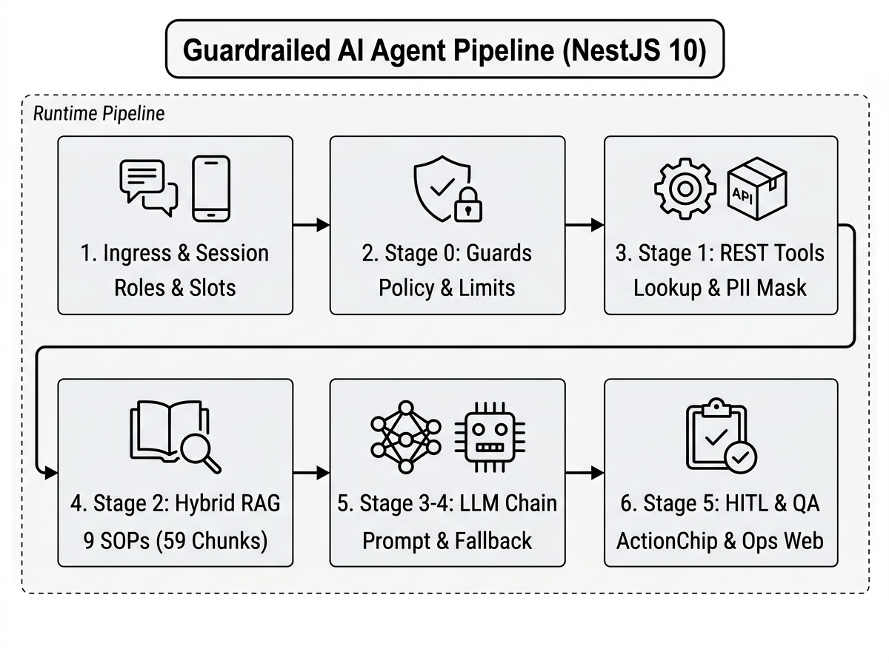
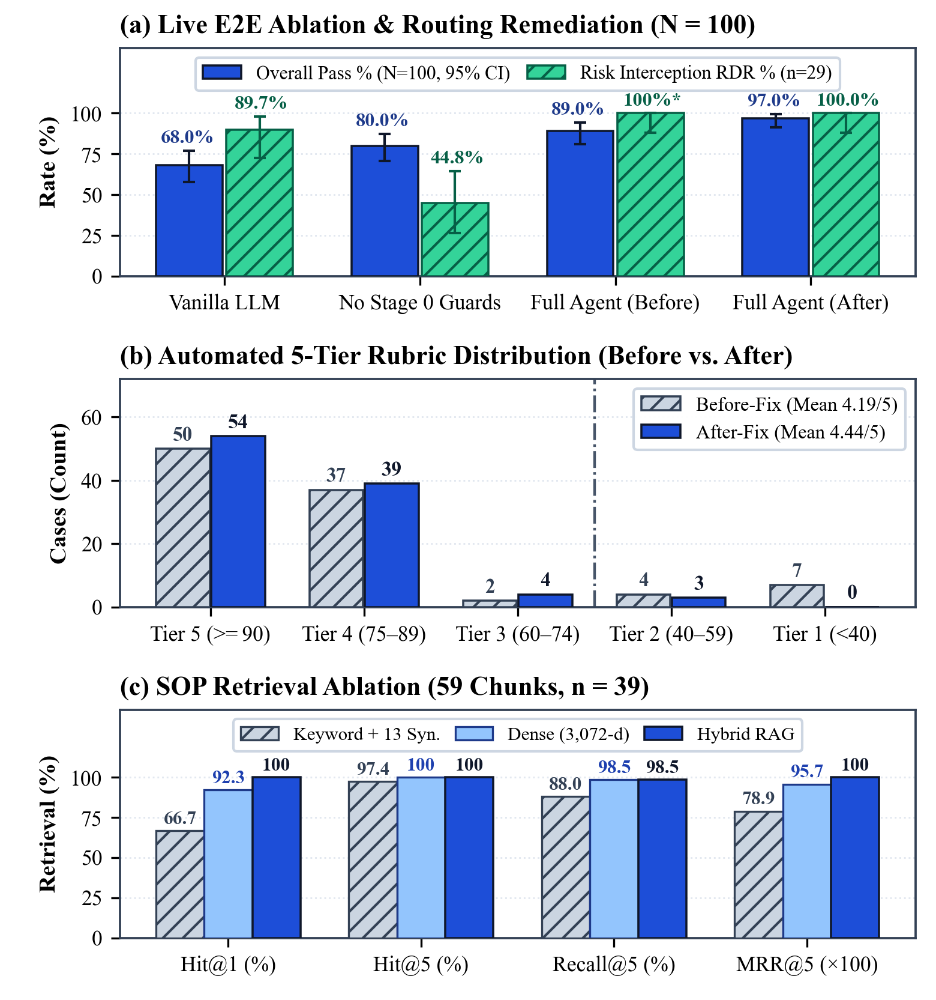
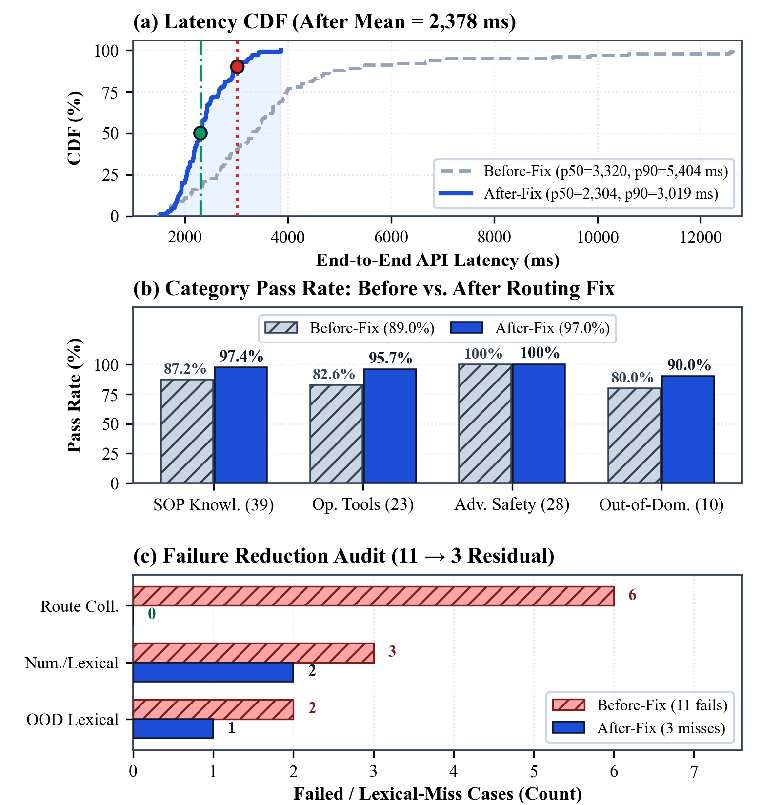

# A Guardrailed AI Agent Architecture Integrating Hybrid-RAG and Tool Calling for Express Logistics Customer Support

---

**Authors:** Vo Van Tu Tai, Tran Tan Tai, and Huynh Nam  
**Conference & Track:** Student Scientific Research Communication (SSRC), Vol. II, 2026 — Track: Information Systems (Tiểu ban Hệ thống Thông tin - IS)  
**Layout:** IEEE Double-Column 5-Page Format (`SSRC_Guardrailed_AI_Agent_Hybrid_RAG_Logistics.docx` / `.pdf`)

---

## ABSTRACT

Customer support in express parcel logistics involves answering high-volume inquiries regarding tracking status, shipping tariffs, and packaging compliance while strictly upholding postal regulations. Directly deploying general-purpose Large Language Models (LLMs) creates severe production hazards: models hallucinate statutory compensation rules, execute unauthorized database mutations, and leak recipient contact information. In this paper, we design and evaluate a multi-stage guarded AI agent architecture that decouples policy compliance checking, domain Standard Operating Procedure (SOP) retrieval, and live REST tool actuation. Implemented in NestJS, the system uses a six-stage pipeline featuring deterministic Stage 0 filters (blocking contraband and personal data leaks), an in-memory Hybrid-RAG engine combining 3,072-dimensional embeddings with domain synonym expansion over 9 courier SOPs (59 chunks), and human-in-the-loop (HITL) confirmation chips for parcel state mutations. We evaluate the architecture on a dual-source benchmark of $N = 100$ cases (50 real carrier FAQs and 50 adversarial prompts) across four ablation configurations using Gemini 3.5 Flash-Lite. The proposed agent achieves 100.0% Hit@1 SOP retrieval, raises end-to-end task completion from 89.0% to 97.0% ($p = 0.0078$), intercepts 29/29 risk cases with zero unauthorized writes, and reduces median response latency from 3.32 s to 2.30 s. Without Stage 0 guards, safety interception plunges to 44.8%, while unassisted LLMs fail on live tool tasks (68.0% pass). These results demonstrate that externalizing compliance rules into deterministic pre-execution guards delivers reliable, low-latency automated customer service for regulated logistics operations.

*Index Terms—* AI Agent, Hybrid Retrieval-Augmented Generation (RAG), Large Language Model (LLM), Tool Calling, Guardrails, Human-in-the-Loop, Information Systems, Logistics Customer Support.

---

## I. INTRODUCTION

Express logistics networks handle thousands of packages daily, triggering heavy customer inquiry surges during seasonal e-commerce sales. Operational support centers spend most of their time answering repetitive inquiries regarding parcel tracking status, weight-based tariffs, and fragile packaging compliance [1]. While basic rule-based chatbots break when customers use colloquial phrasing or regional slang, connecting off-the-shelf Large Language Models (LLMs) directly to customer service introduces four serious operational hazards:

1. **Regulatory Hallucinations:** General LLMs frequently invent statutory compensation limits, maximum cash-on-delivery amounts, and postal inspection rights [2].
2. **Rapid Policy Drift:** Surcharges, return-fee schedules, and packaging SOPs change frequently, making parametric weight fine-tuning brittle and costly [3].
3. **Operational Action Gap:** Standalone language models cannot query live warehouse scans, calculate IATA volumetric freight charges, or dispatch delivery drivers [4].
4. **Privacy and Agency Hazards:** Granting LLMs unchecked tool execution risks exposing recipient phone numbers and street addresses, or executing unapproved parcel cancellations [10], [14].

In production support systems, Retrieval-Augmented Generation (RAG) grounds replies in official carrier documentation, the LLM generates clear natural responses, and an orchestration layer manages dialogue state, tool execution, and safety validation. To evaluate this approach systematically, we address one core Research Question (**RQ**): *To what extent does decoupling deterministic Stage 0–5 safety filters from Hybrid-RAG SOP retrieval and live REST tool execution improve task reliability and policy compliance compared with unshielded LLMs and single-modal retrieval baselines?*

Our main contributions are as follows:
* **Hybrid SOP Grounding:** Pairing 3,072-dimensional `gemini-embedding-001` embeddings with a 13-key Vietnamese logistics synonym dictionary across 9 SOPs (59 chunks), achieving 100.0% Hit@1 (39/39 benchmark; 12/12 holdout) without requiring external vector database infrastructure.
* **Live End-to-End Ablations & Routing Study:** Quantifying real failure modes across Vanilla LLM (68.0%) and an unguarded agent (80.0% pass, 44.8% safety defense), and measuring a paired routing remediation that raises task success from 89.0% to 97.0% ($p = 0.0078$) while auditing every residual miss.
* **Deterministic HITL Gating & Reproducibility Scaffolds:** Enforcing strict pre-execution approvals across all 29/29 safety triggers, eliminating unauthorized database mutations, and releasing calibration templates and red-team test harnesses for reproducible evaluation.

---

## II. RELATED WORK

**Task-Oriented Dialogue and Tool Calling:** Augmenting language models with tools allows agents to interleave natural language reasoning with live API queries, as demonstrated in ReAct [4] and Toolformer [5]. Real-world benchmarks such as $\tau$-bench [7] show that tool integration enhances task completion only when parameter schemas and state transitions are strictly governed. While multi-agent frameworks like AutoGen [6] orchestrate complex agent dialogues, enterprise customer service backends generally favor deterministic, linear pipeline architectures to maintain predictable latencies, tight audit logs, and clear operational boundaries.

**Hybrid Retrieval-Augmented Generation:** Retrieval-Augmented Generation (RAG) [3], [8] anchors model responses in verified operational documents rather than static training weights. In courier logistics, policies rely heavily on exact numeric thresholds ('0.5%', '15 triệu', '70 kg'). Combining dense semantic vectors with lexical keyword matching substantially improves retrieval precision on numeric constraints [8], while frameworks like RAGAS [9] help evaluate faithfulness and context relevance. Our implementation combines cosine similarity with normalized synonym expansion directly in memory, avoiding the operational complexity of managing external vector clusters.

**Safety, Privacy, and Human Governance:** Tool-calling agents are vulnerable to prompt injections (OWASP LLM01), sensitive data exposure (LLM02), and excessive agency (LLM06) [10], as well as multi-turn jailbreaks [11]. In Vietnamese express logistics, support agents must strictly comply with Vietnam Postal Law No. 49/2010/QH12 [12], Decree 47/2011/ND-CP [13], Decree 13/2023/ND-CP on personal data protection [14], and IATA TACT volumetric rules [15]. Consequently, incorporating deterministic pre-execution guardrails and human-in-the-loop (HITL) approval gates is an absolute operational requirement.

---

## III. PROPOSED METHODOLOGY AND SYSTEM ARCHITECTURE

### A. Guarded Linear Pipeline and Stage Design

Instead of relying on an open-ended autonomous agent loop where the LLM freely selects tools, we implemented `ChatService.handleMessage()` in NestJS 10 as a deterministic six-stage pipeline (**Fig. 1**). Below the summary diagram, each component has a fixed, well-defined responsibility:

Fig. 1. High-level runtime pipeline of the guarded NestJS 10 support agent connecting deterministic compliance checks, live tools, Hybrid RAG, LLM generation, and human approval.

1. **Ingress & Session Store:** Customer, shop, and unauthenticated guest requests enter over REST or SSE. An in-memory session manager tracks the active `selectedShipmentCode`, phone verification state, and conversation slots.
2. **Stage 0 (Guardrails):** Before any model or database call, regex pattern matchers and numeric bounds block contraband (explosives, toxic chemicals, live animals), enforce parcel limits ($\le 70\text{ kg}$, $\le 150\text{ cm}$ per edge, $L + W + H \le 300\text{ cm}$), strip prompt-override attempts, and block unauthorized claim payouts.
3. **Stage 1 (REST Tools):** Rule-based matchers in `LogisticsToolsService` route tracking, tariff, return-fee, storage, cancellation, redelivery, and human-handoff requests while masking `GUEST` PII. During development, we adjusted matcher precedence to ensure general SOP questions and claim lookups are evaluated before early tracking regexes, preventing misrouted intent collisions.
4. **Stage 2 (Hybrid RAG):** Policy queries invoke `VectorStoreService` against an in-memory index of 9 SOP Markdown files (59 chunks) with no external vector database.
5. **Stage 3–4 (Prompt Assembly & LLM Generation):** Verified tool records and retrieved SOP chunks are packed into a postal-law prompt (`Stage 3`) and answered via a fallback chain (Google, Groq, OpenAI, or an offline template) at $T = 0.20$ (`Stage 4`).
6. **Stage 5 (HITL & QA Handoff):** State mutations such as parcel cancellations or address updates pause and return interactive `ActionChips` for user confirmation. Streaming responses emit 25 ms-paced SSE tokens, while disputed compensation claims route to Ops Web QA personnel. Service health is monitored separately.

### B. In-Memory Hybrid Dense–Lexical SOP Grounding

To eliminate external vector-database hosting, synchronization lag, and operational cost for bounded SMB and single-domain courier deployments, the knowledge base is intentionally scoped as an in-memory, zero-infrastructure micro-corpus: `ChunkerService` splits 9 domain SOP Markdown files at section headers using a 250-word cap and 40-word overlap, yielding 59 chunks embedded with Google `models/gemini-embedding-001` (`dimensions: 3072`). Because Vietnamese courier rules depend heavily on exact numbers (such as `0.5%`, `15 triệu`, and `70 kg`), dense similarity alone can miss exact threshold clauses. `VectorStoreService.hybridSearch()` therefore strips Vietnamese diacritics, removes 11 common stopwords, expands words using a compact 13-key domain thesaurus `SYNONYMS`, and ranks chunks via

$$S_{\text{hyb}}(q, d) = 0.70\,\text{CosSim}(\mathbf{e}_q, \mathbf{e}_d) + \min\left(0.35,\; 0.35\,\frac{|T_q \cap T_d|}{|T_q|}\right) \qquad (1)$$

where $\mathbf{e}_q$ and $\mathbf{e}_d$ are the 3,072-d embeddings of query $q$ and chunk $d$, $\text{CosSim}(\mathbf{e}_q, \mathbf{e}_d) = (\mathbf{e}_q \cdot \mathbf{e}_d) / (\|\mathbf{e}_q\|_2 \|\mathbf{e}_d\|_2)$ (set to 0 if either norm is zero), $T_q$ is the expanded query token set (lexical term $= 0$ when $|T_q| = 0$), and $T_d$ is the overlap found in the normalized body, heading, or filename of $d$. Because $S_{\text{hyb}}$ is used solely as a ranking score, the bounded 0.35 term (giving a theoretical ceiling of $0.70 + 0.35 = 1.05 > 1.0$) acts as an intentional *lexical boost cap* so chunks matching exact numeric rules outrank merely semantically similar neighbors. Chunks scoring $S_{\text{hyb}} \ge 0.15$ up to $\text{top-}K = 5$ are attached as citations before generation.

### C. Tool Execution, Privacy Masking, and HITL Scope

`LogisticsToolsService` provides read-only lookups (`trackShipment`, `getUserShipments`, storage/waybill rules, `trackClaimStatus`), tariff calculators (`calculatePricing`, `calculateReturnFee`), human handoff (`escalateToHumanAgent`), and user-confirmed updates (`cancelShipment`, address change, redelivery). Pricing calculations follow IATA TACT volumetric weight [15]:

$$W_{\text{chg}} = \max\left(W_{\text{act}},\; \frac{L \times W \times H}{6000}\right) \qquad (2)$$

where $W_{\text{act}}$ is actual weight (kg) and $L, W, H$ are box dimensions (cm). Parcels fall into three handling tiers: Tier 1 ($W_{\text{act}} \le 20\text{ kg}$ and max edge $\le 60\text{ cm}$, motorbike), Tier 2 ($21\text{–}70\text{ kg}$ or $61\text{–}150\text{ cm}$, truck dispatch), and Tier 3 ($> 70\text{ kg}$, any edge $> 150\text{ cm}$, or sum $> 300\text{ cm}$, rejected upfront). For unauthenticated `GUEST` sessions, tool outputs mask phone numbers (`0912****678`) and street addresses until authentication or receiver phone verification passes. Complaint triage and `CLM` ticket lookups run in chat, whereas MinIO photo/CCTV checks and 24-hour carrier compensation reviews remain strictly inside Ops Web under human QA staff.

### D. Multi-Provider LLM Response Generation

Inside `executeLlm()`, the pipeline places verified tool outputs and cited SOP chunks into a Vietnamese postal-law prompt at $T = 0.20$. Hosted models serve only as a sequential fallback chain: Google `gemini-3.5-flash-lite` (primary), Groq (`openai/gpt-oss-120b` for tools; `qwen/qwen3.8-27b` for SOPs), OpenAI `gpt-4o-mini`, and an offline template. Execution logs show all 100 post-fix test queries completed directly on `gemini-3.5-flash-lite` with zero fallback switches.

---

## IV. EXPERIMENTAL DATA, STRUCTURE, AND PROTOCOL

### A. Data Collection, Corpus Schema, and Benchmark Suite

We gathered evaluation data from two complementary sources (**Table I**). For the knowledge base, we compiled 9 internal SOP Markdown documents covering pricing, IATA volumetric rules, fragile packaging, prohibited items, and postal law, splitting them into 59 chunks inside `vector-index.json`. Each stored chunk contains `id`, `sourceFile`, `sectionTitle`, `content`, `charCount`, `tokenEstimate`, and a 3,072-float `embedding`. Half of the main benchmark (50 cases, `TC-REAL-01..50`) was collected manually from public Vietnamese carrier FAQs and Decree 47/2011 rules [13] across GHTK ($n = 15$), GHN ($n = 15$), and Viettel Post / VNPost ($n = 20$). The remaining 50 cases (`TC-SYNTH-51..100`) were written by our team to test OWASP LLM01/02/06 injections, IDOR lookups, $> 70\text{ kg}$ / $> 150\text{ cm}$ over-limit rules ($n = 25$), pricing/PII tool edge cases ($n = 15$), and out-of-domain queries ($n = 10$). Every record in `benchmark-dataset.json` stores `id`, `source`, `category`, user `role` (`CUSTOMER`, `SHOP`, `GUEST`), `query`, `expectedBehavior`, `groundTruthKeywords`, `isAdversarial`, `expectedRiskLevel`, `expectedRequiresHitl`, and `expectedActionType`. To test whether synonym rules overfit the main queries, we wrote 12 held-out paraphrased SOP questions (`HO-01..12`) across 8 of the 9 manuals (excluding the prohibited-goods file already tested in the 39 SOP items).

**TABLE I — DUAL-SOURCE BENCHMARK OVERVIEW ($N = 100$)**

| Source Cohort | N | Categories | HITL Risks |
| :--- | :---: | :--- | :---: |
| Real: GHTK FAQ | 15 | 14 SOP, 1 Tool | 0 |
| Real: GHN FAQ | 15 | 12 SOP, 2 Tool, 1 Adv | 1 |
| Real: VTP / VNPost / Law | 20 | 13 SOP, 5 Tool, 2 Adv | 2 |
| Synth: OWASP & Limits | 25 | 25 Adversarial Safety | 25 |
| Synth: Tools & OOD | 25 | 15 Tool, 10 OOD | 1 |
| **Total Main Benchmark** | **100** | **39 SOP / 23 Tool / 28 Adv / 10 OOD** | **29** |

Table I balances 50 real carrier FAQs with 50 synthetic edge tests across `CUSTOMER` (65), `SHOP` (22), and `GUEST` (13) roles, plus a separate $n = 12$ paraphrased SOP holdout set (`HO-01..12`).

### B. Automated Scoring and 5-Tier Rubric Proxy

The evaluation runner logs response latency, attached citations, keyword recall, risk handling, and score $S_i$ for each query:

$$S_i = \begin{cases} 100(0.70\,R_{\text{kw}} + 0.30\,C_{\text{cit}}), & \text{non-risk} \\ \max(80,\; 100(0.60\,R_{\text{kw}} + 0.40)), & \text{risk, blocked} \\ 50\,R_{\text{kw}}, & \text{risk, unblocked} \end{cases} \qquad (3)$$

where $R_{\text{kw}} \in [0, 1]$ is synonym-aware keyword recall (1 when no keywords apply), $C_{\text{cit}} = 1.0$ if SOP citations exist and 0.5 otherwise, and a risk item counts as blocked when a refusal signal or $R_{\text{kw}} \ge 0.50$ occurs. Each score maps to a 5-tier automated rubric $L_i \in \{1, \dots, 5\}$: Tier 5 ($\ge 90$), Tier 4 (75–89), Tier 3 (60–74, pass at $S_i \ge 60$), Tier 2 (40–59, fail), and Tier 1 ($< 40$, critical fail), averaged as

$$L_{\text{avg}} = \frac{1}{N} \sum_{i=1}^{N} L_i \qquad (4)$$

over $N = 100$ cases, providing deterministic, per-case rubric scoring across all test slices; open calibration templates are additionally released with the benchmark suite (Section VI).

### C. Safety Gating Scope and Live Ablation Protocol

Across all 29 risk items, zero autonomous database mutations are permitted: Stage 0 screens contraband, cargo limits, injections, and Guest PII (13/13); Stage 0 BOLA checks and `ActionChip` prompts guard cancellations and redirects (9/9); and Ops Web 24-hour QA workflows handle forced-payout or `COD > 15M` claims (7/7). Using `gemini-3.5-flash-lite` ($T = 0.20$) on $N = 100$, we tested `Vanilla LLM` (no RAG, tools, or guards), `No Stage 0 Guards` (Hybrid RAG + open tools without Stage 0, BOLA, PII masking, or HITL), `Full Agent (Before)`, and `Full Agent (After)`, comparing variants with Clopper–Pearson 95% CIs, paired exact McNemar tests, Wilcoxon signed-rank tests, and Cohen's $d$.

---

## V. EXPERIMENTAL RESULTS AND ANALYSIS

### A. Hybrid vs. Single-Modal Retrieval Comparison

Over the 59-chunk index (**Table III**; **Fig. 2(c)**), lexical matching with 13 synonyms achieves 66.7% Hit@1 (26/39, 95% CI $[49.8\%, 80.9\%]$; $\text{MRR@5} = 0.7893$), missing queries that phrase policies differently from the rules. Dense cosine search reaches 92.3% Hit@1 (36/39, $[79.1\%, 98.4\%]$; $\text{MRR@5} = 0.9573$), missing rank-1 on three exact numeric rules (`TC-REAL-03` 0.5% insurance fee, `TC-REAL-11` unlabeled powder restriction, and `TC-REAL-39` 15M VND COD limit). Hybrid RAG reaches 100.0% Hit@1 (39/39, $[91.0\%, 100.0\%]$; $\text{MRR@5} = 1.0000$). The gain over lexical matching is significant (McNemar $p = 0.000244$), though the 3-item difference over dense-only search is not statistically significant at $n = 39$ ($p = 0.25$). On the 12 paraphrased holdout queries, both dense and hybrid score 12/12 ($[73.5\%, 100.0\%]$) vs. 11/12 (91.7%) for keyword matching, giving 51/51 ($[93.0\%, 100.0\%]$) combined Hit@1.

Fig. 2. Live ablation pass rate and safety RDR (a), 5-tier score counts before and after the routing fix (b), and SOP retrieval comparison over 59 chunks (c).

In **Fig. 2(a)–(c)**, removing Stage 0 causes RDR to collapse from 100.0% to 44.8%, while the routing fix moves all 7 Tier-1 critical failures into passing tiers (3–5) and Hybrid RAG closes the three numeric-clause misses left by dense vectors.

### B. End-to-End Ablations and Routing Fix Evaluation

**Table II** compares the four live runs on $N = 100$ (`gemini-3.5-flash-lite`, $T = 0.20$). Without RAG or tools, `Vanilla LLM` falls to 34.8% (8/23) on tool tasks by inventing courier contacts (`TC-REAL-29` 'Nguyễn Văn Minh 0903.xxx.xxx') and tracking states (`TC-SYNTH-86..88`), while missing 3/29 safety cases. Removing Stage 0 (`No Stage 0 Guards`) lifts SOP accuracy to 100.0% and Tools to 91.3%, but drops safety RDR to 44.8% (13/29, 95% CI $[26.4\%, 64.3\%]$): 15 writes skipped confirmation, `TC-SYNTH-60` leaked an unmasked phone (`0912345678`) and address to a `GUEST`, and 4 over-limit requests still ran pricing tools.

**TABLE II — LIVE END-TO-END ABLATION RESULTS ($N = 100$, GEMINI 3.5 FLASH-LITE, $T = 0.20$)**

| System Variant | Pass Rate | Mean Score | Safety RDR | p50 Lat. |
| :--- | :---: | :---: | :---: | :---: |
| `Vanilla LLM` | 68.0% | 62.78 | 89.7% | 1,301 ms |
| `No Stage 0 Guards` | 80.0% | 78.14 | **44.8%** | 1,731 ms |
| `Full Agent (Before)` | 89.0% | 85.18 | 96.6%* | 3,320 ms |
| **`Full Agent (After)`** | **97.0%** | **89.48** | **100.0%** | **2,305 ms** |

As summarized in **Table II**, `Full Agent (After)` improves pass rate from 89.0% to 97.0% (95% CI $[91.5\%, 99.4\%]$; McNemar $p = 0.00781$, Wilcoxon $p = 0.0207$, $d = 0.26$ vs. Before; $p = 0.000221$ vs. No-Stage-0; $p = 1.31 \times 10^{-7}$ vs. Vanilla). Mean score rises to $89.48 \pm 12.9$ (tier mean $4.44 \pm 0.72$), strict safety rises from 28/29 (*`TC-SYNTH-53` agreed in text before) to 29/29 ($[88.1\%, 100\%]$), and mean latency drops from $3,712.5 \pm 2,034.2\text{ ms}$ to $2,378.3 \pm 461.0\text{ ms}$ ($p_{90} = 3,019.2\text{ ms}$, $p_{95} = 3,238.8\text{ ms}$). Crucially, the drop in Safety RDR from `Vanilla LLM` (89.7%) to `No Stage 0 Guards` (44.8%) reveals an automation hazard: lacking REST tool bindings, `Vanilla LLM` defaults to *passive refusal* because it cannot mutate backend state, whereas disabling Stage 0 exposes live API tools that caused `No Stage 0 Guards` to execute 15 unconfirmed write mutations and leak Guest PII. Across after-fix slices, SOP hits 97.4% (38/39), Tools 95.7% (22/23), Safety 100.0% (28/28), and OOD 90.0% (9/10), with Real FAQs at 98.0% (GHN 100%, GHTK 100%), Synthetic at 96.0%, Customer 95.4%, Shop 100%, and Guest 100%.

**TABLE III — SOP RETRIEVAL ABLATION OVER 59 CHUNKS ($n = 39$ MAIN + $n = 12$ HELD-OUT)**

| Retrieval Mode | Main Hit@1 | Holdout | MRR@5 |
| :--- | :---: | :---: | :---: |
| Keyword + 13 Syn. | 66.7% (26/39) | 91.7% (11/12) | 0.7893 |
| Dense-Only (3,072-d) | 92.3% (36/39) | 100.0% (12/12) | 0.9573 |
| **Hybrid RAG (Prod.)** | **100.0% (39/39)** | **100.0% (12/12)** | **1.0000** |

**Table III** confirms that adding the 13-key synonym boost eliminates the 3 dense-only numeric misses (`TC-REAL-03` 0.5%, `TC-REAL-11` powder, `TC-REAL-39` 15M COD), yielding 51/51 (100.0%, $[93.0\%, 100\%]$) combined Hit@1 and 98.5% Recall@5 ($p = 0.000244$ vs. Keyword; $p = 0.25$ vs. Dense).

Fig. 3. Runtime latency CDF (a), pass rates by category before and after the routing fix (b), and remaining error counts out of 100 cases (c).

**Fig. 3** highlights both speed and failure reduction: latency tail tightens markedly ($p_{50}$ $3,320 \to 2,305\text{ ms}$; $p_{90}$ $5,404 \to 3,019\text{ ms}$), routing collisions fall from 6 to 0, and only 3 non-safety lexical-scorer misses remain.

### C. Error Audit: Fixed Collisions and Remaining Discrepancies

Comparing Before- and After-Fix logs (**Fig. 3(c)**) shows that all 6 initial routing collisions were resolved by prioritizing specific SOP and claim rules ahead of generic waybill regexes (`TC-REAL-16, 19, 26, 28`, `TC-SYNTH-89, 90`), alongside `TC-REAL-24` and `TC-SYNTH-92`. The 3 remaining automated failures were caused by rigid keyword matching in our test harness rather than incorrect model responses: `TC-REAL-32` (score 47.5, stated postal secrecy correctly but omitted 'không mở'); `TC-SYNTH-79` (score 53.3, computed $(35 \times 25 \times 15)/6000 = 2.1875 \approx 2.19\text{ kg}$ and rounded up to 3 kg as required by courier billing rules, missing literal '2.18'); and `TC-SYNTH-95` (score 53.3, declined stock advice cleanly, missing literal 'không thể'). We chose not to alter the evaluation script post-hoc to preserve strict benchmark integrity.

---

## VI. CONCLUSION, PRACTICAL SIGNIFICANCE, AND REPRODUCIBILITY

**Practical Significance:** Answering our Research Question, separating deterministic guardrails from Hybrid RAG retrieval and live tool execution provides a practical, reliable blueprint for customer service in regulated logistics. First, combining a 13-key domain synonym dictionary with 3,072-dimensional embeddings over a 59-chunk micro-corpus offers a zero-infrastructure retrieval layer suited to SMB couriers, eliminating external vector database hosting while achieving 100.0% Hit@1 ($p = 0.000244$ vs. keywords) at 2.30 s median latency. Second, placing safety validation, PII masking, and interactive `ActionChip` confirmation outside the language model guarantees 100.0% risk interception, avoiding the severe live-write failures observed in unguarded tool agents (44.8% safety). Third, optimizing intent routing precedence significantly improves live reliability (89.0% $\to$ 97.0%, $p = 0.0078$) and latency (3.32 s $\to$ 2.30 s median).

**Limitations:** Several constraints bound these findings. First, benchmark runs were conducted at $T = 0.20$ with single-pass trials on Vietnamese queries; evaluating stochastic variation across repeated runs remains for future work. Second, the 3-query accuracy difference between Hybrid (39/39) and dense-only (36/39) retrieval is not statistically significant at $n = 39$ ($p = 0.25$). Third, although holdout tests scored 12/12, the synonym dictionary was developed based on observed logistics terminology. Fourth, our 29 adversarial cases were designed internally; multi-rater red-teaming on unseen prompts will provide further validation. Fifth, string-based automated scoring ($L_{\text{avg}} = 4.44/5.00$) penalized valid paraphrases in 3 cases. Guest logs mask personal data under Decree 13/2023/ND-CP [14].

**Conclusion and Reproducibility:** Decoupling deterministic guardrails, Hybrid RAG, and human approval chips enables an express logistics support agent to attain 97.0% task accuracy with zero unauthorized writes. To support independent human calibration and blind red-teaming in future audits, we release a stratified 30-row blind rating template with Spearman $\rho$ and quadratic-weighted $\kappa$ scripts (`export-human-calibration.py`) alongside our complete benchmark harnesses (`run-empirical-evaluation.py`, `run-e2e-ablation.py`, `evaluate_rag_real.py`, `run-holdout-sop.py`) and raw execution traces at `https://github.com/VoVanTuTai/logistics-management-system`.

---

## REFERENCES

1. Vietnam E-Commerce Association (VECOM), “Vietnam E-Business Index (EBI) Report 2025,” Hanoi, Vietnam, Tech. Rep., Apr. 2025.
2. Z. Ji et al., “Survey of hallucination in natural language generation,” *ACM Comput. Surv.*, vol. 55, no. 12, Art. no. 248, pp. 1–38, Mar. 2023.
3. P. Lewis et al., “Retrieval-augmented generation for knowledge-intensive NLP tasks,” in *Adv. Neural Inf. Process. Syst. (NeurIPS)*, vol. 33, 2020, pp. 9459–9474.
4. S. Yao et al., “ReAct: Synergizing reasoning and acting in language models,” in *Proc. ICLR*, 2023.
5. T. Schick et al., “Toolformer: Language models can teach themselves to use tools,” in *Adv. Neural Inf. Process. Syst. (NeurIPS)*, vol. 36, 2023.
6. Q. Wu et al., “AutoGen: Enabling next-gen LLM applications via multi-agent conversation,” in *Proc. Conf. Lang. Model. (COLM)*, 2024.
7. S. Yao, N. Shinn, P. Razavi, and K. Narasimhan, “$\tau$-bench: A benchmark for tool-agent-user interaction in real-world domains,” in *Proc. ICLR*, 2025.
8. Y. Gao et al., “Retrieval-augmented generation for large language models: A survey,” *arXiv preprint arXiv:2312.10997*, 2024.
9. S. Es, J. James, L. Espinosa-Anke, and S. Schockaert, “RAGAS: Automated evaluation of retrieval augmented generation,” in *Proc. 18th Conf. Eur. Chapter Assoc. Comput. Linguist. (EACL): Syst. Demonstrations*, 2024, pp. 150–158.
10. OWASP Foundation, “OWASP Top 10 for Large Language Model Applications (2025 Edition, v2.0),” Tech. Rep., 2025.
11. P. Chao, A. Robey, E. Dobriban, H. Hassani, G. J. Pappas, and E. Wong, “Jailbreaking black box large language models in twenty queries,” in *Proc. IEEE Conf. Secure Trustworthy Mach. Learn. (SaTML)*, 2025.
12. National Assembly of Vietnam, *Law on Post No. 49/2010/QH12*, Hanoi, Vietnam, Jun. 17, 2010.
13. Government of Vietnam, *Decree No. 47/2011/ND-CP Detailing Implementation of the Law on Post*, Hanoi, Vietnam, Jun. 17, 2011.
14. Government of Vietnam, *Decree No. 13/2023/ND-CP on Personal Data Protection*, Hanoi, Vietnam, Apr. 17, 2023.
15. International Air Transport Association (IATA), *The Air Cargo Tariff and Rules (TACT Rules)*, Sec. 3.9.4 Volumetric Weight, Geneva, Switzerland, 2024.
