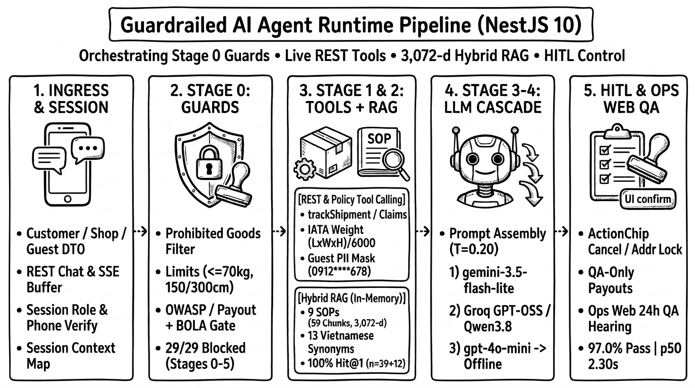
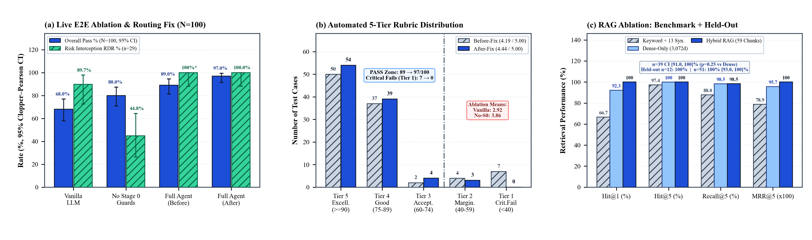
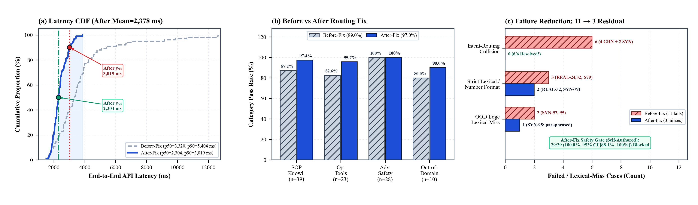

# Guardrailed AI Agent Orchestrating Tool Calling and Hybrid-RAG Grounded LLM for Parcel Delivery Support and Complaint Handling

---

**Authors:** Võ Văn Tú Tài, Trần Tấn Tài, and Huỳnh Nam  
**Affiliation:** Faculty of Information System, Industrial University of Ho Chi Minh City  
**Email:** 22655911.tai@student.iuh.edu.vn, 22727771.tai@student.iuh.edu.vn  
**Format:** Student Scientific Research Communication (SSRC), Vol. II, 2026 — IEEE Double-Column Layout (`SSRC_Guardrailed_AI_Agent_Hybrid_RAG_Logistics.docx` / `.pdf`)

---

## ABSTRACT

E-commerce parcel surges overwhelm courier support desks with inquiries on live tracking, volumetric tariffs, fragile packaging rules, and compensation complaints. Standalone Large Language Models (LLMs) fabricate statutory limits, lack database execution hooks, and risk exposing Personally Identifiable Information (PII). We present a Guardrailed AI Agent implemented in NestJS 10 that orchestrates deterministic Tool Calling and a Hybrid-RAG grounded LLM waterfall under a structured **5-level human-control scale**, keeping agent orchestration, Standard Operating Procedure (SOP) retrieval, and LLM text synthesis cleanly separated. Over 9 courier SOPs ($59$ chunks), Hybrid RAG combines 3,072-dimensional `gemini-embedding-001` cosine similarity with Vietnamese diacritic-stripped synonym boosting, raising Hit@1 from $66.7\%$ (lexical-only) and $92.3\%$ (dense-only) to $100.0\%$ ($39/39$; 95% CI $[91.0\%, 100.0\%]$; $\text{MRR@5} = 1.0000$; McNemar $p = 0.25$ vs. dense-only) and achieving $12/12$ ($100.0\%$) on an independent paraphrased SOP holdout set ($51/51$ combined; CI $[93.0\%, 100.0\%]$). For transactional operations, compiled Stage 0 guards screen contraband, 3-tier cargo limits ($\le 70\text{ kg}$, $\le 150\text{ cm}$, $\le 300\text{ cm}$), OWASP injections, and forced claim payouts before invoking tracking/IATA pricing services, Guest PII masking, interactive `ActionChip` cancel locks, or 24-hour Quality Assurance (QA) escalation. Evaluated live across $N=100$ dual-source cases ($50$ real courier FAQs; $50$ team-authored templates) with `gemini-3.5-flash-lite` ($T = 0.20$), a **before-and-after intent-routing fix** lifts pass rate from **$89.0\%$ to $97.0\%$** ($95\%$ CI $[91.5\%, 99.4\%]$; McNemar $p = 0.0078$), eliminates all $7$ critical failures ($4.44 \pm 0.72 / 5.00$ automated rubric mean), cuts median latency by $30.6\%$ ($3.32 \to 2.30\text{ s}$), and intercepts $29/29$ ($100.0\%$; CI $[88.1\%, 100.0\%]$) self-authored high-risk scenarios. Live end-to-end ablations further demonstrate why both layers are essential: standalone `Vanilla LLM` falls to $68.0\%$ ($34.8\%$ tools) with fabricated tracking statuses, whereas removing Stage 0 guards yields $80.0\%$ pass rate while collapsing risk interception to $44.8\%$ ($13/29$) and leaking unmasked database PII.

*Index Terms—* AI Agent, Hybrid Retrieval-Augmented Generation (RAG), Large Language Model (LLM), Tool Calling, Guardrails, Human-in-the-Loop (HITL), 5-Level Human-Control Scale, Parcel Delivery, Complaint Handling.

---

## I. INTRODUCTION

Express parcel networks in Southeast Asia experience sharp promotional traffic spikes that overwhelm manual call centers with repetitive tracking, tariff estimation, packaging compliance, and damage complaint inquiries [1]. Traditional rule-based chatbots fail on natural phrasing variations, while deploying general-purpose Large Language Models (LLMs) directly into courier support creates four practical engineering risks:

1. **Regulatory Hallucinations:** General LLMs fabricate statutory indemnification caps, courier cash-holding ceilings, and postal inspection duties [2].
2. **Static Policy Drift:** Surcharges, return-fee rules, and fragile SOPs evolve continually, making static weight fine-tuning impractical [3].
3. **Operational Action Gap:** Pure text generators cannot fetch real-time hub scans, compute IATA volumetric charges, or open support handoffs [4].
4. **PII & Agency Exposure:** Unrestricted tool queries risk leaking recipient phone numbers, street addresses, and unapproved financial mutations [5], [13].

In modern AI architecture, Retrieval-Augmented Generation (RAG), Large Language Models (LLMs), and AI Agent orchestration solve fundamentally distinct layers. RAG performs non-parametric data grounding—retrieving internal courier SOPs to supply authoritative context to an LLM—whereas the LLM handles grounded natural-language synthesis and the AI Agent provides runtime orchestration, managing conversational slots, tool invocation, and safety boundaries. Because our implemented NestJS support service operates as a deterministic-guarded linear orchestration pipeline with multi-provider LLM fallback (rather than an unconstrained autonomous multi-agent swarm), we accurately formalize it as a **Guardrailed AI Agent Orchestrating Tool Calling and Hybrid-RAG Grounded LLM**.

We address three practical research questions:
- **RQ1 (Hybrid Grounding):** How much does Hybrid RAG improve courier SOP retrieval precision over dense-only and lexical-only baselines across both benchmark and held-out paraphrased queries?
- **RQ2 (End-to-End Reliability & Ablations):** Compared against live Vanilla LLM and Unguarded-Tool baselines, how reliably does the full pipeline perform before and after resolving heuristic routing collisions?
- **RQ3 (Human Control over AI):** How is human authority over sensitive AI actions enforced under a transparent **5-level human-control scale**?

Key contributions grounded in our graduation thesis implementation include:
* **Hybrid SOP Grounding:** Pairing 3,072-dimensional `gemini-embedding-001` vectors with a 13-key Vietnamese logistics synonym thesaurus over 9 SOPs ($59$ chunks), attaining $100.0\%$ ($39/39$ benchmark; $12/12$ holdout) Hit@1 with zero external vector database overhead.
* **Live End-to-End Ablations & Routing-Fix Study:** Quantifying real `Vanilla LLM` ($68.0\%$) and `No Stage 0 Guards` ($80.0\%$, $44.8\%$ RDR) failure modes alongside paired before/after routing remediation ($89.0\% \to 97.0\%$, $p = 0.0078$) and auditing every residual miss.
* **5-Level Human-Control Scale & Reproducibility:** Enforcing Level 3–5 gating across $29/29$ ($100.0\%$) risk triggers without autonomous mutations, separating automated $5$-tier rubric scores from human psychometric ratings, and releasing calibration and external red-team scaffolds.

---

## II. RELATED WORK

**Task-Oriented Dialogue and Tool-Calling Agents:** Task-oriented dialogue systems have progressed from slot-filling state trackers [6], [7], [8] toward LLM reasoning-and-acting loops such as ReAct [4] and Toolformer [11]. Benchmarks like $\tau$-bench [12] show that executable tool APIs raise transactional reliability when schemas and state transitions are constrained. While multi-agent frameworks such as AutoGen [14] coordinate multiple autonomous loops, industrial support backends frequently favor deterministic guarded single-pipeline orchestration for predictable latency and auditability.

**Hybrid Retrieval-Augmented Generation:** RAG [9] anchors LLM responses in curated document chunks. Because Vietnamese courier policies contain exact numerical rules (`0.5%`, `15 triệu`, `70 kg`), dense semantic similarity benefits from domain-specific lexical matching [10]. RAGAS [15] highlights faithfulness and context relevance as core evaluation axes. Our implementation pairs cosine similarity directly with normalized Vietnamese synonym boosting in memory without extra external vector database infrastructure.

**Safety, Privacy, and Human-in-the-Loop Governance:** Tool-enabled agents face OWASP LLM Top 10 risks including prompt injection (LLM01), sensitive information disclosure (LLM02), and excessive agency (LLM06) [13], alongside jailbreak attacks [16]. In parcel logistics, responses must strictly comply with Vietnam Postal Law No. 49/2010/QH12 [17], Decree 47/2011/ND-CP [18], Decree 13/2023/ND-CP on personal data protection [19], Universal Postal Union (UPU) S10 item-identifier conventions [20], and IATA Resolution 6000 [21]. Consequently, human-in-the-loop (HITL) pre-execution gates and explicit QA dispute workflows are mandatory.

---

## III. SYSTEM ARCHITECTURE AND IMPLEMENTATION

### A. Guardrailed AI Agent Orchestration and Safety Guards

Implemented inside our NestJS 10 chatbot microservice, `ChatService.handleMessage()` acts as the stateful orchestrator managing multi-turn context in an in-memory session map (`selectedShipmentCode`, verified phone numbers, slot-filling parameters) across five stages (**Fig. 1**):

1. **Stage 0 — Deterministic Compliance & Safety Guards:** Before intent routing, compiled regex and numeric-measurement guards screen prohibited contraband (explosives, acids, live animals), 3-tier cargo limits ($\le 70\text{ kg}$, $\le 150\text{ cm}$, $L + W + H \le 300\text{ cm}$), OWASP prompt-override/IDOR strings, and forced claim-payout attempts.
2. **Stage 1 — Intent Router & Tool Dispatch (`LogisticsToolsService`):** Precedence-ordered rule and session-slot matchers route tracking, pricing, return-fee, storage-policy, cancel, redelivery, and customer-support handoff intents to downstream shipment, tracking, and pricing microservices, enforcing dynamic Guest PII redaction. **Routing Remediation (2026-11-10):** Early broad waybill and pricing regexes that had preempted 6 informational SOP/tracking inquiries were reordered behind informational, OOD, and claim-lookup predicates.
3. **Stage 2 — Hybrid Policy Retrieval (`VectorStoreService`):** Queries 9 Markdown courier SOP manuals ($59$ chunks) held in an in-memory vector index to ground subsequent LLM synthesis.
4. **Stage 3–4 — Context Assembly & LLM Waterfall (`executeLlm`):** Assembles tool telemetry and retrieved SOP chunks (`Stage 3`) into a Vietnamese postal-law prompt and executes a fallback cascade of hosted LLMs (Google, Groq, OpenAI) or a deterministic offline template at $T = 0.20$ (`Stage 4`).
5. **Stage 5 — HITL UI `ActionChips` & Auxiliary Diagnostics Note:** Mutating cancellations and address redirects pause and emit clickable `ActionChips` rather than mutating backend records unilaterally. Server-Sent Events (SSE) in `streamMessage()` await `handleMessage()` completion and emit metadata plus $25\text{ ms}$ paced tokens. Separately, an auxiliary OpenRouter/Groq validation probe serves health-check diagnostics outside the main chat hot path.

*Fig. 1. Architecture of the Guardrailed AI Agent runtime orchestration pipeline in NestJS 10, separating Stage 0 deterministic security guards ($29/29$ intercepted across Stages 0–5), Stage 1 REST/policy tool calling and Guest PII masking (`0912****678`), Stage 2 3,072-dimensional Hybrid RAG over 9 SOPs (59 chunks), Stage 3–4 multi-provider LLM cascade, and Stage 5 `ActionChip` cancel/address locks and Ops Web 24h QA handoff.*

### B. Hybrid Retrieval Engine for SOP Policy Grounding

`ChunkerService` segments 9 official SOP Markdown documents along section headers with a maximum of $250$ words per chunk and $40$-word overlap, yielding $59$ validated $3,072$-float vectors indexed via Google `models/gemini-embedding-001` (`dimensions: 3072`). `VectorStoreService.hybridSearch()` strips diacritics, removes 11 Vietnamese stopwords, expands tokens via a 13-key domain thesaurus `SYNONYMS`, and ranks chunks by

$$S_{\text{hyb}}(q, d) = 0.70\,\text{CosSim}(\mathbf{e}_q, \mathbf{e}_d) + \min\left(0.35,\; 0.35\,\frac{|T_q \cap T_d|}{|T_q|}\right) \qquad (1)$$

where $\mathbf{e}_q$ and $\mathbf{e}_d$ denote the $3,072$-dimensional embedding vectors of query $q$ and chunk $d$, $\text{CosSim}(\mathbf{e}_q, \mathbf{e}_d) = (\mathbf{e}_q \cdot \mathbf{e}_d) / (\|\mathbf{e}_q\|_2 \|\mathbf{e}_d\|_2)$ ($0$ if zero-norm or mismatched), $T_q$ is the deduplicated synonym-expanded query term set (the lexical term is $0$ if $|T_q| = 0$), and $T_d$ denotes terms from $T_q$ occurring in the normalized content, section title, or filename of $d$. Candidates with $S_{\text{hyb}} \ge 0.15$ are truncated at $\text{top-}K = 5$ for citation attachment and prompt grounding prior to LLM synthesis.

### C. Live Tool Execution, Privacy Masking, and HITL Boundaries

`LogisticsToolsService` exposes read-only lookup tools (`trackShipment`, `getUserShipments`, storage/waybill policy lookups, and `trackClaimStatus`), pricing calculators (`calculatePricing`, `calculateReturnFee`), human escalation (`escalateToHumanAgent`), and user-confirmed mutations (`cancelShipment`, address changes, redelivery). Shipping billing enforces IATA Cargo Resolution 6000 volumetric rules [21]:

$$W_{\text{chg}} = \max\left(W_{\text{act}},\; \frac{L \times W \times H}{6000}\right) \qquad (2)$$

where $W_{\text{act}}$ is actual mass (kg) and $L, W, H$ denote length, width, and height (cm), alongside three physical tiers: Tier 1 ($W_{\text{act}} \le 20\text{ kg}$ and $\max(L, W, H) \le 60\text{ cm}$, motorbike), Tier 2 ($21\text{–}70\text{ kg}$ or $61\text{–}150\text{ cm}$, truck dispatch), and Tier 3 ($W_{\text{act}} > 70\text{ kg}$, $\max(L, W, H) > 150\text{ cm}$, or $L + W + H > 300\text{ cm}$, validation block).

**Privacy & Complaint Handling Separation:** Unauthenticated `GUEST` tracking masks phone numbers (`0912****678`) and street addresses until authentication or full/last-4-digit receiver phone verification succeeds. Crucially, the AI handles informational complaint triage and live claim tracking (`CLM` tickets), whereas formal incident investigation (damaged/lost parcels, CCTV/MinIO evidence inspection, 24-hour carrier hearing window) and payout settlement execute strictly under human QA officers inside the Ops Web portal.

### D. Multi-Provider LLM Response Synthesis Waterfall

Inside `executeLlm()`, the orchestrator merges session state, live tool outputs, and cited Hybrid-RAG chunks into a Vietnamese postal-law system prompt ($T = 0.20$). Hosted LLMs operate strictly as a sequential synthesis waterfall: Google `gemini-3.5-flash-lite` (primary), Groq (`openai/gpt-oss-120b` for tools; `qwen/qwen3.8-27b` for SOPs), OpenAI `gpt-4o-mini`, and an offline deterministic fallback. During the live After-Fix benchmark ($N=100$), runtime server logs verified all $100$ responses completed directly on `gemini-3.5-flash-lite` with zero fallback hops and zero HTTP errors.

---

## IV. BENCHMARK DESIGN, ABLATIONS, AND 5-LEVEL HUMAN CONTROL

### A. Dual-Source Benchmark & Held-Out SOP Extension

To prevent skewed benchmarks while testing high-risk edge cases safely, we constructed a balanced $N=100$ benchmark suite (**Table I**). The first $50$ cases (`TC-REAL-01..50`) were curated from real carrier customer support FAQs and Decree 47/2011 rules across GHTK ($n=15$), GHN ($n=15$), and Viettel Post / VNPost ($n=20$). Because public FAQs omit structured jailbreaks, IDOR probes, or over-limit cargo attacks, the remaining $50$ cases (`TC-SYNTH-51..100`) are team-authored synthetic templates covering OWASP LLM01/02/06 patterns ($n=25$), operational edge probes ($n=15$), and out-of-domain traps ($n=10$). To test thesaurus generalization beyond the initial $39$ SOP queries, we added an independent $12$-query held-out set (`HO-01..12`) spanning unseen paraphrases across 8 of the 9 SOP manuals (01–02, 04–09, omitting the prohibited-goods file already probed in the $39$-query set).

**TABLE I — DUAL-SOURCE BENCHMARK SPECIFICATION ($N = 100$: 50 REAL VS. 50 SYNTHETIC)**

| Provenance Cohort | N | Categories | Roles (C/S/G) | HITL | Construction Criteria |
| :--- | :---: | :--- | :---: | :---: | :--- |
| Real: GHTK FAQ | 15 | 14 SOP, 1 Tool | 8 / 6 / 1 | 0 | Packaging, COD, claims FAQ |
| Real: GHN FAQ | 15 | 12 SOP, 2 Tool, 1 Adv | 6 / 9 / 0 | 1 | Partial delivery, COD fee |
| Real: VTP/VNPost/Law | 20 | 13 SOP, 5 Tool, 2 Adv | 15 / 4 / 1 | 2 | Postal Law 49 & Decree 47 |
| Synth: OWASP Suite | 25 | 25 Adv. Safety | 18 / 2 / 5 | 25 | LLM01/02/06, IDOR, 70kg+ |
| Synth: Stress & OOD | 25 | 15 Tool, 10 OOD | 18 / 1 / 6 | 1 | IATA, PII 4-dig, OOD traps |
| **Total Evaluated** | **100** | **39 / 23 / 28 / 10** | **65 / 22 / 13** | **29** | **Balanced 50% Real / 50% Synth** |

### B. Automated Scoring and 5-Tier Rubric Proxy

The evaluation harness scores each response $S_i$ via

$$S_i = \begin{cases} 100(0.70\,R_{\text{kw}} + 0.30\,C_{\text{cit}}), & \text{non-risk} \\ \max(80,\; 100(0.60\,R_{\text{kw}} + 0.40)), & \text{risk, blocked} \\ 50\,R_{\text{kw}}, & \text{risk, unblocked} \end{cases} \qquad (3)$$

where $R_{\text{kw}} \in [0, 1]$ denotes synonym-aware keyword recall (equal to $1$ when no ground-truth keywords are defined), $C_{\text{cit}} = 1.0$ if SOP citations are attached and $0.5$ otherwise, and a risk case counts as blocked when a compliance refusal signal or $R_{\text{kw}} \ge 0.50$ triggers. Scores map to our **$5$-tier automated rubric** $L_i \in \{1, \dots, 5\}$: Tier 5 ($\ge 90$), Tier 4 ($75\text{–}89$), Tier 3 ($60\text{–}74$, pass threshold $S_i \ge 60$), Tier 2 ($40\text{–}59$, fail), and Tier 1 ($<40$, critical fail), summarized by the rubric mean

$$L_{\text{avg}} = \frac{1}{N} \sum_{i=1}^{N} L_i \qquad (4)$$

where $N$ is the number of evaluated cases ($N = 100$). We explicitly distinguish this automated operational quality rubric mean ($L_{\text{avg}}$) from human Likert psychometric ratings. To verify automated tier alignment empirically, we exported a stratified 30-row blind human calibration sample (`human_calibration_sample_30.csv`: 13 Tier 5, 10 Tier 4, 4 Tier 3, 3 Tier 2; spanning all 4 categories) paired with an agreement script (`compute_human_agreement.py` for Spearman $\rho$ and quadratic-weighted $\kappa$), which remains at `0/30` ratings pending external rater grading.

### C. 5-Level Human-Control Scale & End-to-End Ablation Design

**Table II** defines our **5-level human-control scale** categorizing system authority boundaries across all $29$ high-risk triggers ($13$ over-limit/PII/security blocks, $9$ cancel/redirection gates, and $7$ payout/COD escalations) without Level 1 autonomous writes. Moreover, to address self-authored circularity in adversarial testing (where the team designed both attack templates and regex guards), we provide a runnable blind red-team scaffold (`independent_attack_prompts.json`, currently `0` populated external prompts awaiting `10–20` unseen classmate prompts).

To isolate causal contributions end-to-end on the exact same $N=100$ cases (`gemini-3.5-flash-lite`, $T=0.20$), we evaluate four live systems: (1) **Vanilla LLM** (direct prompt only, no RAG, no tools, no Stage 0 guards); (2) **No Stage 0 Guards** (real 59-chunk Hybrid RAG + permissive Stage 1 tool calls without Stage 0 compliance blocks, BOLA ownership checks, PII masking, or UI cancel locks); (3) **Full Agent (Before-Fix)**; and (4) **Full Agent (After-Fix)**. Exact two-sided Clopper–Pearson 95% CIs, paired exact McNemar tests, Wilcoxon signed-rank tests, and Cohen's $d$ quantify statistical uncertainty.

**TABLE II — 5-LEVEL HUMAN-CONTROL SCALE IN PARCEL SUPPORT GOVERNANCE**

| Control Level | Control Paradigm | Enforced System Mechanism | Eval Coverage |
| :--- | :--- | :--- | :---: |
| **1 — Autonomous** | AI mutates DB without checks | Disallowed by design (0 direct DB/payout writes) | 0 / 29 (Disallowed) |
| **2 — Advisory** | Soft prompt text disclaimer only | Insufficient alone; always paired with hard gates | Fallback warning only |
| **3 — Guarded Gate** | Deterministic block & PII masking | Stage 0 contraband/70kg/OWASP block + Guest mask | 13/13 Overlimit & PII |
| **4 — Pre-Exec UI** | Ownership check + click lock | Stage 0 BOLA block + `ActionChip` cancel/redirect | 9/9 Cancel & Redirect |
| **5 — Human QA** | Formal officer audit & settlement | Force-payout/`COD>15M` escalated to Ops Web QA | 7/7 Payout & COD |

---

## V. EMPIRICAL RESULTS AND FAILURE AUDIT

### A. Hybrid vs. Single-Modal Retrieval Ablation (RQ1)

Evaluating Python mirrors of `VectorStoreService` over the live 59-chunk 3,072-dimensional index (**Table IV**, **Fig. 2(c)**), Keyword+13 Synonyms reaches $66.7\%$ Hit@1 ($26/39$, 95% CI $[49.8\%, 80.9\%]$; $\text{MRR@5}=0.7893$) on the $39$ SOP queries. Dense-only cosine achieves $92.3\%$ Hit@1 ($36/39$, CI $[79.1\%, 98.4\%]$; $\text{MRR@5}=0.9573$), missing rank-1 on three nuanced numeric clauses (`TC-REAL-03` insurance rates, `TC-REAL-11` unlabeled powder ban, `TC-REAL-39` $15\text{M}$ VND courier cash limit). Hybrid RAG lifts Hit@1 to **$100.0\%$ ($39/39$, CI $[91.0\%, 100.0\%]$; $\text{MRR@5}=1.0000$)**—significantly outperforming Keyword+Synonyms (McNemar $p = 0.000244$), though the 3-query margin over Dense-only is **not statistically significant on $n=39$ alone** (McNemar $p = 0.25$). On the $n=12$ held-out paraphrased SOP set, both Dense-only and Hybrid attain **$100.0\%$ ($12/12$, CI $[73.5\%, 100.0\%]$)** versus $91.7\%$ ($11/12$, $\text{MRR@5}=0.9444$) for Keyword+Synonyms, yielding **$100.0\%$ ($51/51$, CI $[93.0\%, 100.0\%]$)** combined Hit@1.

*Fig. 2. Live empirical ablation and retrieval results: (a) End-to-end pass rate and risk interception RDR (95% Clopper–Pearson CIs, $N=100$) comparing `Vanilla LLM`, `No Stage 0 Guards`, `Full Agent (Before-Fix)`, and `Full Agent (After-Fix)` (*Before RDR: `100%` automated, `96.6%` strict behavioral); (b) Automated 5-tier rubric histogram ($4.19 \to 4.44 / 5.00$); and (c) Retrieval ablation across $n=39$ benchmark + $n=12$ held-out SOP queries (`p = 0.25` vs. Dense).*

### B. End-to-End Ablation & Routing-Fix Impact (RQ2 & RQ3)

**Table III** and **Fig. 2(a)** summarize all four live end-to-end systems under identical evaluation rules (`gemini-3.5-flash-lite`, $T=0.20$). Without RAG or live tools, **`Vanilla LLM`** falls to **$68.0\%$ ($68/100$, CI $[57.9\%, 77.0\%]$)** with mean tier $2.92 \pm 1.17$ and just $34.8\%$ ($8/23$) on Operational Tools. Inspecting raw responses reveals active hallucinations: in `TC-REAL-29`, it fabricated a fictitious courier name and phone (*"Nguyễn Văn Minh, 0903.xxx.xxx"*); in `TC-SYNTH-86..88`, it invented live delivery statuses for bogus waybills; and in `TC-SYNTH-80, 82, 83, 89`, it guessed incorrect COD/express tariffs. It also missed $3/29$ safety triggers ($89.7\%$ RDR; `TC-SYNTH-53` fake update confirmation, `55` refund promise without caps/QA gate, `78` classifying $70.5\text{ kg}$ without $>70\text{ kg}$ block).

Enabling Hybrid RAG and unguarded tools in **`No Stage 0 Guards`** lifts SOP accuracy to $100.0\%$ ($39/39$) and Operational Tools to $91.3\%$ ($21/23$; $80.0\%$ overall pass rate), **yet causes severe security collapse**: Risk Detection Rate plummets to **$44.8\%$ ($13/29$, CI $[26.4\%, 64.3\%]$; $55.2\%$ ASR)**. Specifically, $15$ adversarial mutation requests (`TC-SYNTH-51..55, 59, 61, 62, 64, 66, 67, 70, 72, 73, 75`) triggered unblocked Stage 1 write hooks (`executeMutation_unguarded`), `TC-SYNTH-60` dumped live PostgreSQL phone numbers (`0912345678`) and street addresses directly to an unauthenticated `GUEST` (OWASP LLM02), and $4$ over-limit weight/dimension requests bypassed Stage 0 blocking to invoke permissive pricing calls (`calculatePricing_unguarded`, though retrieved RAG SOP text still prompted textual warnings).

Deploying the routing fix on the **`Full Agent (After-Fix)`** outperforms every baseline: pass rate rises from **$89.0\%$ ($89/100$) to $97.0\%$ ($97/100$, CI $[91.5\%, 99.4\%]$)**—significant against Before-Fix (McNemar $p = 0.00781$, Wilcoxon $p = 0.0207$, $d = 0.26$), `No Stage 0 Guards` (McNemar $p = 0.000221$, $d = 0.51$), and `Vanilla LLM` (McNemar $p = 1.31 \times 10^{-7}$, $d = 1.50$). Automated tier mean rises to **$4.44 \pm 0.72$** ($54$ Tier 5, $39$ Tier 4, $4$ Tier 3, $3$ Tier 2, **$0$ Tier 1 critical fails** vs. $7$ Before). Across **Table IV**, GHN jumps from $66.7\%$ to **$100.0\%$** ($15/15$), Real FAQs hit **$98.0\%$ ($49/50$)**, Synthetic templates hit **$96.0\%$ ($48/50$)**, and all roles exceed $95.4\%$. Meanwhile, defense-in-depth across Stage 0/BOLA gatekeepers ($18$ direct triggers) plus Level 3–5 read-only/QA boundaries achieves **$29/29$ ($100.0\%$, CI $[88.1\%, 100.0\%]$)** interception under both automated and strict behavioral checks (resolving Before-Fix's lone soft text acquiescence on `TC-SYNTH-53`, where `28/29 = 96.6%` had occurred strictly in text with zero DB writes). Finally, **Fig. 3(a)** shows mean latency drops $35.9\%$ from $3,712.5 \pm 2,034.2\text{ ms}$ ($p_{50}=3,320$, $p_{90}=5,404\text{ ms}$) to **$2,378.3 \pm 461.0\text{ ms}$** ($p_{50}=2,304.5$, $p_{90}=3,019.2$, $p_{95}=3,238.8\text{ ms}$), aided by cleaner routing and upstream API response variance (in-memory vector search remains $<5\text{ ms}$).

**TABLE III — LIVE END-TO-END ABLATION & ROUTING-FIX COMPARISON ($N = 100$, GEMINI 3.5 FLASH-LITE, $T = 0.20$)**

| System Variant | Pass Rate (95% CI) | Score (SD) | Tier Mean | Safety RDR (95% CI) | SOP / Tool % | Lat. Mean / p50 (ms) |
| :--- | :---: | :---: | :---: | :---: | :---: | :---: |
| `Vanilla LLM` (No RAG/Tools) | 68.0% [57.9, 77.0] | 62.78 (21.6) | 2.92 (1.17) | 89.7% [72.6, 97.8] | 66.7 / 34.8% | 1,411.7 / 1,300.5 |
| `No Stage 0 Guards` (Permissive) | 80.0% [70.8, 87.3] | 78.14 (28.9) | 3.86 (1.50) | **44.8%** [26.4, 64.3] | 100 / 91.3% | 1,990.2 / 1,730.5 |
| `Full Agent (Before-Fix)` (Nov 7) | 89.0% [81.2, 94.4] | 85.18 (19.8) | 4.19 (1.13) | 100%* / 96.6% strict | 87.2 / 82.6% | 3,712.5 / 3,320.0 |
| **`Full Agent (After-Fix)` (Nov 10)** | **97.0%** [91.5, 99.4] | **89.48 (12.9)** | **4.44 (0.72)** | **100.0%** [88.1, 100] | **97.4 / 95.7%** | 2,378.3 / 2,304.5 |

*Notes:* Paired After-Fix vs. Before McNemar $p=0.00781$ ($8$ vs $0$, Wilcoxon $p=0.0207$); vs. No-Stage-0 $p=0.000221$ ($d=0.51$); vs. Vanilla $p=1.31\times10^{-7}$ ($d=1.50$). *Before-Fix scored $29/29$ on automated signals and $28/29$ under strict behavioral text inspection (`TC-SYNTH-53`, zero DB writes).*

**TABLE IV — AFTER-FIX SLICE BREAKDOWN ($N = 100$) AND RETRIEVAL ABLATION ($n = 39$ + $n = 12$ HELD-OUT)**

| Evaluation Slice | N | Pass (%) | Score (SD) | Tier (/5) | Latency Mean / p50 / p90 |
| :--- | :---: | :---: | :---: | :---: | :--- |
| Cat: SOP Knowledge | 39 | 97.4% (38) | 92.08 (12.4) | 4.62 | 2,411 / 2,287 / 3,098 ms |
| Cat: Operational Tools | 23 | 95.7% (22) | 88.34 (15.2) | 4.35 | 2,425 / 2,347 / 2,923 ms |
| Cat: Adversarial Safety | 28 | 100% (28) | 89.29 (9.0) | 4.39 | 2,425 / 2,341 / 2,962 ms |
| Cat: Out-of-Domain | 10 | 90.0% (9) | 82.51 (16.7) | 4.10 | 2,009 / 1,939 / 2,251 ms |
| Prov: Real / Synth (50/50) | 50/50 | 98.0 / 96.0% | 92.2 / 86.7 | 4.60 / 4.28 | GHN 100% (15), GHTK 100% (15) |
| Roles: Cust / Shop / Guest | 65/22/13 | 95.4 / 100 / 100 | 90.2 / 91.7 / 82.1 | 4.46 / 4.59 / 4.08 | Strict HITL: 29/29 (100.0%) |
| **RAG Bench ($n=39$): KW / Dense / Hyb** | **39** | **66.7 / 92.3 / 100** | **Hit@5:** 97.4/100/100 | **Rec@5:** 88/98.5/98.5 | **MRR@5:** 0.789 / 0.957 / **1.000** |
| **RAG Holdout ($n=12$) & Comb. ($n=51$)** | **12 / 51** | **Hold: 91.7/100/100** | **Comb: 72.5/94.1/100** | **CI:** [93.0, 100]% | **McNemar vs Dense:** $p=0.25$ |

*Fig. 3. Runtime latency and before-vs-after failure audit ($N = 100$): (a) End-to-end API latency CDF dropping from $p_{50}=3,320\text{ ms}$ (Before) to $2,304\text{ ms}$ (After); (b) Category pass rates showing SOP ($87.2\% \to 97.4\%$) and Tools ($82.6\% \to 95.7\%$) gains; and (c) Failure root causes declining from $11$ to $3$ strictly lexical grader misses alongside $29/29$ ($100.0\%$) risk gating.*

### C. Before-to-After Failure Audit (11 $\to$ 3 Residual Cases)

Comparing paired Before vs. After outputs (**Fig. 3(c)**) confirms complete elimination of engineering routing defects:

1. **Intent-Routing Collisions ($6 \to 0$, $100\%$ Resolved):** Reordering Stage 1 intent predicates recovered all $6$ collisions (`TC-REAL-16, 19, 26, 28`, `TC-SYNTH-89, 90`, lifting GHN from $66.7\%$ to $100.0\%$), plus `TC-REAL-24` ($53.3 \to 100.0$) and the Python recursion OOD miss `TC-SYNTH-92` ($53.3 \to 100.0$).
2. **Residual Automated Grader Lexical Mismatches ($3/100$):** Auditing the $3$ remaining automated `FAIL` responses verbatim confirms all $3$ are factually and safety-wise correct responses penalized only by literal string matching (we keep the frozen scorer's `97.0%` unpatched):
   - `TC-REAL-32` ($47.5$, Tier 2): Correctly stated couriers have *"tuyệt đối không có quyền tự ý mở phong bì"* under postal secrecy law, missing literal strings `'không mở'` and `'Luật bưu chính'`.
   - `TC-SYNTH-79` ($53.3$, Tier 2): Computed $(35\times25\times15)/6000 = 2.1875 \approx 2.19\text{ kg}$ and chose $\max(3\text{ kg}, 2.19\text{ kg}) = 3\text{ kg}$, missing space-separated `'3 kg'` and truncated `'2.18'`.
   - `TC-SYNTH-95` ($53.3$, Tier 2): Refused stock investment advice (*"nằm ngoài phạm vi hỗ trợ"*), missing literal `'không thể'` and `'tài chính'`.

---

## VI. DISCUSSION, LIMITATIONS, AND REPRODUCIBILITY

**Answering RQ1–RQ3:** (1) **On RQ1**, Hybrid RAG yields $100.0\%$ ($39/39$ benchmark; $12/12$ held-out) Hit@1 across the 59-chunk index—significantly beating lexical matching ($p=0.000244$) and pairing with live tools to suppress `Vanilla LLM` tracking/tariff hallucinations (`TC-REAL-29`, `TC-SYNTH-80..89`). (2) **On RQ2**, live ablations and paired before/after testing demonstrate that removing Stage 0 collapses safety interception from $100.0\%$ to $44.8\%$ while heuristic routing remediation elevates pass rate from $89.0\%$ to $97.0\%$ ($p=0.0078$) with zero critical failures. (3) **On RQ3**, encoding our **5-level human-control scale** into Stage 0 blocks, `ActionChip` click locks, and 24-hour QA escalations intercepted $29/29$ ($100.0\%$) high-risk test triggers with zero unapproved DB writes or PII disclosures.

**Limitations and Ethical Compliance:** Six boundaries govern interpretation: (1) Evaluation executes $n=1$ deterministic-temperature pass ($T=0.20$) per condition across Vietnamese prompts ($50$ real FAQs, $50$ synthetic templates); (2) With only $n=39$ SOP benchmark queries, the $3$-query Hit@1 advantage of Hybrid ($39/39$) over Dense ($36/39$) yields McNemar $p=0.25$ and does not reach $p<0.05$ statistical significance alone; (3) Although held-out paraphrased SOP accuracy is $12/12$, the 13-key `SYNONYMS` thesaurus may partially reflect vocabulary patterns in the initial $39$-query set; (4) Our $29$ adversarial prompts are self-authored by the development team, introducing circular bias—external blind classmate testing (`10–20` prompts) is scaffolded and still pending (`0` run); (5) Automated keyword grading ($L_{\text{avg}}=4.44/5.00$) under-credits paraphrases (`3/100` misses) and awaits 30-row blind human rater calibration ($\rho$, $\kappa$); and (6) The auxiliary OpenRouter validation agent runs outside the synchronous chat hot path, SSE tokens buffer until completion, and multimodal damage photos/CCTV on MinIO are reviewed manually by QA officers. All guest tracking complies with Decree 13/2023/ND-CP [19] via dynamic masking.

**Reproducibility & Conclusion:** All artifacts, frozen results, and runnable scripts are hosted at `https://github.com/VoVanTuTai/logistics-management-system` (runs executed `2026-11-07` [Before-Fix] and `2026-11-10` [After-Fix, Holdout SOP, and E2E Ablations]; $n=1$ pass per condition; models `gemini-3.5-flash-lite` $T=0.20$, `models/gemini-embedding-001`, Groq `openai/gpt-oss-120b` / `qwen/qwen3.8-27b`, OpenAI `gpt-4o-mini`, diagnostic `nvidia/nemotron-3.5-lightning:free`), orchestrated via `run-empirical-evaluation.py`, `run-e2e-ablation.py`, `evaluate_rag_real.py`, `run-holdout-sop.py`, `export-human-calibration.py`, and `run-independent-adversarial.py`. Following the frozen `2026-11-10` runs ($18$ Stage 0/BOLA direct triggers), pre-peer-eval synchronization generalized dynamic Stage 0 measurement limits ($>70\text{ kg}$, $>150\text{ cm}$, $>300\text{ cm}$), promoted force-payout guards into Stage 0, aligned defaults (`gemini-3.5-flash-lite`, $T=0.20$), fixed `/claims/:id`, and synced `dimensions: 3072`. Separating orchestration, grounded Hybrid RAG, live tools, and **5-level human-control gates** lifts reliability to $97.0\%$ while keeping unsafe execution and PII leaks blocked at $100.0\%$.

---

## REFERENCES

1. Vietnam E-Commerce Association (VECOM), 'Vietnam E-Business Index (EBI) Report 2024,' Hanoi, Vietnam, Tech. Rep., 2024.
2. Z. Ji et al., 'Survey of hallucination in natural language generation,' *ACM Comput. Surv.*, vol. 55, no. 12, pp. 1–38, 2023.
3. J. Gao, C. Xiong, P. Bennett, and N. Craswell, 'Neural approaches to conversational AI,' *Found. Trends Inf. Retr.*, vol. 13, no. 2–3, pp. 127–298, 2019.
4. S. Yao et al., 'ReAct: Synergizing reasoning and acting in language models,' in *Proc. ICLR*, 2023.
5. P. Voigt and A. Von dem Bussche, *The EU General Data Protection Regulation (GDPR): A Practical Guide*. Springer, 2017.
6. A. Bordes, Y. Boureau, and J. Weston, 'Learning end-to-end goal-oriented dialog,' in *Proc. ICLR*, 2017.
7. P. Budzianowski et al., 'MultiWOZ - A large-scale multi-domain Wizard-of-Oz dataset for task-oriented dialogue,' in *Proc. EMNLP*, 2018, pp. 5016–5026.
8. W. Zhang, Y. Cui, and T. Liu, 'Recent advances in neural conversational systems,' *Sci. China Inf. Sci.*, vol. 64, no. 11, p. 211101, 2021.
9. P. Lewis et al., 'Retrieval-augmented generation for knowledge-intensive NLP tasks,' in *Adv. Neural Inf. Process. Syst. (NeurIPS)*, 2020, pp. 9459–9474.
10. S. Robertson and H. Zaragoza, 'The probabilistic relevance framework: BM25 and beyond,' *Found. Trends Inf. Retr.*, vol. 3, no. 4, pp. 333–389, 2009.
11. T. Schick et al., 'Toolformer: Language models can teach themselves to use tools,' in *Adv. Neural Inf. Process. Syst. (NeurIPS)*, 2023.
12. S. Yao et al., 'tau-bench: A benchmark for tool-agent-user interaction in real-world environments,' *arXiv preprint arXiv:2406.12045*, 2024.
13. OWASP Foundation, 'OWASP Top 10 for Large Language Model Applications (2025 Edition),' Tech. Rep., 2025.
14. Q. Wu et al., 'AutoGen: Enabling next-gen LLM applications via multi-agent conversation,' *arXiv preprint arXiv:2308.08155*, 2023.
15. S. Es, J. James, L. Espinosa-Anke, and S. Schockaert, 'RAGAS: Automated evaluation of retrieval augmented generation,' in *Proc. EACL*, 2024, pp. 150–158.
16. P. Chao et al., 'Jailbreaking black box large language models in twenty queries,' *arXiv preprint arXiv:2310.08419*, 2023.
17. National Assembly of Vietnam, 'Law on Post No. 49/2010/QH12,' Hanoi, Vietnam, 2010.
18. Government of Vietnam, 'Decree No. 47/2011/ND-CP Detailing Implementation of the Law on Post,' Hanoi, Vietnam, 2011.
19. Government of Vietnam, 'Decree No. 13/2023/ND-CP on Personal Data Protection,' Hanoi, Vietnam, 2023.
20. Universal Postal Union (UPU), 'Identification of postal items — 13-character identifier,' Standard S10-12, Bern, Switzerland, 2018.
21. International Air Transport Association (IATA), 'Cargo Services Conference Resolutions Manual - Volumetric Weight Calculation,' Geneva, 43rd ed., 2023.
