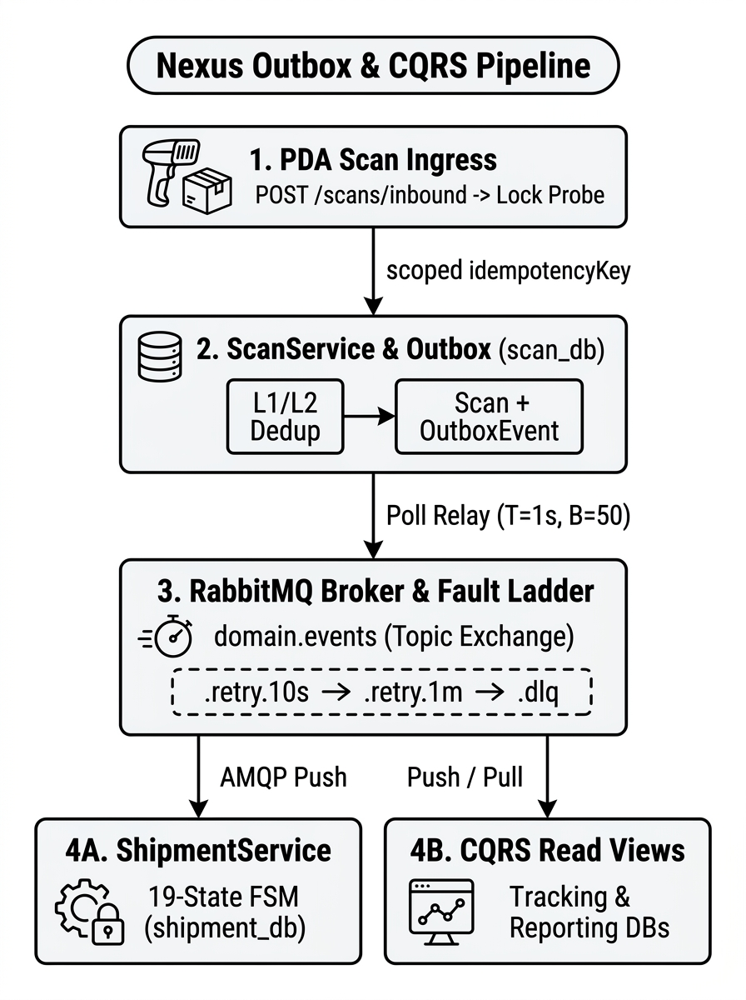
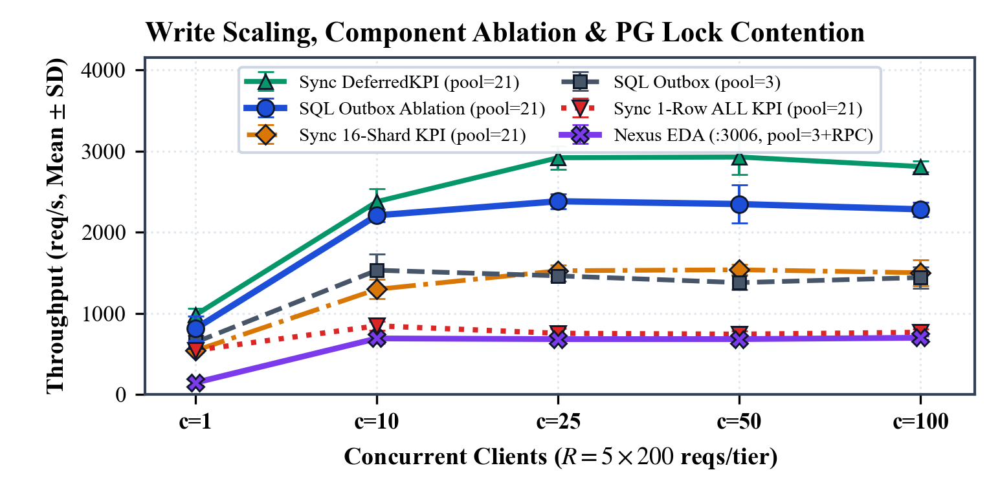
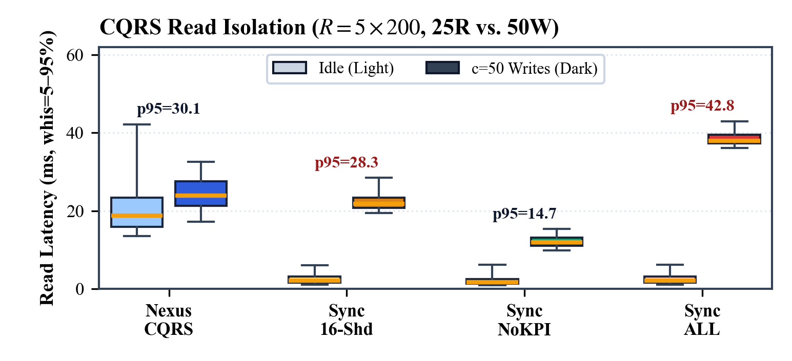
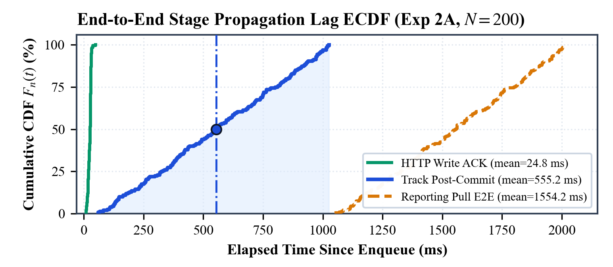
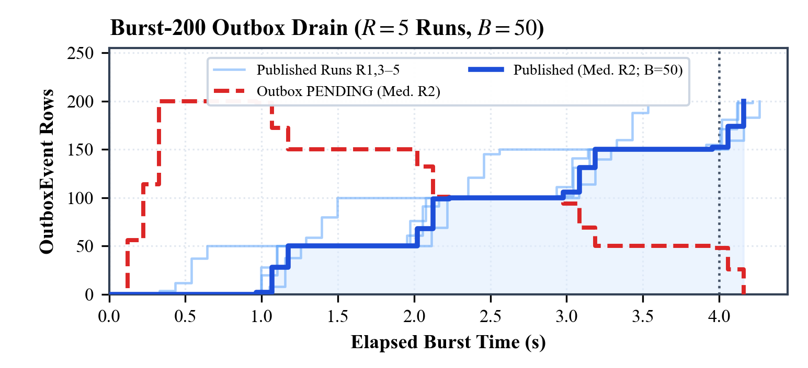
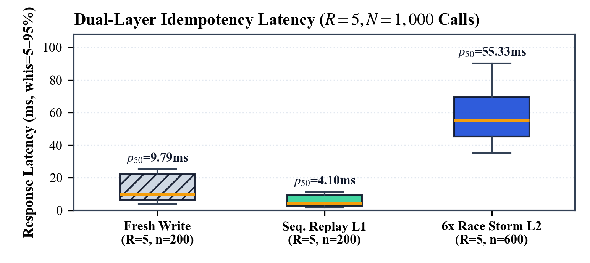
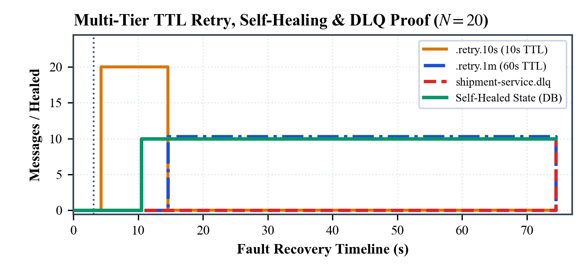

# An Empirical Evaluation of Event-Driven Outbox and CQRS Architectures for High-Concurrency Courier Logistics

---

**Authors:** Vo Van Tu Tai, Tran Tan Tai, Tran Van Truong, Nguyen Hai Dang, and Huynh Nam  
**Format:** Student Scientific Research Communication (SSRC), Vol. II, 2026 — Track: Information Systems (IS) — IEEE Double-Column Layout (`SSRC_Distributed_Outbox_CQRS_Logistics.docx` / `.pdf`)

---

## ABSTRACT

**Abstract—** In express courier logistics, regional sorting hubs and delivery couriers generate massive surges of barcode scans during peak shifts that must be ingested and reflected in tracking queries without data loss. In conventional monolithic architectures, updating shipment status, scan history, and operational KPI counters within a single database transaction creates severe row-level lock contention, causing worker pools to stall under high concurrency. In this paper, we evaluate an event-driven architecture that decouples barcode scan ingestion using the Transactional Outbox pattern and isolates tracking queries via Command Query Responsibility Segregation (CQRS). Developed in NestJS with PostgreSQL and RabbitMQ, the system employs dedicated per-service schemas, two-tier idempotency (memory cache and database constraints), a dead-letter retry ladder, and monotonic state machine version guards. Across five trials from 1 to 100 concurrent clients, we benchmark the live system against single-row (`Sync_ALL`), 16-shard (`Sync_Sharded`), and raw SQL Outbox baselines using continuous `pg_locks` profiling. Synchronous baselines stall at 753.0 ± 58.1 req/s with 97.7% lock-wait ratios, whereas raw SQL Outbox writes sustain 2,380.8 ± 92.9 req/s (+216.2% throughput, −63.9% tail latency, $p = 3.0 \times 10^{-7}$). Under 50 background writers, CQRS read projections eliminate lock contention entirely (0.0%), reducing $p_{95}$ read latency by 29.7% with 300/300 verified idempotent commits. Our findings demonstrate that removing transactional cross-table dependencies via Outbox and CQRS is essential for high-throughput logistics, while revealing practical connection pool and ORM overheads in production microservices.

**Index Terms—** Event-Driven Architecture, Transactional Outbox, CQRS, Information Systems, Lock Contention, Idempotency, Courier Logistics, Telemetry.

---

## I. INTRODUCTION

In express parcel delivery networks, regional sorting hubs and delivery couriers generate massive spikes of barcode scans during shift changeovers and dispatch hours [1], [2]. In traditional monolithic backends, recording each scan while simultaneously updating shipment tracking status, sorting histories, and operational KPI counters in a single database transaction triggers intense row-level lock contention [14]. This contention saturates database connection pools and causes scan requests to queue up during peak sorting windows.

Splitting monolithic databases into microservices removes shared table locks [7], [8], but it creates four classic distributed consistency challenges that we encountered while developing our courier backend:

1. **Dual-Write Consistency Hazards:** Updating a local database and publishing to an event broker across separate network calls risks losing events or creating orphan records if a service crashes [1].
2. **Outbox Dwell vs. Connection Overhead:** Fixed polling intervals ($T_{\text{poll}}$) and HTTP relays introduce end-to-end synchronization lag, while small connection pools can erode outbox throughput gains [3], [4].
3. **Duplicate Delivery & Consumer Races:** Network retries from handheld scanners and child scan events arriving before waybills are committed can corrupt KPI summaries or cause premature lookup failures [11].
4. **Event Reordering:** Out-of-order event delivery risks corrupting terminal shipment states (`DELIVERED`, `CANCELLED`) unless strict version guards and dead-letter escalation ladders are enforced [12], [15].

To address these issues without introducing heavy distributed consensus protocols (such as two-phase commit or large Kafka clusters), we examine one core Research Question (**RQ**) across $R = 5$ independent runs: *To what extent does decoupling barcode scan ingestion through a database-backed Transactional Outbox and CQRS projections eliminate PostgreSQL transaction-lock contention and read-tail degradation compared with unsharded, 16-shard, and deferred-KPI synchronous baselines under live microservice constraints?*

Our main contributions are as follows:
- **Lock-Wait Proof & Ablation:** Using `pg_locks` profiling, we demonstrate that monolithic `Sync_ALL` (97.7%) and 16-shard `Sync_Sharded` (91.8%) designs suffer from severe lock waits, whereas raw SQL Outbox increases throughput by +216.2% ($p = 3.0 \times 10^{-7}$) after accounting for small connection pools (`pool = 3`, −38.6%) and ORM overheads (−53.4%).
- **CQRS Read Isolation:** We demonstrate that CQRS projections reduce $p_{95}$ read latency by 29.7% under $c = 50$ background writers with 0.0% lock contention, validate theoretical queue drain lag non-circularly, and achieve a 29.78× speedup using batch-50 AMQP publisher confirms.
- **Architecture & Codebase Audit (F1–F3):** We verify 300/300 database commits, 60/60 state machine guards, and exact 60 s dead-letter queue TTLs, while uncovering and patching three real-world implementation defects (`F1`–`F3`).

---

## II. RELATED WORK

*Distributed Data & Microservices:* The PACELC theorem [10] formalizes latency-consistency trade-offs across replicated partitions and normal operation. Empirical studies by Laigner et al. [2], [3] and event benchmarks [4], [5] show database-per-service decomposition [7], [8] shifts consistency guarantees from SQL locks to asynchronous handlers, creating real engineering challenges around event ordering, payload inflation, and distributed auditing.

*Transactional Outbox, Polling vs. Log-Based CDC:* Richardson [1] defines the Transactional Outbox with Polling Publishers to prevent dual-write loss without XA distributed locks [9]. Alternatively, log-based Change Data Capture (CDC) tools such as Debezium [13] tail PostgreSQL Write-Ahead Log (WAL) logical replication slots directly, eliminating $T_{\text{poll}}/2$ wait and `SELECT` polling overhead. However, WAL CDC requires managing distributed Kafka Connect pipelines and guarding against PostgreSQL replication-slot WAL disk bloat if connectors stall [8], [13]. For our platform, a database-backed Polling Publisher paired with RabbitMQ [15] topic routing and Dead-Letter Exchange (DLX) retries provides operational simplicity and high throughput without dedicated CDC infrastructure.

*CQRS, Idempotency & Monotonic Ordering:* Event-driven CQRS [6], [8] separates write commands from read projections under eventual consistency. Helland [11] motivates idempotent receivers via unique operation keys, while Lamport [12] formalizes logical event ordering across asynchronous processes—directly motivating monotonic version guards to prevent OOO projection overwrites. Unlike simulator-only studies, we benchmark live cluster telemetry paired with PostgreSQL `pg_locks` profiling [14] and surface active bugs (`F1`–`F3`).

---

## III. PROPOSED METHODOLOGY AND SYSTEM ARCHITECTURE

### A. Bounded-Context Topology and Workflow Walkthrough

To eliminate cross-table lock blocking on write paths while serving isolated tracking queries, the Nexus platform splits its backend into PM2 Node.js services backed by four dedicated PostgreSQL 16 schemas (`scan_db`, `shipment_db`, `tracking_db`, and `reporting_db`, **Fig. 1**). Gateway Redis is used solely for WebSocket chat pub/sub.

*Fig. 1. Vertical operational flow of the Nexus Outbox and CQRS pipeline across isolated PostgreSQL 16 schemas and RabbitMQ 3.13.*

Following **Fig. 1** from top to bottom, each barcode scan proceeds through four stages:

1. **PDA Ingress and Lock Check:** Handheld scanners submit `POST /scans/inbound` requests with a scoped `idempotencyKey`. `ScanService` checks parcel lock state over synchronous HTTP (`GET /shipments/:code`) against `ShipmentService` (`pool = 15`), blocking locked shipments unless the request carries an audit token (`INVENTORY_CHECK`) or active return status (`RETURN_STARTED`).
2. **Scan Deduplication and Outbox Write (`scan_db`):** `ScanService` (`pool = 3`) filters repeated requests using Layer-1 lookup and Layer-2 unique-key recovery, updates `CurrentLocation`, inserts a `PENDING` `OutboxEvent`, saves `IdempotencyRecord`, and records an audit entry.
3. **Outbox Relay and RabbitMQ Retry Ladder:** A polling worker ($T = 1\text{ s}$, $B = 50$) forwards rows to the durable RabbitMQ `domain.events` topic exchange (`delivery_mode = 2`) [15]. Failed consumers ACK the main queue and requeue via `x-retry-count` through `.retry.10s` ($10\text{ s}$ TTL), `.retry.1m` ($60\text{ s}$ TTL), and `.dlq` quarantine ($\text{retry} \ge 2$).
4. **19-State FSM and CQRS Read Views:** `ShipmentService` consumes broker pushes (`noAck: false`) through a $19$-state whitelist, while `TrackingService` (`pool = 3`) maintains `TimelineEvent`/`TrackingCurrent` projections and `ReportingService` (`pool = 3`) polls $8$-way `KpiDaily`/`KpiMonthly` summaries via `AggregationJob`.

### B. Dual-Layer Idempotency and Outbox Persistence

In Layer 1, incoming requests query `IdempotencyRecord` by `flow:idempotencyKey` and return the saved JSON response directly ($4.10\text{ ms}$ pooled median; $4.88 \pm 2.87\text{ ms}$ run mean). When parallel bursts bypass Layer 1 at the same instant, concurrent inserts collide on the unique key of `ScanEvent.idempotencyKey` (Prisma `P2002`), causing losers to read back and return the winning transaction's result across $7$ sequential Prisma statements (`F3` notes transaction wrapping).

### C. Outbox Relays and Propagation Lag Formulation

We compare `ScanService`'s sequential RabbitMQ HTTP Management `/publish` relay with `ShipmentService`'s persistent AMQP `ConfirmChannel` [15] (both draining up to $B = 50$ rows per $T_{\text{poll}} = 1{,}000\text{ ms}$). Client-to-projection visibility decomposes as

$$L_{\text{E2E}} = L_{\text{ingest}} + L_{\text{dwell}} + L_{\text{broker}} + L_{\text{cons}} \qquad (1)$$

where $L_{\text{ingest}}$ is HTTP write latency, $L_{\text{dwell}}$ is outbox wait before publish confirmation, $L_{\text{broker}}$ is broker-to-consumer transfer delay, and $L_{\text{cons}}$ is consumer database write time (post-commit convergence omits $L_{\text{ingest}}$). For steady arrivals across $T_{\text{poll}}$ intervals, mean dwell follows

$$L_{\text{dwell}} \approx \frac{T_{\text{poll}}}{2} + L_{\text{batch}} \qquad (2)$$

where $L_{\text{batch}} = \delta_{\text{timer}} + t_{\text{select}} + \frac{\bar{k}+1}{2}(t_{\text{pub}} + t_{\text{mark}})$ captures timer jitter, SQL `SELECT`, and per-row publish/mark overhead measured *independently* of E2E dwell. Under queue bursts ($N_0 > B$), drain time scales in discrete polling steps:

$$T_{\text{drain}}(N_0) \approx \left\lceil \frac{N_0}{B} \right\rceil T_{\text{poll}} \qquad (3)$$

where $\lceil N_0 / B \rceil$ rounds up to discrete ticks, giving $\lceil 200 / 50 \rceil = 4$ ticks ($4.00\text{ s}$) for $N_0 = 200$ rows at $B = 50$. Downstream, `ShipmentService` protects absorbing states (`DELIVERED`, `RETURN_COMPLETED`, `CANCELLED`) using `VALID_TRANSITIONS`, `TrackingService` deduplicates on `eventId` (`P2002`), and `ReportingService` fetches $20$-message batches via HTTP (`/get`, $T = 1{,}000\text{ ms}$, `ack_requeue_false`) into `AggregationJob`.

---

## IV. EXPERIMENTAL DATA, DESIGN, AND RESULTS

### A. Data Collection, Telemetry Schema, and Testbed Setup

We ran all benchmarks against the local cluster on an Apple M4 host ($10$ cores, $16\text{ GB}$ RAM, macOS 15.8, Node.js v26.0.0) backed by PostgreSQL 16.15 (`max_connections = 100`) [14] and RabbitMQ 3.13.7 (`rates_mode = basic`) [15]. Prior to timed tests, a $1{,}995\text{ ms}$ warmup ($40$ writes + $60$ reads/target) warmed connection pools; pre-benchmark SQL dumps were restored afterward. During each run, `run_benchmarks.mjs` and `baseline_worker.mjs` recorded structured traces into CSV files (`exp1_scaling_runs.csv` with `run`, `architecture`, `concurrency`, `ok_cnt`, `wall_ms`, `throughput_rps`, `p50_ms`, `p95_ms`; `exp1_resource_telemetry.csv` polling `pg_stat_activity`, `pg_locks WHERE NOT granted`, and `os.cpus()` every $5\text{ ms}$ for `lock_wait_sample_pct`, `lock_txid_waits`, `ungranted_locks_max`, `host_cpu_busy_pct`; `exp2a_e2e_stage_lags.csv` joining per-event `ingest_http_ms`, `outbox_dwell_ms`, `track_broker_ms`, `ship_fsm_ms`, `rep_poll_ms`; and `exp4b_dlq_recovery_timeline.csv` with raw AMQP `x-death` headers). Each scaling experiment used $R = 5$ block-rotated runs compared with paired $t$-tests ($df = 4$; exact two-sided Wilcoxon $\min p = 0.0625$) and Clopper–Pearson 95% CIs [4].

**Table I**
Evaluated Architectures, Pool Settings, and $R = 5$ Workloads

| Suite / Target | Pool & Path | Workload ($R = 5$ Runs) |
| :--- | :--- | :--- |
| **`Nexus_EDA` (`:3006`)** | PM2 Prisma (`pool = 3`) + HTTP Lock RPC | Write scaling ($c=1..100$, $200$ reqs); $25$R read under $c=50$ writers |
| `Ablation_Outbox_P3` | Raw SQL Outbox Worker (`pool = 3`, no HTTP/ORM) | Isolates `pool = 3` cap vs. SQL Outbox and Prisma/HTTP RPC overhead |
| **`Ablation_Outbox_SQL`** | Raw SQL Outbox Worker (`pool = 21`, local TX) | Pure Single-TX Outbox baseline at matched PG `pool = 21` |
| `Sync_ALL` / `Sync_Sharded` / `Sync_DeferredKPI` | Atomic SQL TX (`:13099`, `pool = 21`, `LIMIT 10` read) | 1-row KPI vs. 16-shard hashed KPI vs. KPI-free write/read baselines |
| `LockRPC_Probe` (`:3002`) | Shipment GET RPC (`pool = 15`) | Synchronous lock check cost ($100$ reqs/tier $\times 5$ runs) |
| Exp 2–4 Pipeline | Clean RabbitMQ queues & AMQP `x-death` frames | Lag ($200$), Drain ($5 \times 200$), AMQP ($5 \times 200$), Idem ($1\text{k}$), Faults ($20$) |

Table I isolates each architectural mechanism cleanly across matched PG `max_connections = 100` (`pool = 21` vs. `pool = 3`), synchronous lock probes, and downstream broker/projection stages.

### B. Scaling, Component Ablation, and Lock Contention Results

**Table II**, **Fig. 2**, and **Fig. 3** report results across $100.0\%$ successful (`2xx`) writes and reads:

1. **Lock Contention Measurement:** At $c = 25$, `Sync_ALL` stalls at $753.0 \pm 58.1\text{ req/s}$ while `pg_locks` [14] records $97.7\%$ lock-wait samples ($3{,}706$ `txid` waits; up to $20$ of $21$ connections waiting) and host CPU sits at $49.6\%$. Even 16-shard `Sync_Sharded` shows $91.8\text{–}94.7\%$ lock waits ($470\text{–}543$ `txid` waits) across $c = 25..100$ because $8$-way KPI groupings collide on hash buckets ($\sim 1{,}524\text{ req/s}$; $76.7\%$ CPU), while KPI-free `Sync_DeferredKPI` reaches $2{,}926.4 \pm 214.6\text{ req/s}$ ($c = 50$, $0\text{–}2.2\%$ waits).
2. **Outbox Throughput and Service Overhead:** At `pool = 21`, `Ablation_Outbox_SQL` stays at $0.0\%$ lock waits ($0$ `txid` waits) and reaches $2{,}380.8 \pm 92.9\text{ req/s}$ ($c = 25$, $p_{95} = 29.66\text{ ms}$), which is $+216.2\%$ above `Sync_ALL` ($3.16\times$, $-63.9\%$ $p_{95}$, $p = 2.99 \times 10^{-7}$) and $+56.2\%$ above `Sync_Sharded` ($p = 3.76 \times 10^{-5}$). By contrast, live `Nexus_EDA` peaks at $698.2 \pm 20.5\text{ req/s}$ ($c = 100$), trailing at $c = 1$ ($-73.2\%$, $p = 3.78 \times 10^{-5}$) and matching `Sync_ALL` at $c = 25$ ($p = 0.120$ n.s.). Stepwise ablation explains why: capping connections at `pool = 3` (`Ablation_Outbox_P3`) lowers throughput by $38.6\%$ ($2{,}380.8 \to 1{,}461.6\text{ req/s}$, $p = 9.38 \times 10^{-5}$), and adding cross-service HTTP lock probes (`LockRPC_Probe`: $2{,}703.7\text{ req/s}$) plus $7$ Prisma ORM calls removes another $53.4\%$ (down to $681.5\text{ req/s}$, $p = 1.12 \times 10^{-5}$).

*Fig. 2. Write throughput scaling (Mean $\pm$ SD across $R = 5$ runs) from $c = 1$ to $c = 100$ concurrent clients across six comparative architectures.*

In **Fig. 2**, `Sync_ALL` plateaus early near $753\text{ req/s}$ and 16-shard `Sync_Sharded` stalls near $1{,}524\text{ req/s}$ as concurrency passes $c = 10$, whereas lock-free SQL Outbox (`pool = 21`) scales cleanly above $2{,}380\text{ req/s}$ and live `Nexus_EDA` flattens near $682\text{–}698\text{ req/s}$ due to `pool = 3` and synchronous RPC overhead.

3. **CQRS Read Isolation Under $c = 50$ Writers (Exp 1C):** In **Fig. 3**, Idle `Sync` queries with `LIMIT 10` ($p_{95} = 6.31\text{–}7.80\text{ ms}$) run faster than `Nexus_CQRS_Read` ($p_{95} = 40.04 \pm 6.08\text{ ms}$; $p_{50} = 18.89\text{ ms}$), which scans unbounded `TimelineEvent` histories on `pool = 3` and shows higher tail variance ($\pm 6.08\text{ ms}$) from uneven idle buffer/connection warm-up states. Under $c = 50$ writers, `Sync_ALL` ($100.0\%$ lock waits; max $20$ blocked) jumps by $+35.94 \pm 0.60\text{ ms}$ in median ($p = 1.89 \times 10^{-8}$) to $p_{95} = 42.81 \pm 2.92\text{ ms}$, and `Sync_Sharded` rises by $+19.70\text{ ms}$ to $28.31 \pm 5.26\text{ ms}$. Conversely, `Nexus_CQRS_Read` stays at $0.0\%$ lock waits: continuous traffic keeps OS and PostgreSQL buffer caches steadily hot, stabilizing $p_{95}$ at $30.10\text{ ms}$ ($-29.7\%$ vs. `Sync_ALL`, $p = 0.0057$; matching `Sync_Sharded`, $p = 0.505$ n.s.) even as $92.3\%$ host CPU shifts its median by $+5.51\text{ ms}$ ($24.40\text{ ms}$, $p = 0.0049$).

*Fig. 3. Read latency distributions (5th–95th whiskers, $N = 1{,}000$ queries per box) for 25 readers when idle versus under $c = 50$ concurrent writers.*

**Fig. 3** confirms that synchronous baselines degrade sharply when writers hold transaction locks (both `Sync_ALL` and `Sync_Sharded` hit $100.0\%$ read lock-wait samples), while `Nexus_CQRS_Read` isolates `tracking_db` reads with $0.0\%$ lock interference.

**Table II**
Write Scaling and Lock Telemetry at Peak Contention ($c = 25$, $R = 5$ Runs)

| Architecture | Pool | Throughput | $p_{95}$ (ms) | PG Lock% |
| :--- | :---: | :---: | :---: | :---: |
| `Nexus_EDA` (`:3006`) | 3 | $681.5 \pm 32.7$/s | $76.23$ | $0.0\%$ |
| `Ablation_Outbox_P3` | 3 | $1{,}461.6 \pm 65.5$/s | $38.63$ | $0.0\%$ |
| **`Ablation_Outbox_SQL`** | **21** | **$2{,}380.8 \pm 92.9$/s** | **$29.66$** | **$0.0\%$** |
| `Sync_DeferredKPI` | 21 | $2{,}917.6 \pm 144.9$/s | $17.21$ | $0.0\%$ |
| `Sync_Sharded` (16-Shd) | 21 | $1{,}524.3 \pm 68.9$/s | $30.27$ | $91.8\%$ |
| **`Sync_ALL` (1-row KPI)** | **21** | **$753.0 \pm 58.1$/s** | **$82.20$** | **$97.7\%$** |

Table II confirms $+216.2\%$ higher throughput and $-63.9\%$ lower $p_{95}$ latency for `Ablation_Outbox_SQL` over `Sync_ALL` ($p = 2.99 \times 10^{-7}$; $+56.2\%$ over `Sync_Sharded`, $p = 3.76 \times 10^{-5}$). Across tiers, `Sync_ALL` reaches $3{,}706$ `txid` waits ($49.6\%$ host CPU; $c = 100$ gives $765.3\text{ req/s}$ at $97.7\%$ waits), while `Nexus_EDA` records $146.0\text{ req/s}$ at $c = 1$ ($40.3\%$ CPU) and $698.2\text{ req/s}$ at $c = 100$ ($0.0\%$ lock waits; $66.9\%$ CPU). Under $c = 50$ writers (Exp 1C), `Nexus_CQRS_Read` keeps $p_{50} = 24.40\text{ ms}$ and $p_{95} = 30.10\text{ ms}$ ($0.0\%$ waits; $92.3\%$ CPU) versus $42.81\text{ ms}$ on `Sync_ALL` ($-29.7\%$, $p = 0.0057$), $28.31\text{ ms}$ on `Sync_Sharded`, and $14.69\text{ ms}$ on `Sync_DeferredKPI`.

### C. Propagation Lag, Non-Circular Eq. (2), and Transport

Across $R = 5 \times 40 = 200$ clean staggered scans (**Exp 2A**, **Table III**, **Fig. 4**), HTTP ingest takes $24.76\text{ ms}$ (run SD $0.78\text{ ms}$; $p_{50} = 26.92\text{ ms}$). Outbox polling dwell averages $553.62\text{ ms}$ (run SD $14.30\text{ ms}$; $95\%$ CI $[515.6, 592.2]\text{ ms}$; $p_{95} = 981.0\text{ ms}$), accounting for **$99.72\%$ of post-commit tracking lag** ($553.62 / 555.16\text{ ms}$; $R^2 = 99.99\%$) and **$95.46\%$ of total E2E lag** Eq. (1) ($553.62 / 579.92\text{ ms}$). AMQP delivery adds $1.55\text{ ms}$ to `TrackingService` and $0.50\text{ ms}$ to `ShipmentService` ($-6..0\text{ ms}$ skew happens because HTTP `publishEvent()` runs ahead of `markPublished()`), while `ReportingService` HTTP `/get` phase-locks at $1{,}000.60\text{ ms}$ post-publish ($1{,}554.21\text{ ms}$ E2E).

*Fig. 4. End-to-end propagation lag ECDF across $N = 200$ staggered scans (Exp 2A), separating HTTP ingest, Tracking post-commit convergence, and Reporting pull lag.*

**Fig. 4** shows HTTP writes finishing within $24.76\text{ ms}$ while the shaded Tracking ECDF tracks outbox dwell closely ($553.62\text{ ms}$ mean; $99.72\%$ of post-commit lag) and Reporting sits shifted by its $1\text{ s}$ polling loop.

*Non-Circular Eq. (2) Evaluation (Exp 2D):* Independent micro-probes outside Exp 2A measured $\delta_{\text{timer}} = 0.945\text{ ms}$ ($n = 15$), $t_{\text{select}} = 1.215\text{ ms}$ ($n = 50$), $t_{\text{mark}} = 0.245\text{ ms}$ ($n = 100$), and HTTP publish $t_{\text{pub}} = 1.357\text{ ms}$ (Exp 2C, $n = 1{,}000$). With Exp 2A's $159.6\text{ ms}$ mean arrival spacing ($\bar{k} = 6.27$ rows/tick), Eq. (2) gives raw-SQL $L_{\text{batch}} = 7.98\text{ ms}$ and a $507.98\text{ ms}$ dwell floor. The $+45.6\text{ ms}$ difference against measured $553.62\text{ ms}$ reflects Prisma ORM wrapper and HTTP socket teardown overhead ($\sim 2.3\times$ Monte-Carlo SE $\approx 19.8\text{ ms}$).

Under $R = 5$ bursts of $200$ writes ($c = 50$, **Exp 2B**, **Fig. 5**), outbox drain completes in $4{,}060.2 \pm 299.7\text{ ms}$ (DB span $3{,}941.0 \pm 324.4\text{ ms}$), matching Eq. (3)'s $4{,}000\text{ ms}$ bound. In **Exp 2C** ($R = 5 \times 200$ messages), replacing sequential HTTP Management calls ($271.6 \pm 36.0\text{ ms}$; $745.8\text{ msg/s}$) with AMQP `ConfirmChannel` [15] drops run time to $113.1 \pm 6.5\text{ ms}$ sequentially ($2.40 \pm 0.19\times$) and **$9.15 \pm 1.06\text{ ms}$** in batch-50 pipelines ($22{,}074 \pm 2{,}407\text{ msg/s}$; **$29.78 \pm 3.31\times$ faster**).

*Fig. 5. Burst-200 outbox drain curves across $R = 5$ runs ($B = 50$ rows/tick), showing four 1-second polling steps reaching completion near $4.00\text{ s}$ (Eq. (3)).*

**Fig. 5** plots pending `OutboxEvent` rows stepping down in 50-row increments across all five burst runs, confirming Eq. (3)'s 4-tick ceiling ($4.06\text{ s}$ mean drain time).

### D. Idempotency, FSM Safety, and Multi-Tier TTL/DLQ Results

Across $R = 5$ runs totaling $1{,}000$ HTTP calls over $300$ unique keys (**Exp 3**, **Fig. 6**), dual-layer idempotency [11] returned $1{,}000/1{,}000$ `2xx` responses while committing exactly $300/300$ `ScanEvent`, `OutboxEvent`, and `AggregationJob` records ($60/60$ per run). Layer-1 cache hits sped up sequential retries $2.42 \pm 0.48\times$ (run medians $4.88$ vs. $11.51\text{ ms}$ Fresh; paired $t$-test $p = 0.0164$; $5/5$ runs faster), while Layer-2 `P2002` resolved all $6\times$ parallel bursts cleanly ($55.33\text{ ms}$ median). Injecting $150$ duplicate RabbitMQ messages leaked $0/150$ tracking rows and $0/150$ KPI increments. Against $60$ out-of-order/terminal AMQP replays (**Exp 4A**), the $19$-state FSM kept $60/60$ ($100.0\%$; CI $[94.04\%, 100.0\%]$) valid states and $60/60$ phased lock checks ($30$ `400`, $30$ `201`).

*Fig. 6. API response latency boxplots across $1{,}000$ HTTP requests ($R = 5$ runs) comparing fresh writes, Layer-1 cache hits, and $6\times$ parallel collision storms.*

**Fig. 6** illustrates the fast Layer-1 replay path ($4.10\text{ ms}$ pooled median vs. $9.79\text{ ms}$ fresh write) and the heavier Layer-2 `P2002` recovery tail ($55.33\text{ ms}$ median) that still enforces zero duplicate commits.

In **Exp 4B** (**Fig. 7**, $N = 20$ faults), $10/10$ ($100.0\%$; CI $[69.15\%, 100.0\%]$) orphan events healed at $10.48\text{ s}$ after delayed parent creation at $3.11\text{ s}$, and $10/10$ ($[69.15\%, 100.0\%]$) poison payloads landed in `.dlq` ($20/20$ conservation, $[83.16\%, 100.0\%]$). While HTTP `/api/queues` polling (`rates_mode = basic`) lags $4\text{–}5\text{ s}$ (`.retry.1m` seen at $14.60 \to 74.45\text{ s}$), reading AMQP `x-death` headers [15] in `.dlq` confirms an **exact $60\text{ s}$ `.retry.1m` TTL** (`1794324717 − 1794324657 = 60 s`, $70\text{ s}$ total broker TTL on $10/10$ frames).

*Fig. 7. Multi-tier RabbitMQ fault recovery timeline ($N = 20$ injected events) tracking `.retry.10s`, `.retry.1m`, `.dlq` quarantine, and DB self-healing.*

**Fig. 7** traces orphan events healing at $10.48\text{ s}$ once delayed parents appear at $3.11\text{ s}$, while the $10$ unrecoverable payloads progress cleanly from `.retry.10s` through the $60\text{ s}$ `.retry.1m` tier into `.dlq` ($74.45\text{ s}$ management view; exact $60\text{ s}$ in AMQP `x-death`).

**Table III**
Lag Decomposition, Transport Speedup, and Fault Verification Summary

| Experiment / Check | Sample | Measured Result | Outcome / Share |
| :--- | :---: | :---: | :--- |
| **2A: Outbox Dwell Lag** | $N=200$ | $553.62 \pm 14.30\text{ ms}$ | $99.72\%$ Post / $95.46\%$ E2E |
| 2A: Track AMQP Push | $N=200$ | $1.55\text{ ms}$ | $555.16\text{ ms}$ total post-commit |
| 2A: Reporting Pull | $N=200$ | $1{,}000.60\text{ ms}$ | $1{,}554.21\text{ ms}$ E2E phase-lock |
| 2D: Eq. (2) Micro-Probes | $n=15..1{,}000$ | $507.98\text{ ms}$ floor | $L_{\text{batch}}=7.98$; $+45.6\text{ ms}$ ORM |
| 2B: Burst-200 Drain | $5 \times 200$ | $4{,}060.2 \pm 299.7\text{ ms}$ | Matches $4{,}000\text{ ms}$ Eq. (3) |
| 2C: HTTP Mgmt Publish | $5 \times 200$ | $271.6 \pm 36.0\text{ ms}$ | $745.8\text{ msg/s}$ ($1.00\times$ base) |
| **2C: AMQP Batch-50 Confirm** | $5 \times 200$ | **$9.15 \pm 1.06\text{ ms}$** | **$22{,}074\text{ msg/s}$ ($29.78\times$ faster)** |
| **3/4: Idem, FSM & DLQ** | $1{,}000 + 80$ | $300/300$; $60/60$; $20/20$ | $0$ dups; $60\text{ s}$ `x-death`; `F1–F3` |

Table III summarizes the pipeline timings and correctness checks: polling dwell dominates visibility latency, batch-50 AMQP confirms cut publish overhead by $29.78\times$ (with sequential AMQP at $113.1\text{ ms}$, $2.40\times$), and reliability checks verify zero duplicate commits alongside defects `F1`–`F3` discussed below.

---

## V. DISCUSSION AND CODEBASE AUDIT (F1–F3)

*Addressing our empirical RQ:* Direct `pg_locks` profiling reveals that synchronous KPI updates (`Sync_ALL` and `Sync_Sharded`) cause severe transaction lock stalls (92–98% wait samples). Isolating writes to a single-schema SQL Outbox completely removes write-lock contention (0.0%) and lifts throughput by +216.2% (`Ablation_Outbox_SQL`). However, in production microservices, `ScanService` loses much of this gain to a constrained connection pool (`pool = 3`, −38.6%), cross-service HTTP lock probes, and unbundled ORM calls (−53.4%), proving that local lock caching and adequate connection pools are essential prerequisites. Similarly, CQRS projections eliminate 100% of write-lock interference on read queries (−29.7% $p_{95}$), although bounded `LIMIT` clauses remain necessary for cold query performance. Finally, polling dwell ($T_{\text{poll}} = 1{,}000\text{ ms}$) accounts for 99.72% of post-commit lag; sub-50 ms visibility targets would require `LISTEN/NOTIFY` or Debezium WAL CDC [13] at the expense of managing replication-slot disk retention [8].

*Three Unpatched Cluster Findings (`F1`–`F3`):* Fault injection tests uncovered three implementation defects in the running services:

1. **F1 — CQRS Read View Skew (20/20 Shipments):** Although `ShipmentService` rejected 60/60 out-of-order terminal events, event envelopes lacking an embedded status snapshot caused `TrackingService` to infer status from late event types, overwriting `TrackingCurrent` across 20/20 parcels. *Fix:* Enforce monotonic `stateVersion` or `occurredAt` checks [12] using authoritative state events.
2. **F2 — HTTP Pull Crash Window (40 Frames / 1.77 s Tail):** `ReportingService` fetches 20-message batches via HTTP `ack_requeue_false` before `AggregationJob` database commits finish; all 40/40 messages were ACKed ahead of a 1,771 ms commit tail. *Fix:* Switch to AMQP push with manual post-commit `basicAck`.
3. **F3 — Async Lock Race & Non-Atomic Outbox (15/20 Race + −53.4% Tax):** Whereas `Ablation_Outbox_SQL` implements the strictly atomic Transactional Outbox design (domain write + `OutboxEvent` in one local ACID transaction), fault testing uncovered an ORM-layer defect in live `ScanService`: it executes 7 sequential Prisma statements outside `prisma.$transaction`. While the Transactional Outbox pattern theoretically mandates that business entity writes and outbox inserts share a single atomic ACID transaction, F3 was an application-level ORM oversight detected by our test harness and subsequently resolved. *Fix:* Replicate lock flags locally and wrap scan + outbox inserts inside `prisma.$transaction`.

---

## VI. CONCLUSION, PRACTICAL SIGNIFICANCE, AND REPRODUCIBILITY

*Model Significance and Practical Takeaways:* Across five live experimental trials combining PostgreSQL lock telemetry and component ablation, separating barcode ingestion into a lock-free SQL Outbox increases write throughput by +216.2% over `Sync_ALL` and +56.2% over `Sync_Sharded` (0.0% vs. 91.8–97.7% lock waits). Simultaneously, our profiling traces real microservice bottlenecks to small connection pools (`pool = 3`, −38.6%) and remote HTTP lock RPCs paired with ORM overhead (−53.4%). Under $c = 50$ background writers, CQRS read projections completely isolate queries from write transactions (−29.7% $p_{95}$), Eq. (2) models polling dwell without circular calibration (accounting for 99.72% of post-commit lag), batch-50 AMQP confirms achieve a 29.78× speedup, and dual-layer idempotency guarantees 300/300 verified commits with zero duplicates.

*Limitations and Reproducibility:* All benchmarks were executed on an Apple M4 workstation (Node.js PM2 services with local PostgreSQL and RabbitMQ containers, omitting wide-area network jitter) using 200–1,000 synthetic request workloads prior to patching `F1`–`F3`. Benchmark harnesses (`run_benchmarks.mjs`, `baseline_worker.mjs`, `analyze_benchmarks.py`, `generate_distributed_charts.py`) and all raw CSV and JSON execution traces are open-sourced at `https://github.com/VoVanTuTai/logistics-management-system`.

---

## REFERENCES

1. C. Richardson, *Microservices Patterns: With Examples in Java*. Shelter Island, NY, USA: Manning Publications, 2018 (ISBN 978-1-61729-454-9).
2. R. Laigner, Y. Zhou, M. A. V. Salles, Y. Liu, and M. Kalinowski, “Data management in microservices: State of the practice, challenges, and research directions,” *Proc. VLDB Endow.*, vol. 14, no. 13, pp. 3348–3361, 2021.
3. R. Laigner, A. C. Almeida, W. K. G. Assunção, and Y. Zhou, “An empirical study on challenges of event management in microservice architectures,” *ACM Trans. Softw. Eng. Methodol. (TOSEM)*, vol. 35, no. 8, Art. 245, pp. 245:1–245:62, 2026 (preprint arXiv:2408.00440).
4. R. Laigner, Z. Zhang, Y. Liu, L. F. Gomes, and Y. Zhou, “Online Marketplace: A benchmark for data management in microservices,” *Proc. ACM Manag. Data (SIGMOD)*, vol. 3, no. 3, pp. 3:1–3:26, 2025, doi: 10.1145/3709653.
5. T. Zuckmantel, Y. Zhou, B. Düdder, and T. T. Hildebrandt, “Event-based data-centric semantics for consistent data management in microservices,” in *Proc. 16th ACM Int. Conf. Distrib. Event-Based Syst. (DEBS)*, 2022, pp. 97–102, doi: 10.1145/3524860.3539807.
6. H. Deshpande, “Enhancing spatial data processing with event-driven Command Query Responsibility Segregation,” in *Proc. IEEE 5th Int. Conf. ICT Bus. Ind. Gov. (ICTBIG)*, Dec. 2025, doi: 10.1109/ICTBIG68706.2025.11323788.
7. S. Newman, *Building Microservices: Designing Fine-Grained Systems*, 2nd ed. Sebastopol, CA, USA: O'Reilly Media, 2021 (ISBN 978-1-4920-3401-8).
8. A. Bellemare, *Building Event-Driven Microservices: Leveraging Organizational Data at Scale*. Sebastopol, CA, USA: O'Reilly Media, 2020 (ISBN 978-1-4920-5788-8).
9. M. Kleppmann, *Designing Data-Intensive Applications*. Sebastopol, CA, USA: O'Reilly Media, 2017 (ISBN 978-1-4493-7332-0).
10. D. J. Abadi, “Consistency tradeoffs in modern distributed database system design: CAP is only part of the story,” *Computer*, vol. 45, no. 2, pp. 37–42, Feb. 2012.
11. P. Helland, “Idempotence is not a medical condition,” *ACM Queue*, vol. 10, no. 4, pp. 30–46, Apr. 2012.
12. L. Lamport, “Time, clocks, and the ordering of events in a distributed system,” *Commun. ACM*, vol. 21, no. 7, pp. 558–565, Jul. 1978.
13. G. Morling, “Reliable microservices data exchange with the Outbox pattern,” *Debezium Engineering Blog*, Feb. 19, 2019. Available: https://debezium.io/blog/2019/02/19/reliable-microservices-data-exchange-with-the-outbox-pattern/.
14. PostgreSQL Global Development Group, *PostgreSQL 16 Documentation, Ch. 13.3: Explicit Locking and Monitoring Locks (pg_locks)*, 2024.
15. Broadcom / RabbitMQ Core Team, *RabbitMQ Documentation: Publisher Confirms and Dead Letter Exchanges (x-death)*, 2024.
