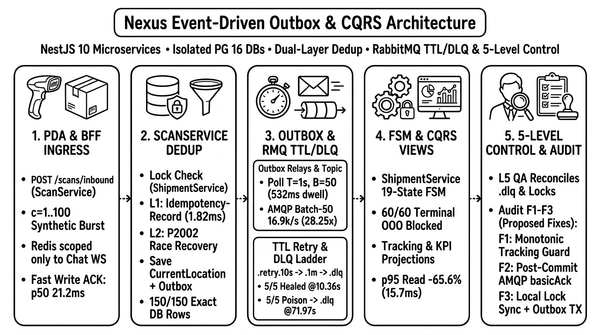
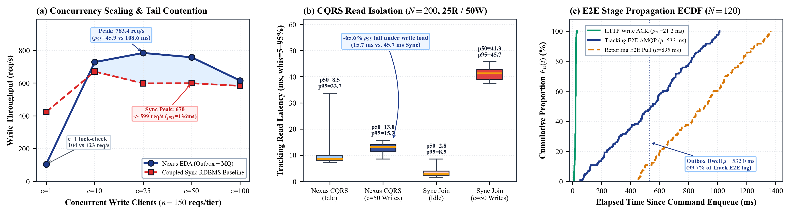
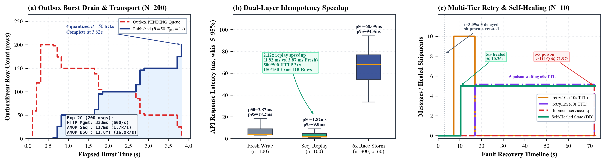

# Design and Empirical Evaluation of an Event-Driven Outbox and CQRS Architecture for High-Concurrency Courier Logistics

---

**Authors:** Võ Văn Tú Tài, Trần Tấn Tài, and Huỳnh Nam  
**Affiliation:** Faculty of Information System, Industrial University of Ho Chi Minh City  
**Email:** 22655911.tai@student.iuh.edu.vn, 22727771.tai@student.iuh.edu.vn  
**Format:** Student Scientific Research Communication (SSRC), Vol. II, 2026 — IEEE Double-Column Layout (`SSRC_Distributed_Outbox_CQRS_Logistics.docx` / `.pdf`)

---

## ABSTRACT

Express courier platforms endure intense burst write amplification across barcode scans, waybill transitions, and real-time analytics. Shared relational schemas suffer row-level lock contention under concurrent load, while naive dual-writes risk losing domain events on process crashes. We design and empirically evaluate the Nexus Event-Driven Outbox and Command Query Responsibility Segregation (CQRS) architecture built on NestJS 10 microservices, isolated PostgreSQL 16 databases, and RabbitMQ 3.13. Our implementation integrates: (1) a dual-layer idempotency guard pairing fast-path key lookup with PostgreSQL `P2002` unique-constraint race recovery; (2) persistent outbox relays contrasting sequential HTTP Management API publishing against native AMQP `ConfirmChannel` transport; (3) a deterministic $19$-state shipment finite-state machine (FSM) whitelist; (4) decoupled tracking and $8$-way KPI read projections; and (5) multi-tier Dead-Letter TTL retry queues (`10 s` $\to$ `1 min` $\to$ `.dlq`) governed under a **5-level human-control scale** categorizing system authority boundaries rather than psychometric user ratings. Live benchmarks on the running cluster show $7.52\times$ write throughput scaling to $783.36\text{ req/s}$ ($c = 25$), a $65.59\%$ reduction in $p_{95}$ tracking read tail latency under $c = 50$ concurrent writers ($15.73$ vs. $45.73\text{ ms}$, Mann–Whitney $p = 4.83 \times 10^{-67}$), a $28.25\times$ publish speedup in a pipelined batch-50 AMQP probe ($2.84\times$ sequential relay), $150/150$ exact-once writes across $500$ duplicate HTTP requests, $60/60$ ($100.0\%$; $95\%$ CI $[94.04\%, 100.0\%]$) FSM invariant preservation against out-of-order attacks, and $5/5$ ($[47.82\%, 100.0\%]$) transient self-healing at $10.36\text{ s}$ alongside $5/5$ poison quarantine to `.dlq`, while exposing three active code findings (`F1`–`F3`) with targeted engineering remediations.

*Index Terms—* Event-Driven Architecture, Transactional Outbox Pattern, Command Query Responsibility Segregation (CQRS), Idempotency, RabbitMQ Dead-Letter Exchange, 5-Level Human-Control Scale, Courier Logistics.

---

## I. INTRODUCTION

Modern express courier and parcel management networks generate continuous streams of domain events across distributed sorting hubs, handheld Personal Digital Assistants (PDAs), dispatch consoles, and public tracking portals. During promotional surges, concurrent inbound, outbound, and delivery scans create severe write bursts alongside latency-sensitive read queries from merchants and recipients [1], [5]. Consolidating operational command ingestion, multi-table state validation, and multi-dimensional KPI rollups within one shared ACID transaction boundary induces row-level lock contention, connection pool saturation, and tail-latency degradation.

Decomposing the monolith into autonomous bounded-context microservices avoids single-schema coupling [6], [7], yet introduces four practical data management hazards examined empirically in our graduation thesis implementation:

1. **Dual-Write Consistency Anomaly:** Updating a service's local database and publishing to a message broker outside a coordinated persistence flow risks permanently lost domain events or phantom downstream states if a crash occurs between commits [1].
2. **Outbox Dwell & Transport Bottlenecks:** While the Transactional Outbox preserves at-least-once emission, polling intervals ($T_{\text{poll}}$), batch caps ($B$), and HTTP Management API serialization dominate eventual-consistency convergence lag.
3. **Retry Storms & Consumer Race Conditions:** Unstable wireless PDA links emit sequential and parallel duplicate writes, whereas asynchronous broker delivery can deliver child scan events before parent waybills materialize.
4. **Out-of-Order State Skew & Operator Control:** Delayed or reordered events reaching terminal shipments (`DELIVERED`, `CANCELLED`) can regress lifecycle states unless guarded deterministically alongside clear human operator escalation for dead-letter faults [16].

To solve these issues without heavyweight two-phase commit (2PC) or ZooKeeper/Kafka cluster overhead, we evaluate the live Nexus Event-Driven Outbox and CQRS platform across three research questions:
- **RQ1 (Scalability & Read Isolation):** Under high write concurrency, how much does Outbox + CQRS decoupling improve write scaling and isolate public tracking read tail latency ($p_{95}$) compared with a synchronized monolithic RDBMS transaction baseline?
- **RQ2 (Lag Decomposition & Transport Gain):** Which pipeline stage dominates cross-database convergence lag, and how much faster is native AMQP `ConfirmChannel` batching than sequential HTTP Management API publishing?
- **RQ3 (Safety, Self-Healing & Human Control):** How reliably do dual-layer idempotency, the $19$-state FSM whitelist, and **5-level human-control** TTL/DLQ governance preserve state integrity—and what active codebase defects surface under live fault testing?

---

## II. RELATED WORK

*Distributed Data Management & Microservices:* The CAP theorem [3] and PACELC formulation [2] frame trade-offs between strong consistency and low-latency availability, motivating BASE workflows [4] in distributed systems. Empirical studies by Laigner et al. [5] show that database-per-service decomposition [6], [7] shifts consistency burdens from SQL engines into messaging handlers, requiring strict verification of idempotency, single-writer ownership, and asynchronous fault handling.

*Transactional Outbox & Message Brokers:* Hohpe and Woolf [8] and Richardson [1] establish the Transactional Outbox and Polling Publisher patterns to eliminate dual-write data loss without distributed XA locks [9], [15]. While partitioned logs such as Apache Kafka [10], [11] target high-volume replay, AMQP brokers like RabbitMQ [12] fit polyglot service backbones via flexible topic routing and native Dead-Letter Exchange (DLX) TTL queues.

*CQRS, Idempotency & Ordering Safety:* CQRS [13], [17] isolates write commands from denormalized read views optimized for point lookups and analytics. Helland [14] emphasizes idempotent receivers keyed by unique operation tokens, while Lamport [16] highlights logical ordering hazards across asynchronous messages. Rather than relying on abstract queue simulators, this paper audits our live NestJS + PostgreSQL 16 + RabbitMQ 3.13 cluster under disclosed synthetic burst and fault workloads, documenting concrete runtime vulnerabilities (`F1`–`F3`) and targeted remediations.

---

## III. SYSTEM ARCHITECTURE AND CORE MECHANISMS

### A. Bounded-Context Topology and Service Separation

As depicted in **Fig. 1** and summarized in **Table I**, the Nexus courier platform deploys 12 isolated PostgreSQL 16 databases across autonomous NestJS 10 TypeScript microservices, centering our event-driven benchmark on four core transactional and CQRS contexts alongside companion dispatch, manifest, delivery, and payment services: `ScanService` (`scan_db`), `ShipmentService` (`shipment_db`), `TrackingService` (`tracking_db`), and `ReportingService` (`reporting_db`). Single-writer schema ownership is strictly enforced: `scan_db` owns `CurrentLocation`, `shipment_db` holds authoritative `Shipment` lifecycle state, `tracking_db` serves public read views, and `reporting_db` maintains 8-way KPI rollups (Redis 7 in the gateway BFF handles exclusively WebSocket chat pub/sub with zero role in event persistence or CQRS). Services exchange persistent events (`delivery_mode = 2`) over a durable RabbitMQ 3.13 topic exchange (`domain.events`, 65 active queue bindings).

**TABLE I — NEXUS BOUNDED-CONTEXT SERVICES, SCHEMA OWNERSHIP, AND MESSAGING CONTRACTS**

| Service / DB | Owned State / Model | Relay / Consumer Mode | Safety & Dedup Contract |
| :--- | :--- | :--- | :--- |
| `ScanService` (`scan_db`) | `ScanEvent`, `OutboxEvent`, `CurrentLocation` | HTTP Mgmt Relay ($T_{\text{poll}} = 1{,}000\text{ ms}$, $B = 50$) | `IdempotencyRecord` + `ScanEvent` `P2002` |
| `ShipmentService` (`shipment_db`) | `Shipment` ($19$-state FSM), `outbox_events` | AMQP Confirm Relay + Push (`noAck: false`) | `VALID_TRANSITIONS`; `.retry.10s` $\to$ `.1m` $\to$ `.dlq` |
| `TrackingService` (`tracking_db`) | `TimelineEvent`, `TrackingIndex`, `TrackingCurrent` | AMQP Push Consumer (`tracking-service.q`) | `TimelineEvent.eventId` `P2002` deduplication |
| `ReportingService` (`reporting_db`) | `KpiDaily`, `KpiMonthly` ($8$-way), `AggregationJob` | HTTP Pull ($1{,}000\text{ ms}$, $B = 20$, `ack_requeue_false`) | `AggregationJob.jobKey` `P2002` deduplication |
| `CoupledSyncBaseline` (shared PG) | Monolithic SQL tables + 8-way KPI row counters | Single-TX SQL ACID (PG pool = 21) | Synchronous row locks + multi-table JOINs |

*Fig. 1. Architecture of the live Nexus Event-Driven Outbox and CQRS pipeline across isolated PostgreSQL 16 databases and RabbitMQ 3.13, illustrating ingress and `ScanService` dual-layer deduplication, outbox relays and TTL/DLQ recovery, `ShipmentService` 19-state FSM governance, decoupled CQRS projections, and Level-5 operator control alongside proposed code-audit remediations (`F1`–`F3`).*

### B. Dual-Layer Idempotency and Persistent Outbox Writes

Before persisting an inbound scan, `ScanService` performs a synchronous HTTP lock check against `ShipmentService` (`assertShipmentNotLocked`), rejecting locked parcels (HTTP 400) unless the request carries an authorized audit override (`INBOUND` with note `INVENTORY_CHECK` / Vietnamese `"Kiểm tồn kho"`) or active reverse-logistics transit (`RETURN_STARTED` with `INBOUND`/`OUTBOUND`). Once permitted, `ScanService` scopes the client token as `flow:idempotencyKey` and executes a two-tier deduplication sequence:

1. **Layer 1 — Fast Sequential Lookup:** Queries `IdempotencyRecord` by `scopedIdempotencyKey` and returns the cached JSON snapshot immediately ($1.825\text{ ms}$ median) for sequential PDA retries.
2. **Layer 2 — Parallel Race Recovery (`P2002`):** Inserts into `ScanEvent` under a unique constraint on `idempotencyKey`. When concurrent duplicate threads bypass Layer 1 simultaneously, PostgreSQL rejects losing inserts with Prisma unique-constraint error `P2002`, prompting `createIfAbsent()` to fetch and replay the winner's committed record cleanly.
3. **Outbox Persistence:** For each new scan, the handler upserts `CurrentLocation`, appends a `PENDING` `OutboxEvent`, persists the idempotent snapshot, and records `OpsAuditLog` before returning HTTP 201 (wrapping `ScanEvent` + `OutboxEvent` inside `prisma.$transaction` is identified as remediation `F3` in Section V).

### C. Outbox Relays and Propagation Lag Formulation

Pending outbox records drain periodically every $T_{\text{poll}} = 1{,}000\text{ ms}$ in batches up to $B = 50$ rows. Notice that our live codebase intentionally contrasts two relay implementations: `ScanOutboxRelayService` publishes sequentially via RabbitMQ's HTTP Management API, whereas `ShipmentOutboxRelayService` maintains a persistent TCP AMQP `ConfirmChannel` flushing batch entries sequentially [12]. Client-to-projection visibility lag decomposes linearly across four pipeline stages:

$$L_{\text{E2E}} = L_{\text{ingest}} + L_{\text{dwell}} + L_{\text{broker}} + L_{\text{cons}} \qquad (1)$$

where $L_{\text{ingest}}$ is fast-path HTTP ingestion latency (scan validation and commit), $L_{\text{dwell}}$ is outbox table dwell time awaiting relay pickup and broker publish, $L_{\text{broker}}$ is broker-to-consumer transport delay, and $L_{\text{cons}}$ denotes downstream projection persistence time (with post-commit propagation defined as $L_{\text{conv}} = L_{\text{dwell}} + L_{\text{broker}} + L_{\text{cons}}$). Because scans arrive asynchronously across periodic polling windows, expected dwell follows

$$L_{\text{dwell}} \approx \frac{T_{\text{poll}}}{2} + L_{\text{batch}} \qquad (2)$$

where $T_{\text{poll}} = 1{,}000\text{ ms}$ is the fixed relay interval (yielding a $500\text{ ms}$ midpoint wait) and $L_{\text{batch}}$ denotes intra-batch serialization overhead ($\approx 32\text{ ms}$), directly predicting the measured $531.96\text{ ms}$ mean dwell. When concurrent bursts exceed capacity ($N_0 > B$), draining quantizes across multiple polling ticks:

$$T_{\text{drain}}(N_0) \approx \left\lceil \frac{N_0}{B} \right\rceil T_{\text{poll}} \qquad (3)$$

where $N_0$ is the burst volume and $B = 50$ is the per-tick batch limit, predicting $4$ ticks ($\approx 3.8\text{–}4.0\text{ s}$) for $N_0 = 200$ concurrent writes.

### D. 19-State Authority FSM, CQRS Views, and 5-Level Control

Downstream, `ShipmentService` consumes events via AMQP push (`noAck: false`) and guards status changes inside `ShipmentStateMachine` using an explicit `VALID_TRANSITIONS` whitelist spanning $19$ lifecycle states and $15$ consumed domain event types starting from `CREATED`. Three absorbing terminal states (`DELIVERED`, `RETURN_COMPLETED`, `CANCELLED`) allow only self-idempotent replays, rejecting backward transitions. Independently, `TrackingService` deduplicates `TimelineEvent` (`P2002` on `eventId`) and upserts `TrackingCurrent`/`TrackingIndex`, while `ReportingService` polls via HTTP (`1,000 ms`, $B = 20$, `ack_requeue_false`) to update 8-way KPI rollups (`KpiDaily`/`KpiMonthly` across `{courier, hub, zone}` $\times$ `ALL`) guarded by `AggregationJob.jobKey`. Transient failures invoke `moveToRetryOrDlq()`, ACKing the main queue immediately so healthy traffic never stalls while escalating via `x-retry-count` across `.retry.10s` ($10\text{ s}$ TTL), `.retry.1m` ($60\text{ s}$ TTL), and `.dlq` (count $\ge 2$) under our **5-level human-control scale** categorizing system authority rather than psychometric user ratings.

---

## IV. EXPERIMENTAL SETUP, SYNTHETIC WORKLOAD & RESULTS

### A. Cluster Testbed, Synthetic Workload Criteria, and Baseline

All live benchmarks ran on the running cluster hosted on an Apple M4 machine ($10$-core CPU, $16\text{ GB}$ RAM, macOS 15.8), Node.js v26.0.0, PostgreSQL `16-alpine` (`max_connections = 100`), and RabbitMQ `3.13-management-alpine`. Pre-test SQL snapshots of all cluster databases were restored post-run to keep workspace state clean. To isolate bounded-context decoupling rigorously, an auxiliary in-process baseline (`CoupledSyncBaseline`) shares the same PostgreSQL 16 instance (connection pool $21$, matching Prisma defaults) and executes lock validation, scan insert, timeline append, `TrackingCurrent` upsert, and 8-combination `KpiDaily` updates inside one atomic SQL `BEGIN/COMMIT` transaction.

**Table II** discloses all synthetic cohorts generated by the benchmark runner: $220$ seeded synthetic shipments (`333991000001..220`) rotated deterministically round-robin across $3$ hubs (`HUB_HCM_01`, `HUB_DN_01`, `HUB_HN_01`), $3$ zones (`SOUTH`, `CENTRAL`, `NORTH`), and $5$ couriers (`C01..C05`), standardized at `1.5 kg`, `500,000 VND`, `GENERAL`, `STANDARD`. Exp 2A staggers $120$ clean parcels using randomized $60\text{–}210\text{ ms}$ delays to avoid polling-phase aliasing. Uncertainty is quantified via two-sided Mann–Whitney $U$ tests, $10{,}000$-resample bootstrap 95% confidence intervals, and exact two-sided Clopper–Pearson 95% binomial CIs.

**TABLE II — SYNTHETIC BENCHMARK WORKLOAD AND FAULT-INJECTION SPECIFICATION**

| Exp ID | Synthetic Pool / Volume | Construction & Timing Criteria | Verified Engineering Objective |
| :--- | :--- | :--- | :--- |
| **Exp 1 / 1C** | $100$ parcels; $n=150$/tier ($c \le 100$); $N=200$ reads | Round-robin 3 hubs $\times$ 5 couriers; $25$ readers vs. $50$ writers (`1C`) | Write scaling crossover & CQRS read isolation ($p_{95}$) |
| **Exp 2A / 2B / 2C** | $120$ clean (`2A`); $200$ burst (`2B`); $200$ msgs (`2C`) | $60\text{–}210\text{ ms}$ stagger (`2A`); $c=50$ burst; direct RMQ (`2C`) | UUID E2E lag decomposition & HTTP vs. AMQP Confirm |
| **Exp 3 / 3C** | $500$ HTTP calls ($150$ keys); $+50$ RMQ dup frames | $100$ fresh + $100$ replay + $300$ 6x race ($c=60$) + RMQ inject | L1/L2 `P2002` dedup & consumer `ackmode` audit |
| **Exp 4A / 4B** | $20$ locked/terminal (`4A`); $10$ orphan faults (`4B`) | $60$ OOO + $20$ lock probes; $5$ delayed @$3.09\text{ s}$ + $5$ poison | FSM invariant safety, lock TOCTOU & `.retry`/`.dlq` |

### B. Concurrency Scaling and CQRS Read Isolation (RQ1)

**Table III** and **Fig. 2(a)–(b)** report write scaling for $c \in \{1, 10, 25, 50, 100\}$ ($100\%$ HTTP `2xx` across $750$ writes per architecture) and concurrent tracking read isolation ($N = 200$ queries issued at $c = 25$ concurrent readers under Idle vs. $c = 50$ continuous background writers).

**TABLE III — CONCURRENCY SCALING (EXP 1) AND CQRS READ ISOLATION (EXP 1C) VS. SYNCHRONOUS RDBMS**

| Tier / Condition | Nexus req/s | Nexus $p_{50}$ | Nexus $p_{95}$ | Sync req/s | Sync $p_{50}$ | Sync $p_{95}$ | Gain & Two-Sided $p$-Value |
| :--- | :---: | :---: | :---: | :---: | :---: | :---: | :--- |
| Write $c = 1$ ($n = 150$) | $104.2$ | $6.91$ | $19.96$ | $423.1$ | $1.89$ | $3.36$ | Sync $4.1\times$ faster ($p = 8.77\times 10^{-47}$) |
| Write $c = 10$ ($n = 150$) | $727.3$ | $12.66$ | $21.41$ | $670.0$ | $8.38$ | $43.54$ | $+8.6\%$ rps, $-50.8\%$ $p_{95}$ ($p = 7.08\times 10^{-4}$) |
| **Write $c = 25$ (Peak)** | **$783.4$** | **$29.52$** | **$45.89$** | **$597.6$** | **$26.99$** | **$108.59$** | **$+31.1\%$ rps, $-57.7\%$ $p_{95}$ ($p = 0.177$, n.s.)** |
| Write $c = 50$ ($n = 150$) | $757.1$ | $62.07$ | $90.85$ | $598.7$ | $63.87$ | $136.22$ | $+26.5\%$ rps, $-33.3\%$ $p_{95}$ ($p = 0.0118$) |
| Write $c = 100$ ($n = 150$) | $614.8$ | $156.80$ | $183.04$ | $582.4$ | $122.84$ | $190.27$ | $+5.6\%$ rps, $-3.8\%$ $p_{95}$ ($p = 0.0105$) |
| Read Idle ($N = 200$, $25$R)\* | — | $8.46$ | $33.70^\ast$ | — | $2.82$ | $8.50$ | Sync faster idle ($p = 3.31\times 10^{-55}$) |
| **Read ($25$R / $50$W Load)** | **—** | **$13.03$** | **$15.73$** | **—** | **$41.26$** | **$45.73$** | **$-65.59\%$ $p_{95}$ ($p = 4.83\times 10^{-67}$)** |

*Notes: Latencies in ms; $p$-values from two-sided Mann–Whitney $U$ tests comparing single-request latency distributions. \*Idle Nexus $p_{95}$ reflects cold TCP/Prisma pool warmup on initial queries (mean $10.74 \pm 7.33\text{ ms}$ idle vs. $12.60 \pm 2.14\text{ ms}$ under write load).*

Two intuitive regimes emerge in **Fig. 2(a)**: (1) *Single-Thread Overhead ($c = 1$):* Coupled Sync runs faster ($423.05$ vs. $104.17\text{ req/s}$; $p_{50} = 1.89$ vs. $6.91\text{ ms}$; $p = 8.77\times 10^{-47}$) because `ScanService` performs an HTTP lock probe and sequential Prisma queries. (2) *Lock-Contention Inversion ($c \ge 10$):* Nexus scales $7.52\times$ to $783.36\text{ req/s}$ ($c = 25$) while compressing write $p_{95}$ latency by $57.7\%$ ($45.89$ vs. $108.59\text{ ms}$) and $p_{99}$ ($60.84$ vs. $175.53\text{ ms}$)—notably, per-request median difference at $c=25$ is not statistically significant ($p = 0.177$) because Nexus trades lower worst-case tails ($p_{95}$) for slight baseline overhead, whereas $c = 50$ ($p = 0.0118$) shows significant gains while Sync stalls near $\sim 598\text{ req/s}$ ($p_{99} = 233.19\text{ ms}$, $\max = 243.06\text{ ms}$ at $c=100$) under shared `ALL|ALL|ALL` KPI row locks. Under $c = 50$ writers (**Exp 1C**, **Fig. 2b**), Sync joins degrade $+38.45\text{ ms}$ in median latency (bootstrap $95\%$ CI $[37.89, 39.13]\text{ ms}$, $p = 4.83\times 10^{-67}$), whereas CQRS reads stay flat ($+4.57\text{ ms}$ median vs. idle, CI $[4.18, 4.75]\text{ ms}$, $p = 1.75\times 10^{-33}$), yielding **$-65.59\%$ $p_{95}$ tail latency** ($15.73$ vs. $45.73\text{ ms}$) and **$-69.48\%$ mean latency** ($U = 0.0$, $p = 4.83\times 10^{-67}$).

*Fig. 2. Measured telemetry across live Dockerized services: (a) Write throughput scaling ($c \in \{1..100\}$, $n = 150$/tier); (b) Tracking read latency distributions (5th–95th whiskers, $N = 200$ queries at $25$ concurrent readers under Idle vs. $c = 50$ writers); and (c) Post-commit stage propagation ECDF ($N = 120$ joined scans).*

### C. Stage Propagation Lag & Transport Speedup (RQ2)

Correlating $N = 120$ clean synthetic events across PostgreSQL timestamps via UUID `eventId` (**Exp 2A**, **Table IV**, **Fig. 2c**) shows Fast-Path HTTP Ingestion finishes in $20.27\text{ ms}$ ($95\%$ bootstrap CI $[19.52, 21.01]\text{ ms}$; $p_{50}=21.17\text{ ms}$). Post-commit Outbox Polling Dwell averages $531.96\text{ ms}$ ($95\%$ CI $[480.93, 581.24]\text{ ms}$; $p_{95}=970.45\text{ ms}$), matching Eq. (2) ($500\text{ ms}$ midpoint $+ \approx 32\text{ ms}$ transmit) and accounting for **$99.69\%$ of mean post-commit Tracking convergence** ($99.98\%$ of total E2E variance). Adding HTTP ingestion brings full client-to-view $L_{\text{E2E}}$ in Eq. (1) to $\approx 553.3\text{ ms}$. RabbitMQ AMQP push delivery takes only $1.03\text{ ms}$ ($[0.89, 1.18]\text{ ms}$) to `TrackingService` and $0.19\text{ ms}$ ($[0.02, 0.36]\text{ ms}$) to `ShipmentStateMachine` ($\pm 1\text{–}3\text{ ms}$ clock skew yields tiny min clamping), whereas `ReportingService`'s HTTP pull adds $363.18\text{ ms}$ ($[360.81, 365.63]\text{ ms}$, $895.14\text{ ms}$ [$845.60, 942.71$] post-commit E2E).

**TABLE IV — STAGE LAG DECOMPOSITION (EXP 2A, $N = 120$) & TRANSPORT MICRO-BENCHMARK (EXP 2C, $N = 200$)**

| Stage / Transport Channel | $N$ | Mean [95% CI] | SD | $p_{50}$ | $p_{95}$ | Rate / Lag Share |
| :--- | :---: | :---: | :---: | :---: | :---: | :--- |
| Ingest HTTP ACK ($L_{\text{ingest}}$) | $120$ | $20.27$ [$19.52, 21.01$] | $4.16$ | $21.17$ | $25.50$ | Client Write Edge |
| **Outbox Dwell ($T_{\text{poll}}=1\text{ s}$)** | **$120$** | **$531.96$ [$480.93, 581.24$]** | **$278.3$** | **$546.0$** | **$970.5$** | **$99.69\%$ ($99.98\%$ Var.)** |
| AMQP Push $\to$ Shipment FSM | $120$ | $0.19$ [$0.02, 0.36$] | $0.92$ | $0.00$ | $1.00$ | $532.15\text{ ms}$ Post-Commit |
| AMQP Push $\to$ Tracking DB | $120$ | $1.03$ [$0.89, 1.18$] | $0.77$ | $1.00$ | $2.00$ | $532.99\text{ ms}$ Post-Commit |
| HTTP Pull $\to$ Reporting Cube | $120$ | $363.18$ [$360.81, 365.63$] | $13.59$ | $360.0$ | $387.0$ | $895.14\text{ ms}$ Post-Commit |
| Exp 2C: HTTP Mgmt Seq. (Relay A) | $200$ | $1.665$ (total $333.4$) | $0.846$ | $1.454$ | $2.824$ | $599.9\text{ msg/s}$ ($1.0\times$) |
| Exp 2C: AMQP Confirm Seq. (Relay B) | $200$ | $0.586$ (total $117.4$) | $0.197$ | $0.575$ | $0.736$ | $1{,}703.9\text{ msg/s}$ ($2.84\times$) |
| **Exp 2C: AMQP Batch-50 Probe** | **$200$** | **$0.058$ (total $11.8$)** | **$0.007$** | **$0.060$** | **$0.065$** | **$16{,}949.2\text{ msg/s}$ ($28.25\times$)** |

Under a $200$-scan burst ($c = 50$, **Exp 2B**, **Fig. 3a**), `ScanOutboxRelayService` drains across $4$ quantized batches of $B = 50$ rows in $3{,}817\text{ ms}$ ($3.82\text{ s}$), matching Eq. (3) ($4 \times 1{,}000\text{ ms}$). In **Exp 2C**, replacing sequential HTTP Management requests ($333.38\text{ ms}$ total) with persistent AMQP `ConfirmChannel` cuts 200-message publish time to $117.38\text{ ms}$ sequentially (`Relay B`, $2.84\times$) and **$11.80\text{ ms}$ in the pipelined batch-50 micro-benchmark probe** ($16{,}949.2\text{ msg/s}$, $28.25\times$).

*Fig. 3. Burst drain, deduplication, and self-healing telemetry: (a) Outbox Batch-50 burst drain staircase ($N = 200$ writes, $T_{\text{poll}} = 1{,}000\text{ ms}$) with Exp 2C transport comparison; (b) Dual-Layer Idempotency latency speedup ($N = 500$ requests / $150$ unique keys); and (c) Live multi-tier TTL retry recovery and `.dlq` quarantine trajectory over $72.5\text{ s}$ ($N = 10$ faults).*

### D. Idempotency, FSM Safety & 5-Level Human Control (RQ3)

Across $500$ synthetic HTTP calls over $150$ unique keys (**Exp 3**, **Fig. 3b**), Dual-Layer Idempotency returned $500/500$ ($100.0\%$) HTTP `2xx` while creating strictly $150/150$ `ScanEvent` and `OutboxEvent` rows. Layer-1 cache replay accelerated sequential retries **$2.12\times$** ($1.825\text{ ms}$ [$1.82\text{ ms}$ rounded] vs. $3.873\text{ ms}$ Fresh median; median gain $2.05\text{ ms}$, $95\%$ CI $[1.57, 3.95]\text{ ms}$, Mann–Whitney $p = 9.61\times 10^{-13}$), while Layer-2 `P2002` cleanly resolved every 6-way parallel race ($68.09\text{ ms}$ median). Re-injecting $50$ duplicate RabbitMQ envelopes produced $0/50$ Tracking leaks and $0/50$ clean KPI leaks ($1{,}750 \to 1{,}750$, $60/60$ distinct `AggregationJob` commits), while SQL audit timestamps explained an initial $+50$ probe offset (`07:51:07.224Z` vs. `10.085Z`, $2.86\text{ s}$ post-pop SQL flush under `ack_requeue_false`). Against $60$ illegal out-of-order and terminal AMQP injections (**Exp 4A**), `ShipmentStateMachine` preserved **$60/60$ ($100.0\%$; Clopper–Pearson $95\%$ CI $[94.04\%, 100.0\%]$)** authoritative states. In **Exp 4B** (**Fig. 3c**), $5/5$ ($100.0\%$; wider Clopper–Pearson $95\%$ CI $[47.82\%, 100.0\%]$ at $N = 5$) delayed parent faults self-healed on `.retry.10s` expiry at $10.36\text{ s}$, while $5/5$ poison tokens escalated cleanly into `.retry.1m` ($17.03\text{ s}$) and `.dlq` ($71.97\text{ s}$), mapped cleanly onto our **5-level human-control scale** (**Table V**).

**TABLE V — VERIFICATION TELEMETRY (EXP 3–4B) MAPPED TO 5-LEVEL HUMAN-CONTROL SCALE**

| Verification Scope | Control Scale Tier | Measured Outcome | Enforced System Action & Audit Finding |
| :--- | :--- | :---: | :--- |
| **Terminal OOO & View Safety** (Exp 4A) | **L1 — Unchecked Auto** (Disallowed) | $0$ FSM jumps; $20/20$ View Skew | `ShipmentStateMachine` blocks $60/60$ terminal attacks; `TrackingCurrent` (`F1`) overwrites view on missing-snapshot OOO |
| **Non-Blocking Fault Offload** (Exp 4B) | **L2 — Blocking Retry** (Disallowed) | $0$ main-queue stalls | Consumer ACKs main queue immediately and escalates failed frames via `x-retry-count` |
| **Exp 3 / 3C / 4A: Guards & Dedup** | **L3 — Automated Guard Gate** | $150/150$ Exact DB; $0/50$ Dup Leak | L1 (`1.825 ms`, $2.12\times$) + L2 `P2002` dedup storms; `AggregationJob` $150/150$ ($+2.86\text{ s}$ `F2` pop lag) |
| **Exp 4B: Transient Orphan Wait** | **L4 — Bounded TTL Retry** | $5/5$ Healed ($10.36\text{ s}$) [$47.8, 100\%$] | `.retry.10s` resolves missing-parent race after delayed create at $3.09\text{ s}$ without operator paging |
| **Exp 4B `.dlq` & Exp 4A Lock Gate** | **L5 — Human Operator Escalation** | $5/5$ `.dlq` ($71.97\text{ s}$); $20/20$ Phased | Poison isolates in `.dlq`; locked parcels require `INVENTORY_CHECK` override ($18/20$ interleaved `F3`) |

---

## V. DISCUSSION, CODE FINDINGS & TARGETED REMEDIATIONS

*Answering RQ1–RQ3:* (1) **On RQ1**, Outbox + CQRS eliminates shared KPI counter row-locks above $c = 10$ ($783.36\text{ req/s}$ peak) and reduces $p_{95}$ tracking read latency by **$65.59\%$** under concurrent write saturation ($15.73$ vs. $45.73\text{ ms}$, $p = 4.83\times 10^{-67}$). (2) **On RQ2**, periodic $1{,}000\text{ ms}$ polling dwell accounts for **$99.69\%$** of mean post-commit lag ($531.96\text{ ms}$) and **$99.98\%$** of variance, while native AMQP batching boosts broker publish throughput up to **$28.25\times$** over sequential HTTP relays. (3) **On RQ3**, dual-layer `P2002` idempotency, $19$-state FSM whitelisting ($60/60$), and 5-level human-control `.retry`/`.dlq` ladders enforce eventual convergence while keeping human authority intact.

*Three Active Codebase Findings & Proposed Remediations (**Table VI**):* Live fault instrumentation exposed three active implementation gaps in the running services, documented alongside targeted engineering patches not yet applied inside the frozen telemetry sweep:

1. **CQRS Read-Model View Skew (`F1`):** Inside `TrackingDisplayMapper`, out-of-order events omitting `data.shipment.currentStatus` fall back to event-to-status mapping and overwrite `TrackingCurrent` across all $20/20$ tested parcels even while `ShipmentService` rejected $60/60$ attacks. *Remediation:* Enforce a monotonic `stateVersion` or `occurredAt` guard on `TrackingCurrent` and derive status solely from authoritative `shipment.state_changed` events.
2. **HTTP Pull Ackmode Crash Window (`F2`):** `ReportingService`'s HTTP consumer pops $20$-message batches using `ack_requeue_false` up to $2.86\text{ s}$ ahead of sequential SQL `AggregationJob` commits. *Remediation:* Migrate to persistent AMQP push with manual `basicAck` executed strictly post-commit.
3. **Inter-Service Lock TOCTOU & Outbox Atomicity (`F3`):** Interleaved `INVENTORY_CHECK` bursts triggered $18/20$ lock probes (vs. $20/20$ phased) because `ShipmentsService` resets `isLocked = false` asynchronously mid-tick while `ScanService` checks locks over HTTP and persists `ScanEvent` and `OutboxEvent` sequentially outside `prisma.$transaction`. *Remediation:* Replicate lock flags locally into `scan_db` (eliminating $c=1$ HTTP lock overhead) and wrap writes atomically in `prisma.$transaction`.

**TABLE VI — ACTIVE CODEBASE AUDIT FINDINGS AND TARGETED REMEDIATIONS**

| Finding ID | Active Service Component | Measured Cluster Evidence | Proposed Engineering Remediation |
| :--- | :--- | :--- | :--- |
| **F1: CQRS Read View Skew** | `TrackingDisplayMapper` / `TrackingProjectionStore` | $20/20$ overwritten views on missing-snapshot OOO | Guard `TrackingCurrent` by monotonic `occurredAt` / `stateVersion` |
| **F2: HTTP Pull Crash Window** | `ReportingRabbitmqConsumerService` | $+50$ in-flight / $2.86\text{ s}$ lag under `ack_requeue_false` | Switch HTTP `/get` to AMQP manual `basicAck` post-commit |
| **F3: Async Lock TOCTOU** | `ScansService` & `ShipmentsService` | $18/20$ interleaved vs. $20/20$ phased; $6.91\text{ ms}$, $c = 1$ HTTP | Sync lock flag into `scan_db`; wrap writes in `prisma.$transaction` |

---

## VI. CONCLUSION, LIMITATIONS, AND REPRODUCIBILITY

*Conclusion:* Evaluating the live Nexus Event-Driven Outbox and CQRS implementation against a shared-DB synchronous baseline confirms **$7.52\times$** write scaling ($783.36\text{ req/s}$), **$65.59\%$** lower tracking $p_{95}$ read latency ($p = 4.83\times 10^{-67}$), **$28.25\times$** batched AMQP publish speedup in micro-benchmark probing, **$100.0\%$** FSM safety ($60/60$, $[94.04\%, 100.0\%]$), **$5/5$** transient recovery balanced with Level-5 `.dlq` quarantine at $71.97\text{ s}$, and concrete active findings (`F1`–`F3`).

*Limitations & Reproducibility:* Four boundaries govern interpretation: (1) benchmarks executed as an $n = 1$ live single-host sweep (Apple M4 Docker cluster, excluding WAN multi-region jitter) followed by snapshot restore and targeted SQL/clean-verification addenda; (2) workloads ($100\text{–}500$ requests) represent controlled synthetic stress/fault scenarios rather than multi-day production logs; (3) the $c=25$ write median difference ($p=0.177$) is non-significant on single-request central tendency even though tail $p_{95}$ drops $57.7\%$, and `Exp 4B`'s $5/5$ heal rate spans a wide $95\%$ CI ($[47.82\%, 100.0\%]$) due to $N = 5$; and (4) findings `F1`–`F3` remain unpatched in the evaluated binaries and represent priority engineering hardening alongside `LISTEN/NOTIFY` outbox wakeups and pipelined AMQP confirms. All source code, frozen datasets (`benchmark_raw_summary.json`, `canonical_stats.json`, `verification_addendum.json`, executed `2026-11-09T14:48:54Z`), and analysis scripts (`run_benchmarks.mjs`, `analyze_benchmarks.py`, `generate_distributed_charts.py`, `generate_distributed_fig1_blueprint.py`) are archived at `https://github.com/VoVanTuTai/logistics-management-system`.

---

## REFERENCES

1. C. Richardson, *Microservices Patterns: With Examples in Java*. Shelter Island, NY, USA: Manning Publications, 2018 (520 pp., ISBN 978-1-61729-454-9).
2. D. J. Abadi, “Consistency tradeoffs in modern distributed database system design: CAP is only part of the story,” *Computer*, vol. 45, no. 2, pp. 37–42, Feb. 2012.
3. S. Gilbert and N. Lynch, “Brewer's conjecture and the feasibility of consistent, available, partition-tolerant web services,” *ACM SIGACT News*, vol. 33, no. 2, pp. 51–59, Jun. 2002.
4. D. Pritchett, “BASE: An Acid alternative,” *ACM Queue*, vol. 6, no. 3, pp. 48–55, May 2008.
5. R. Laigner, Y. Zhou, M. A. V. Salles, Y. Liu, and M. Kalinowski, “Data management in microservices: State of the practice, challenges, and research directions,” *Proc. VLDB Endow.*, vol. 14, no. 13, pp. 3348–3361, 2021.
6. S. Newman, *Building Microservices: Designing Fine-Grained Systems*, 2nd ed. Sebastopol, CA, USA: O'Reilly Media, 2021 (616 pp., ISBN 978-1-4920-3401-8).
7. V. Vernon, *Implementing Domain-Driven Design*. Upper Saddle River, NJ, USA: Addison-Wesley, 2013 (656 pp., ISBN 978-0-321-83457-7).
8. G. Hohpe and B. Woolf, *Enterprise Integration Patterns: Designing, Building, and Deploying Messaging Solutions*. Boston, MA, USA: Addison-Wesley, 2003 (ISBN 978-0-321-20068-6).
9. M. Kleppmann, *Designing Data-Intensive Applications*. Sebastopol, CA, USA: O'Reilly Media, 2017 (616 pp., ISBN 978-1-4493-7332-0).
10. J. Kreps, N. Narkhede, and J. Rao, “Kafka: A distributed messaging system for log processing,” in *Proc. NetDB Workshop*, Athens, Greece, 2011, pp. 1–7.
11. J. Kreps, “The Log: What every software engineer should know about real-time data's unifying abstraction,” *LinkedIn Engineering Blog*, Dec. 2013.
12. A. Videla and J. J. W. Williams, *RabbitMQ in Action: Distributed Messaging for Everyone*. Shelter Island, NY, USA: Manning Publications, 2012 (312 pp., ISBN 978-1-935182-97-9).
13. G. Young, “CQRS Documents,” *CQRS Info Technical Notes*, Nov. 2010.
14. P. Helland, “Idempotence is not a medical condition,” *ACM Queue*, vol. 10, no. 4, pp. 30–46, Apr. 2012.
15. H. Garcia-Molina and K. Salem, “Sagas,” in *Proc. ACM SIGMOD Int. Conf. Manage. Data*, San Francisco, CA, USA, 1987, pp. 249–259.
16. L. Lamport, “Time, clocks, and the ordering of events in a distributed system,” *Commun. ACM*, vol. 21, no. 7, pp. 558–565, Jul. 1978.
17. M. Fowler, “CQRS,” *MartinFowler.com Architecture Series*, Jul. 2011.
