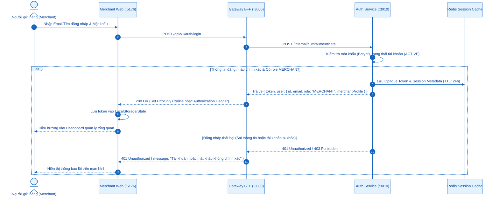
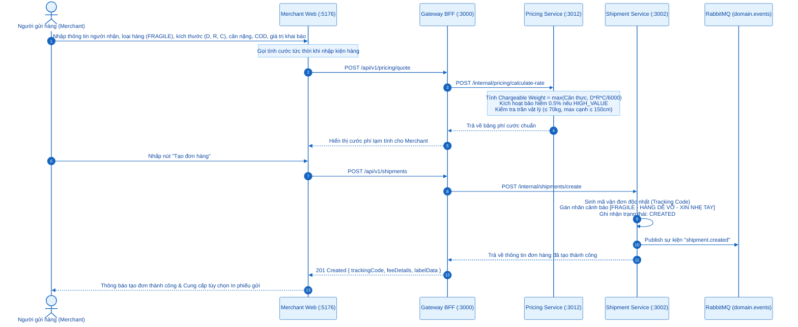
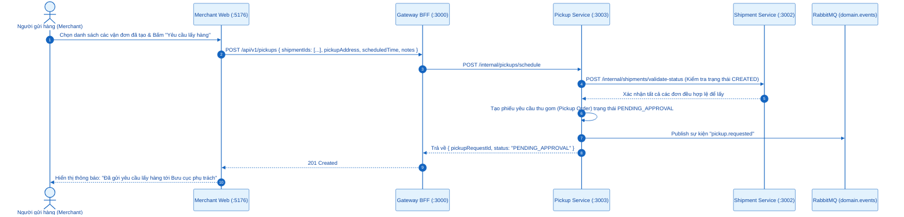
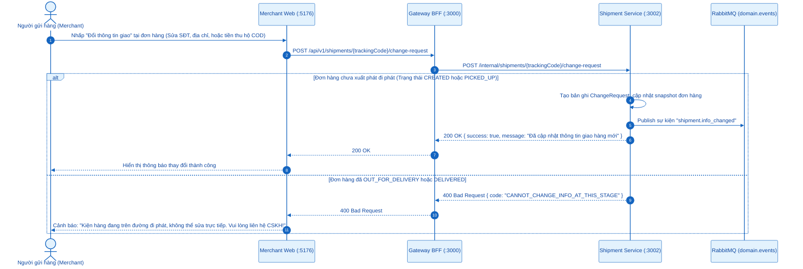
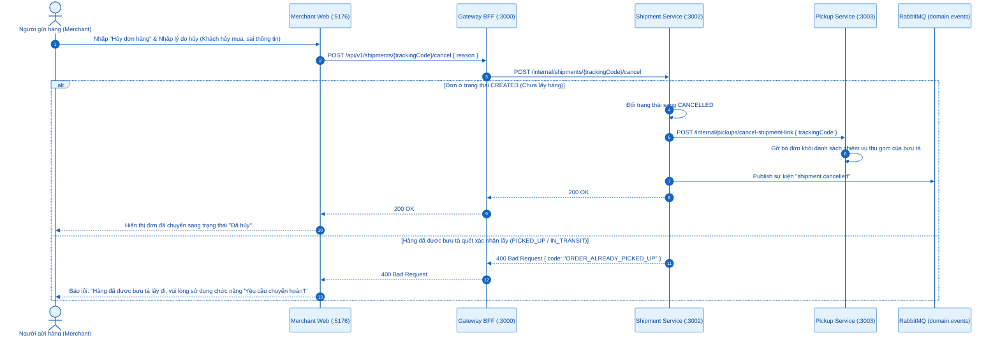
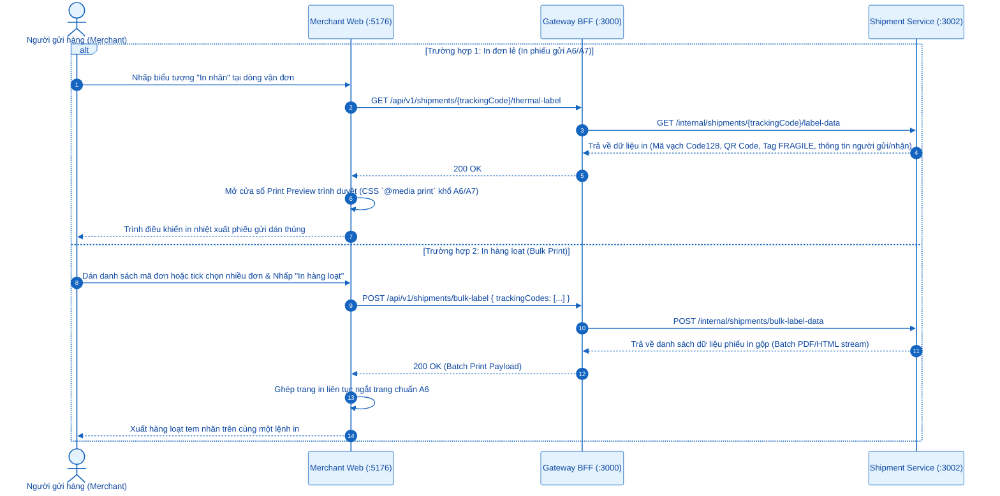
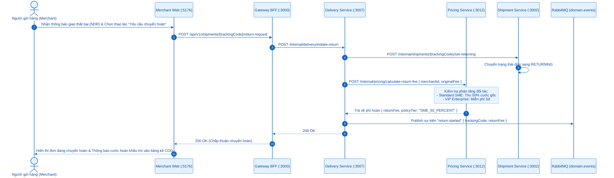
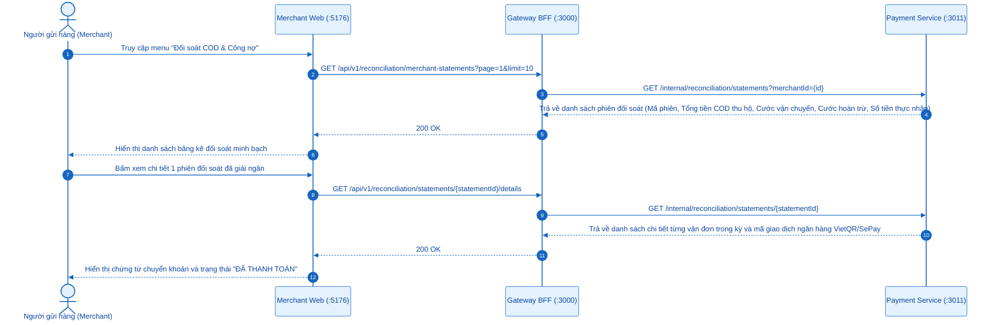

# SƠ ĐỒ TUẦN TỰ (SEQUENCE DIAGRAMS) - ACTOR: NGƯỜI GỬI HÀNG (MERCHANT / SHOP)
## Ứng dụng phục vụ: `apps/merchant-web` (Port `:5176`)

---

## 0. Tổng Quan Nhóm Chức Năng Người Gửi Hàng

Chủ shop / Doanh nghiệp gửi hàng (*Merchant*) sử dụng hệ thống để quản lý vòng đời bưu phẩm từ khi tạo đơn đến khi hoàn tất thanh toán đối soát:
- **2.1. Đăng nhập & Xác thực hệ thống**: Đăng nhập Opaque token an toàn, lưu phiên làm việc.
- **2.2. Tạo đơn hàng & Tự động tính cước IATA**: Kiểm tra trần vật lý, tự động kích hoạt tem cảnh báo `[FRAGILE]` và bảo hiểm toàn diện.
- **2.3. Đặt lịch yêu cầu bưu tá đến lấy hàng (Pickup Request)**: Khởi tạo nhiệm vụ thu gom hàng tận kho shop.
- **2.4. Yêu cầu đổi thông tin giao (Change Request)**: Cập nhật người nhận, địa chỉ, số điện thoại, tiền COD khi đơn chưa lấy.
- **2.5. Hủy đơn hàng**: Hủy đơn trước khi bưu tá đến kho, tự động hủy lệnh pickup liên đới.
- **2.6. In nhãn vận đơn đơn lẻ (A6/A7) & In nhiều vận đơn hàng loạt (Bulk Print)**: Xuất phiếu gửi có mã vạch barcode 1D/QR.
- **2.7. Yêu cầu chuyển hoàn & Tự động khấu trừ cước theo phân tầng**: Khấu trừ 50% cước hoàn đối với SME, 0đ với VIP Enterprise.
- **2.8. Theo dõi đối soát giải ngân COD qua SePay/VietQR**: Tra cứu phiên đối soát và khớp nối dòng tiền tự động.

---

## 2.1. Đăng Nhập & Xác Thực Hệ Thống

---

## 2.2. Tạo Đơn Hàng, Tính Cước IATA Tức Thời & Gắn Tem Hàng Dễ Vỡ

---

## 2.3. Đặt Lịch Yêu Cầu Lấy Hàng (Pickup Request)

---

## 2.4. Yêu Cầu Đổi Thông Tin Giao (Change Request)

---

## 2.5. Hủy Đơn Hàng Trước Khi Bưu Tá Đến Lấy

---

## 2.6. In Nhãn Vận Đơn Đơn Lẻ (A6/A7) & In Hàng Loạt (Bulk Print)

---

## 2.7. Yêu Cầu Chuyển Hoàn & Tự Động Khấu Trừ Cước Hoàn Theo Phân Tầng

---

## 2.8. Theo Dõi Đối Soát Giải Ngân COD Qua SePay / VietQR

