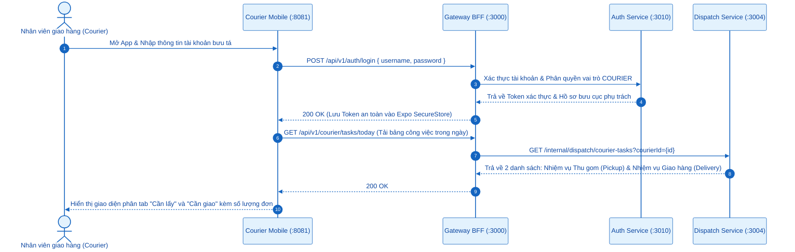
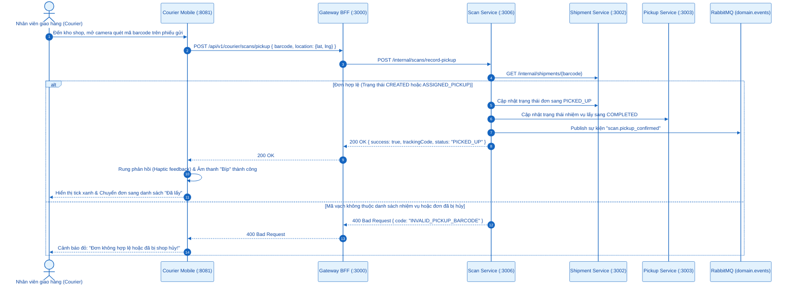
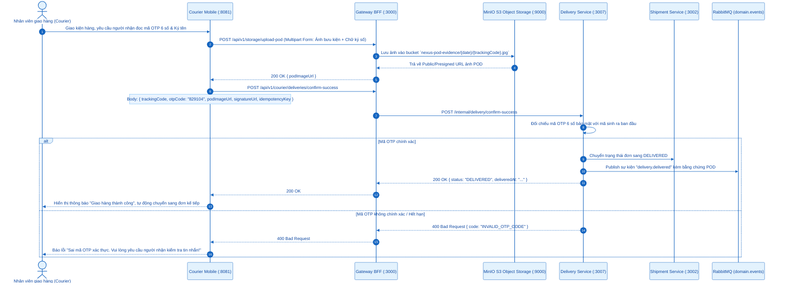
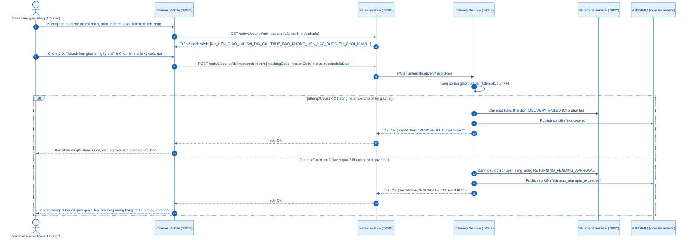
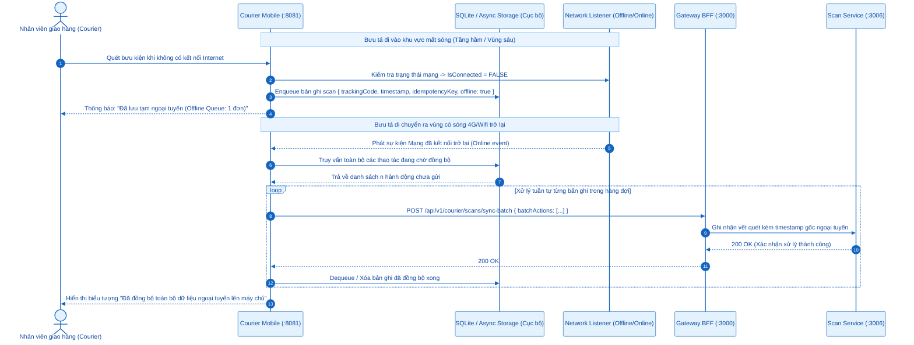
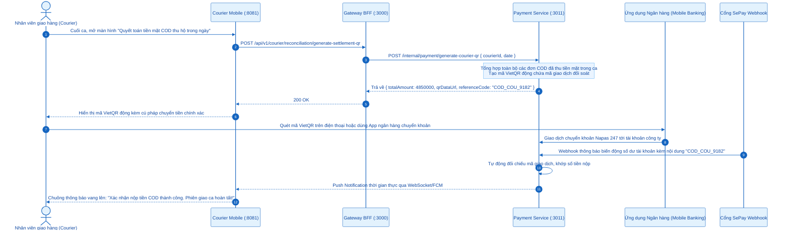

# SƠ ĐỒ TUẦN TỰ (SEQUENCE DIAGRAMS) - ACTOR: NHÂN VIÊN GIAO HÀNG (COURIER / SHIPPER)
## Ứng dụng phục vụ: `apps/courier-mobile` (Port `:8081` - Expo React Native)

---

## 0. Tổng Quan Nhóm Chức Năng Bưu Tá / Shipper

Nhân viên giao nhận (*Courier / Shipper*) thao tác trực tiếp trên ứng dụng di động thực hiện thu gom hàng đầu nguồn (Pickup) và phát hàng chặng cuối (Last-mile Delivery):
- **3.1. Đăng nhập & Quản lý nhiệm vụ giao nhận**: Tiếp nhận danh sách đơn cần lấy và đơn cần giao trong ngày.
- **3.2. Quét mã vạch xác nhận lấy hàng từ Shop (Scan Pickup)**: Sử dụng camera quét barcode/QR, phát sinh sự kiện `scan.pickup_confirmed`.
- **3.3. Xác nhận phát thành công (Xác thực OTP 6 số + Chụp ảnh POD/Chữ ký tải lên MinIO)**: Đảm bảo giao đúng người, đúng địa chỉ.
- **3.4. Báo cáo sự cố phát thất bại (Biên bản NDR)**: Ghi nhận lý do giao không thành công (Khách hẹn lại, Không nghe máy...).
- **3.5. Hàng đợi ngoại tuyến (Offline Queue Synchronization)**: Tiếp tục quét và chụp ảnh khi mất sóng 4G, tự động đồng bộ khi có mạng.
- **3.6. Thu tiền COD mặt & Quyết toán nộp tiền qua VietQR SePay**: Nộp tiền COD thu hộ cuối ngày bằng chuyển khoản ngân hàng tự động.

---

## 3.1. Đăng Nhập & Quản Lý Nhiệm Vụ Giao Nhận

---

## 3.2. Quét Mã Vạch Xác Nhận Lấy Hàng (Scan Pickup)

---

## 3.3. Xác Nhận Phát Thành Công: Xác Thực OTP 6 Số & Ảnh POD Tải Lên MinIO

---

## 3.4. Báo Cáo Sự Cố Phát Thất Bại & Lập Biên Bản NDR

---

## 3.5. Đồng Bộ Hàng Đợi Ngoại Tuyến (Offline Queue Synchronization)

---

## 3.6. Thu Tiền COD Mặt & Quyết Toán Nộp Tiền Qua VietQR SePay

