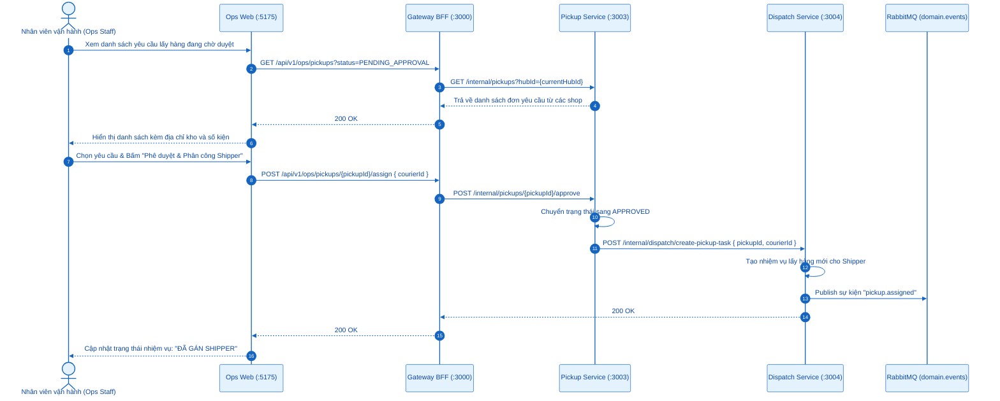
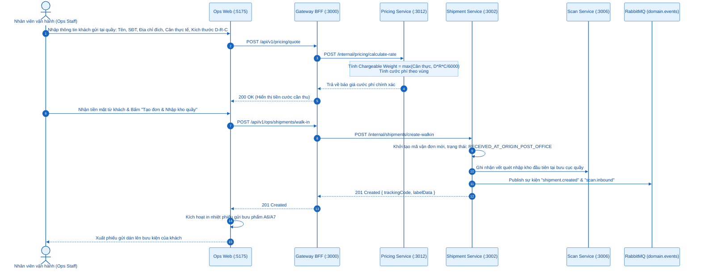
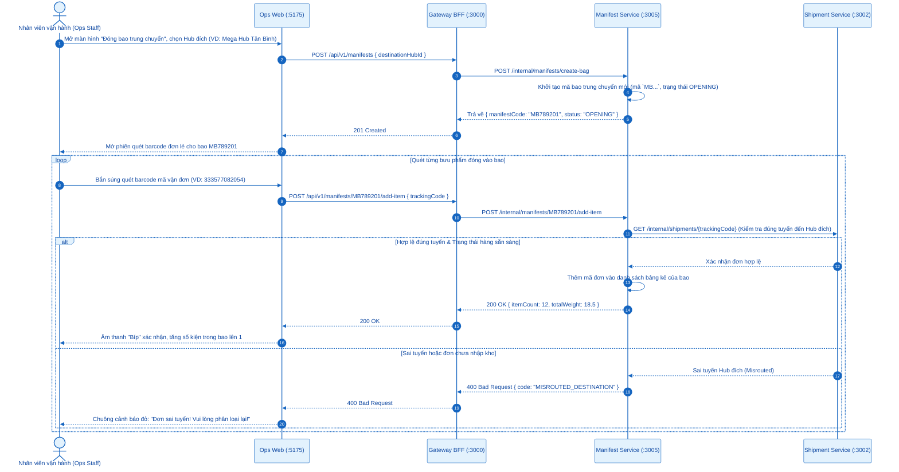
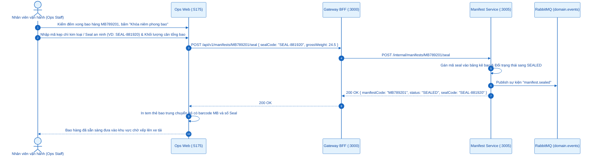
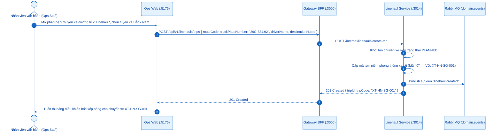
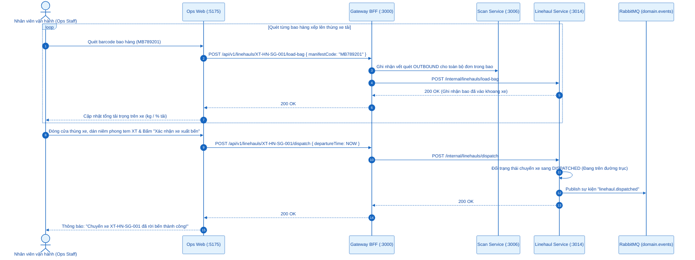
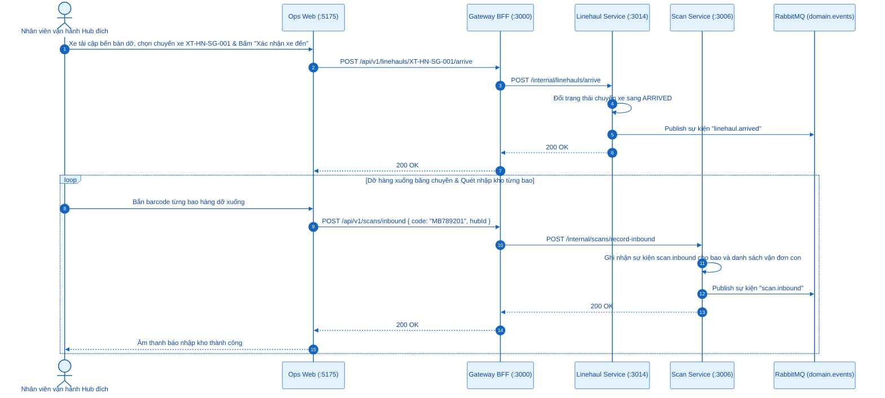
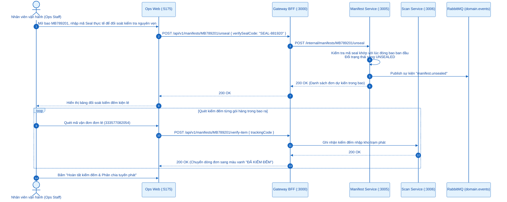
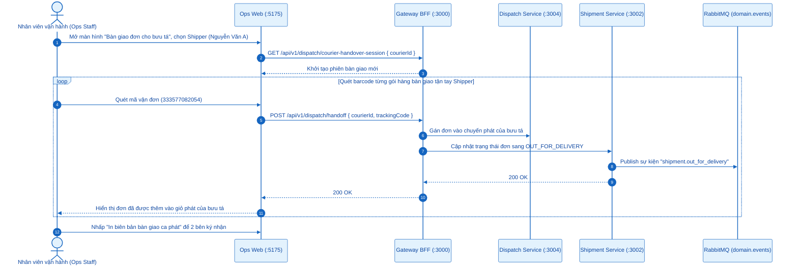
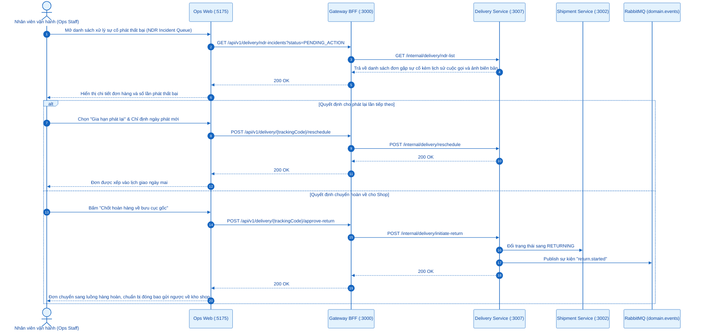

# SƠ ĐỒ TUẦN TỰ (SEQUENCE DIAGRAMS) - ACTOR: NHÂN VIÊN VẬN HÀNH (OPS STAFF)
## Ứng dụng phục vụ: `apps/ops-web` (Port `:5175`)

---

## 0. Tổng Quan Nhóm Chức Năng Nhân Viên Vận Hành

Nhân viên vận hành (*Ops Staff*) tại các bưu cục giao dịch và Hub khai thác chịu trách nhiệm điều phối mạng lưới, luân chuyển kiện hàng qua các công đoạn:
- **4.1. Phê duyệt yêu cầu lấy hàng & Phân công bưu tá thu gom**: Duyệt pickup từ shop và điều phối shipper.
- **4.2. Tạo đơn gửi trực tiếp tại quầy bưu cục (Walk-in)**: Tiếp nhận khách gửi hàng tại chỗ, cân đo IATA, in phiếu gửi A6.
- **4.3. Khởi tạo bao trung chuyển (Manifest MB) & Đóng đơn lẻ vào bao**: Gom kiện lẻ vào bao tải chuyên dụng.
- **4.4. Đóng seal niêm phong kẹp chì an ninh**: Khóa bao bằng số seal kẹp chì độc nhất.
- **4.5. Điều phối xe tải Linehaul & Cấp tem niêm phong xe tải (Mã XT)**: Quản lý tải trọng và tuyến xe kết nối Hub.
- **4.6. Quét xuất kho (Outbound) & Xác nhận xe khởi hành**: Bốc xếp bao hàng lên xe và xuất trạm.
- **4.7. Xác nhận xe đến & Quét nhập kho (Inbound)**: Hạ tải và quét nhận hàng đến Hub đích.
- **4.8. Cắt seal mở bao & Kiểm đếm chia chọn**: Phân loại kiện hàng về các bàn phát tuyến quận/huyện.
- **4.9. Quét bàn giao đơn cho bưu tá đi phát (Handoff)**: Chuyển trạng thái đơn sang `OUT_FOR_DELIVERY`.
- **4.10. Xử lý sự cố giao hàng NDR & Kích hoạt chuyển hoàn**: Tiếp nhận báo cáo lỗi và xử lý sau 3 ca phát.
- **4.11. Đối soát giải ngân COD bưu cục**: Thu nộp tiền COD qua VietQR tự động hoặc duyệt thủ quỹ trực tiếp.

---

## 4.1. Phê Duyệt Yêu Cầu Lấy Hàng & Điều Phối Bưu Tá (Pickup Dispatch)

---

## 4.2. Tạo Đơn Hàng Gửi Trực Tiếp Tại Quầy Bưu Cục (Walk-in)

---

## 4.3. Khởi Tạo Bao Trung Chuyển (Manifest MB) & Đóng Đơn Lẻ Vào Bao

---

## 4.4. Đóng Seal Niêm Phong Kẹp Chì An Ninh

---

## 4.5. Điều Phối Xe Tải Linehaul & Cấp Tem Niêm Phong Xe (Mã XT)

---

## 4.6. Quét Xuất Kho Outbound Lên Xe & Xác Nhận Xe Đi

---

## 4.7. Quét Nhập Kho Inbound Khi Xe Đến Hub Đích

---

## 4.8. Cắt Seal Mở Bao & Kiểm Đếm Chia Chọn Vận Đơn

---

## 4.9. Quét Bàn Giao Đơn Cho Bưu Tá Đi Phát (Handoff)

---

## 4.10. Xử Lý Sự Cố Giao Thất Bại & Kích Hoạt Hoàn Hàng

