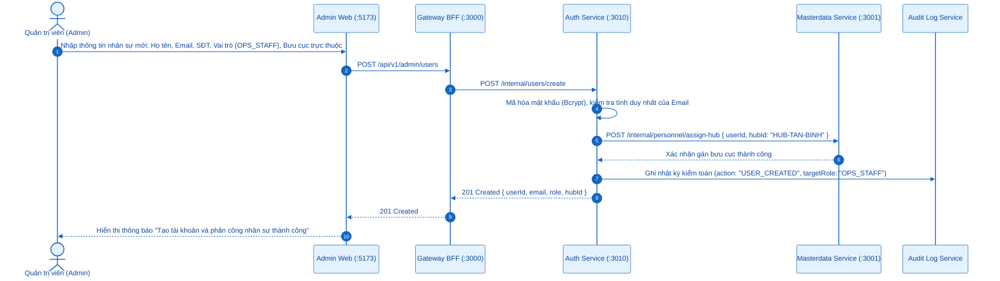
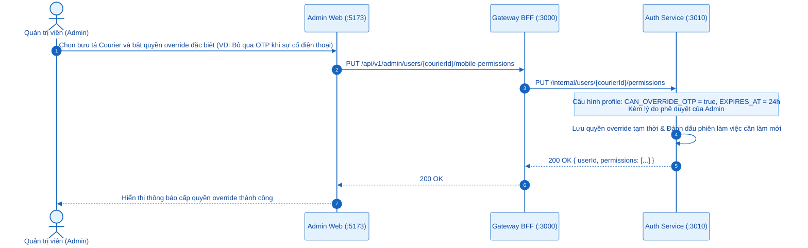
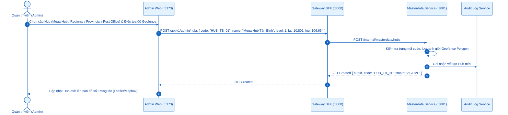
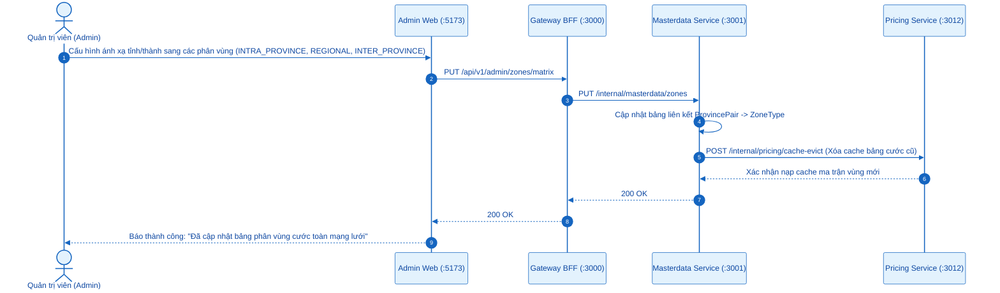
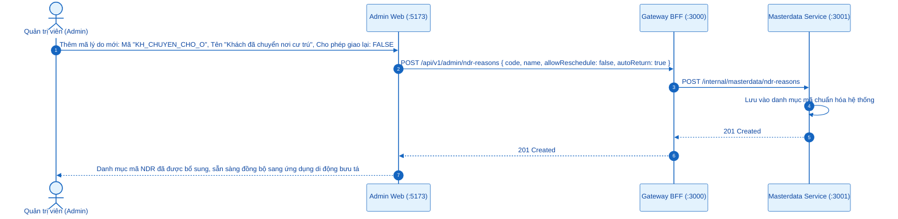
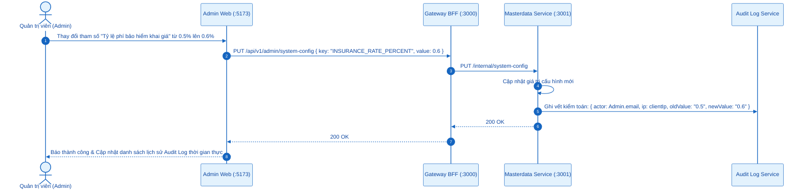

# SƠ ĐỒ TUẦN TỰ (SEQUENCE DIAGRAMS) - ACTOR: QUẢN TRỊ VIÊN (SYSTEM ADMIN)
## Ứng dụng phục vụ: `apps/admin-web` (Port `:5173`)

---

## 0. Tổng Quan Nhóm Chức Năng Quản Trị Hệ Thống

Quản trị viên (*System Admin*) quản lý danh mục dùng chung (Master Data), phân quyền truy cập, kiểm soát mạng lưới và cấu hình chính sách vận hành toàn hệ thống:
- **5.1. Quản trị người dùng & Phân công nhân sự**: Tạo tài khoản, khóa/mở khóa, gán bưu cục cho Ops, gán tuyến cho Courier.
- **5.2. Quản lý phân quyền RBAC & Mobile Override**: Cấu hình ma trận vai trò và cấp quyền ghi đè ngoại lệ trên app bưu tá.
- **5.3. Quản trị danh mục mạng lưới Hub 4 cấp**: Thêm, sửa, kích hoạt hoặc vô hiệu hóa các Hub từ Cấp 1 tới Cấp 4.
- **5.4. Quản lý Zone địa lý & Ma trận vùng cước**: Thiết lập bảng phân vùng địa lý phục vụ định tuyến và tính phí IATA.
- **5.5. Quản lý danh mục lý do giao thất bại (NDR Reasons)**: Chuẩn hóa bộ mã sự cố phát hàng dùng chung toàn mạng lưới.
- **5.6. Cấu hình tham số hệ thống & Tra soát Audit Log**: Quản lý timeout, tỷ lệ phí bảo hiểm, kiểm toán vết thay đổi nhạy cảm.

---

## 5.1. Quản Trị Người Dùng & Phân Công Nhân Sự (Ops Staff / Courier)

---

## 5.2. Quản Lý Phân Quyền RBAC & Mobile Permission Override

---

## 5.3. Quản Trị Danh Mục Mạng Lưới Hub 4 Cấp (Thêm, Sửa, Vô Hiệu Hóa)

---

## 5.4. Quản Lý Khu Vực / Zone Địa Lý & Ma Trận Vùng Cước

---

## 5.5. Quản Trị Danh Mục Mã Lý Do Giao Thất Bại (NDR Reasons)

---

## 5.6. Cấu Hình Tham Số Hệ Thống & Kiểm Toán Tra Soát Audit Log

