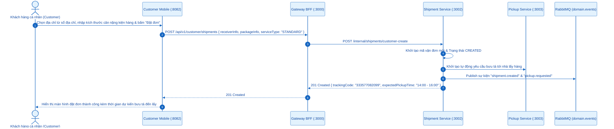
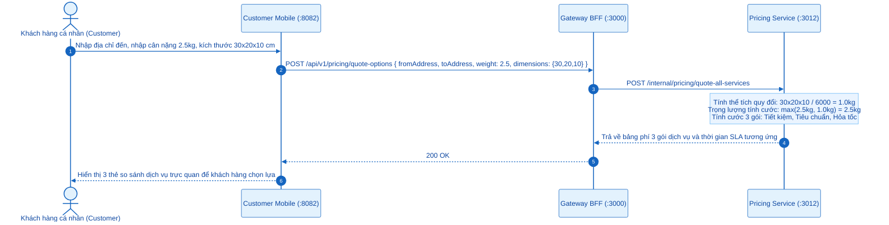
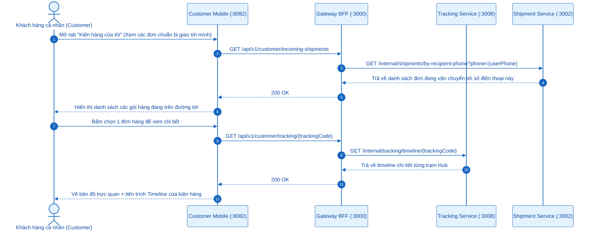
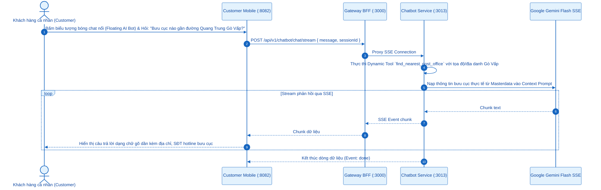
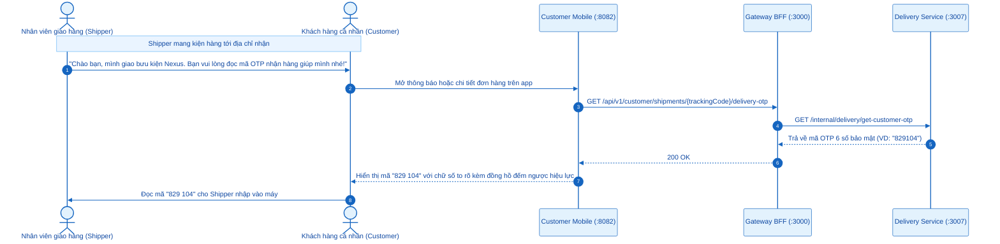

# SƠ ĐỒ TUẦN TỰ (SEQUENCE DIAGRAMS) - ACTOR: KHÁCH HÀNG CÁ NHÂN (CUSTOMER C-END)
## Ứng dụng phục vụ: `apps/customer-mobile` (Port `:8082` - React Native Expo)

---

## 0. Tổng Quan Nhóm Chức Năng Khách Hàng Cá Nhân

Khách hàng cá nhân (*Customer C-End*) thao tác trên ứng dụng di động riêng biệt (`customer-mobile`), phục vụ nhu cầu gửi bưu phẩm cá nhân, quản lý đơn hàng nhận về và tương tác thông minh với AI:
- **6.1. Tạo đơn gửi hàng lẻ cá nhân**: Nhập địa chỉ, trọng lượng, kích thước và đặt lịch lấy hàng tận nhà.
- **6.2. Tính cước tự động & So sánh gói dịch vụ chuẩn IATA $V/6000$**: So sánh chi phí Tiết kiệm, Tiêu chuẩn và Hỏa tốc.
- **6.3. Tra cứu hành trình bưu kiện thời gian thực & Quản lý sổ địa chỉ**: Theo dõi đơn gửi đi và đơn sắp nhận về.
- **6.4. Tương tác cùng trợ lý ảo AI Logistics RAG qua Widget nổi (Floating Chatbot)**: Hỏi đáp bưu chính 24/7.
- **6.5. Xác thực nhận hàng an toàn bằng mã OTP 6 số**: Cung cấp mã OTP định danh cho bưu tá khi nhận bưu phẩm.

---

## 6.1. Khách Hàng Tạo Đơn Gửi Hàng Lẻ Trên Ứng Dụng Di Động

---

## 6.2. Ước Tính Cước & So Sánh Gói Dịch Vụ Chuẩn IATA $V/6000$

---

## 6.3. Tra Cứu Hành Trình Bưu Phẩm & Quản Lý Sổ Địa Chỉ

---

## 6.4. Tương Tác Trợ Lý AI Logistics RAG Qua Cửa Sổ Chat Nổi

---

## 6.5. Xác Thực Nhận Hàng An Toàn Bằng Mã OTP 6 Số

