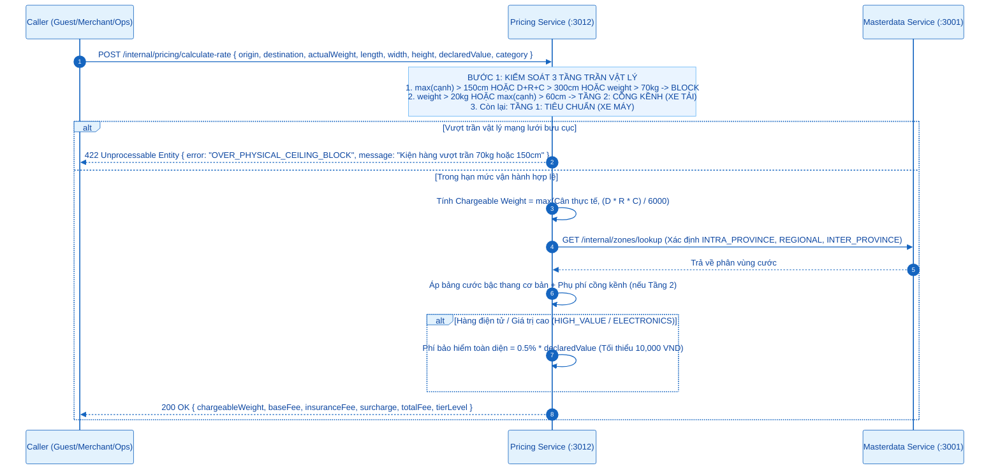
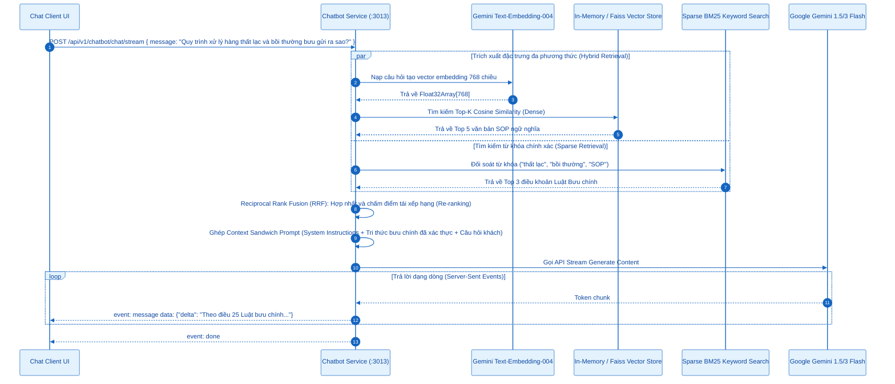
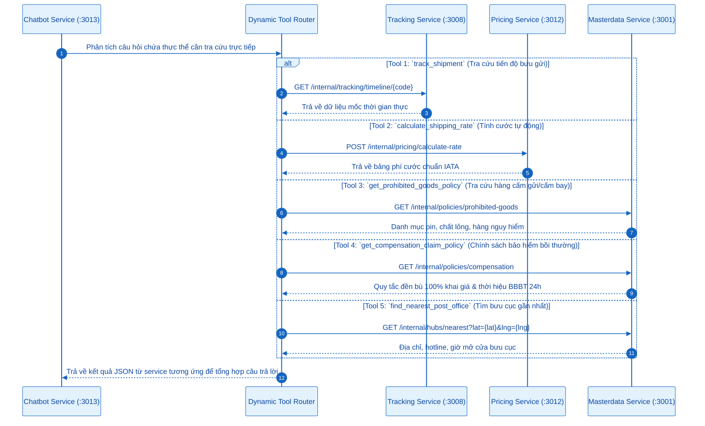
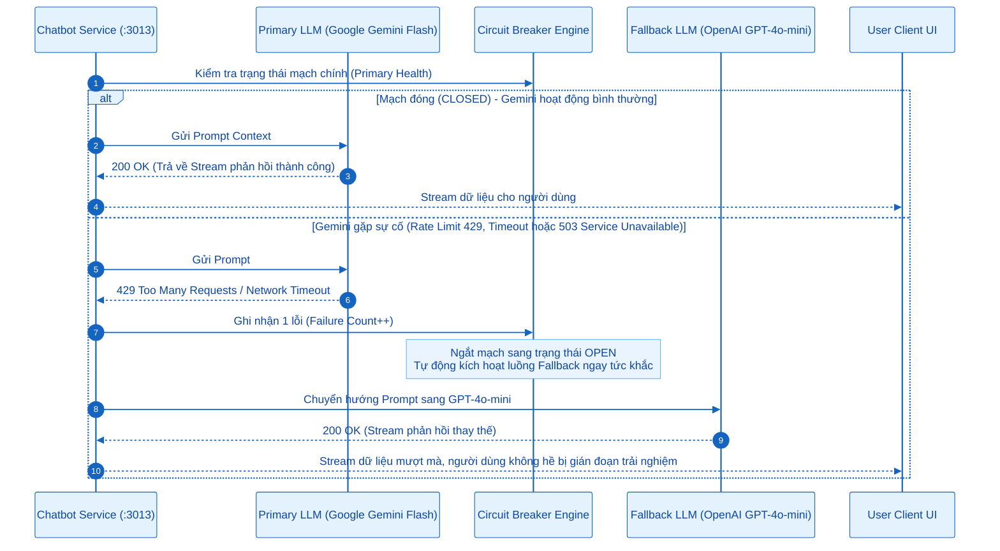
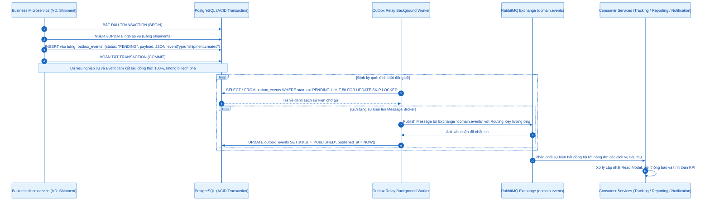
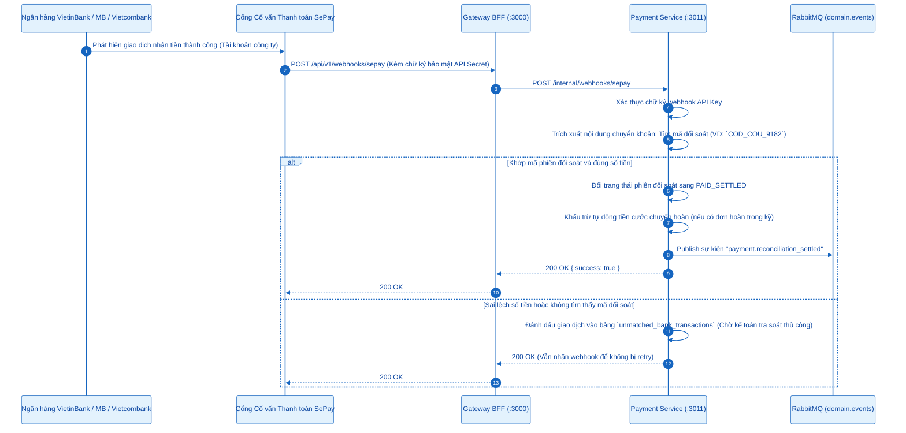

# SƠ ĐỒ TUẦN TỰ (SEQUENCE DIAGRAMS) - ACTOR: HỆ THỐNG & TRỢ LÝ AI (SYSTEM & AI ENGINE)
## Thành phần phục vụ: `@NEXUS/chatbot-service` (:3013), `pricing-service` (:3012), `payment-service` (:3011), Outbox Relays, RabbitMQ

---

## 0. Tổng Quan Nhóm Chức Năng Hệ Thống & Động Cơ Trí Tuệ Nhân Tạo

Actor Hệ thống & Trợ lý AI (*System & AI Engine*) đóng vai trò hạt nhân tự động hóa vận hành, tính toán định giá, xử lý ngôn ngữ tự nhiên và bảo đảm tính toàn vẹn phân tán:
- **7.1. Động cơ định giá chuẩn hóa IATA $V/6000$ đa dịch vụ**: Công thức tính cước thể tích và kiểm soát 3 tầng trần vật lý.
- **7.2. Quy trình truy xuất tri thức Hybrid RAG & Phản hồi dạng dòng SSE**: Kết hợp tìm kiếm ngữ nghĩa Dense Vector 768-dim và Sparse BM25.
- **7.3. Cơ chế thực thi 5 Dynamic Tools thời gian thực**: Tự động nhận diện ý định và gọi trực tiếp Microservices nội bộ.
- **7.4. Cơ chế chuyển đổi dự phòng mô hình thông minh (Smart LLM Fallback)**: Tự động chuyển đổi giữa Google Gemini và OpenAI GPT-4o-mini khi gặp lỗi quota/mạng.
- **7.5. Chuyển giao sự kiện qua Transactional Outbox Pattern & RabbitMQ**: Đảm bảo phân phối sự kiện bất đồng bộ tin cậy (At-least-once delivery).
- **7.6. Khớp nối thanh toán Webhook SePay & Tự động chốt đối soát COD**: Quét biến động số dư ngân hàng và đối soát tiền thu hộ.

---

## 7.1. Động Cơ Định Giá Chuẩn Hóa IATA $V/6000$ Đa Dịch Vụ

---

## 7.2. Quy Trình Hybrid RAG & Context Sandwich SSE Generation

---

## 7.3. Cơ Chế Thực Thi 5 Dynamic Tools Thời Gian Thực

---

## 7.4. Cơ Chế Chuyển Đổi Dự Phòng Mô Hình Thông Minh (Smart LLM Fallback)

---

## 7.5. Chuyển Giao Sự Kiện Qua Transactional Outbox Pattern & RabbitMQ

---

## 7.6. Khớp Nối Thanh Toán Webhook SePay & Đối Soát COD Tự Động

